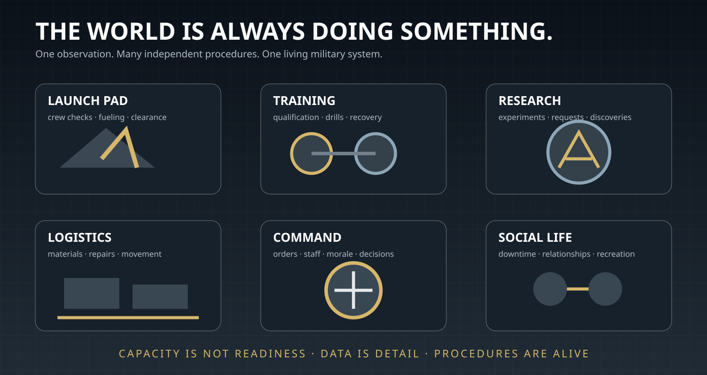
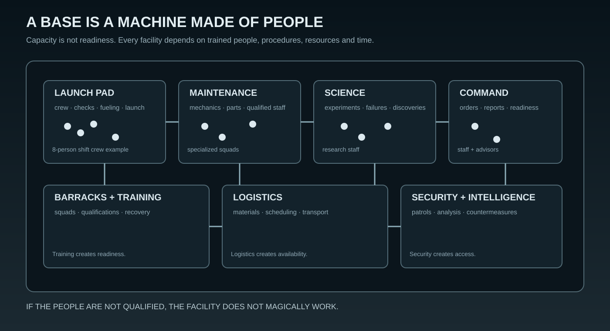
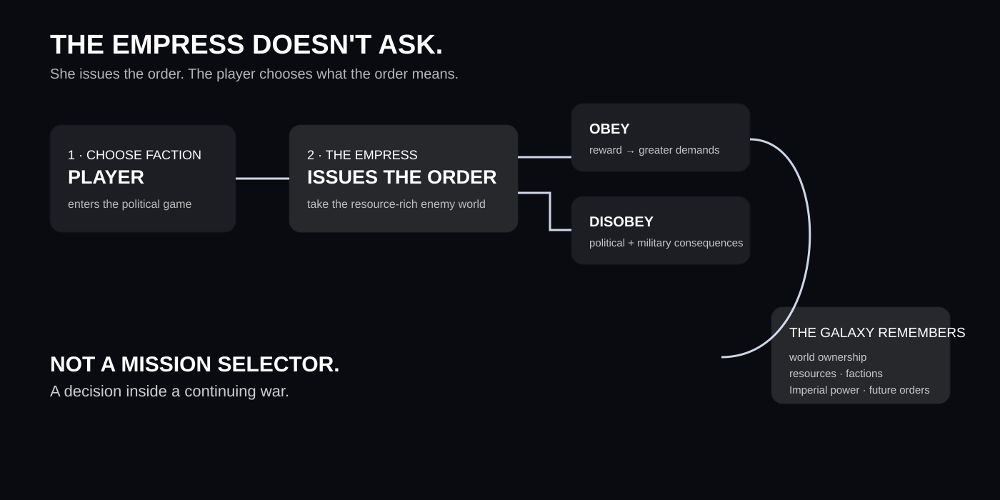
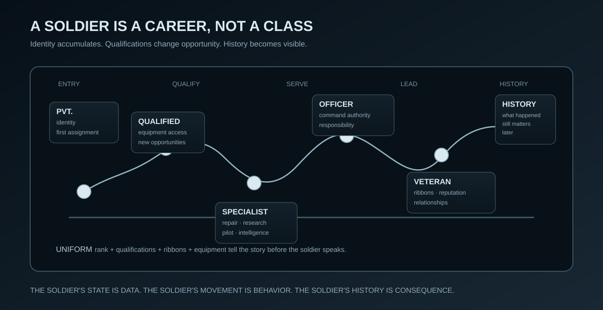
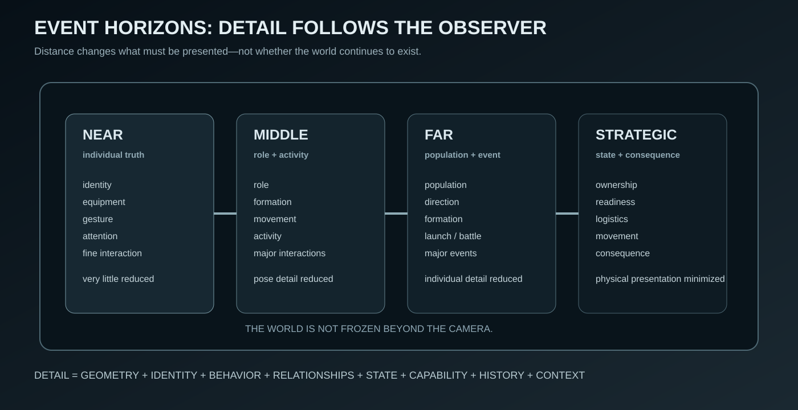
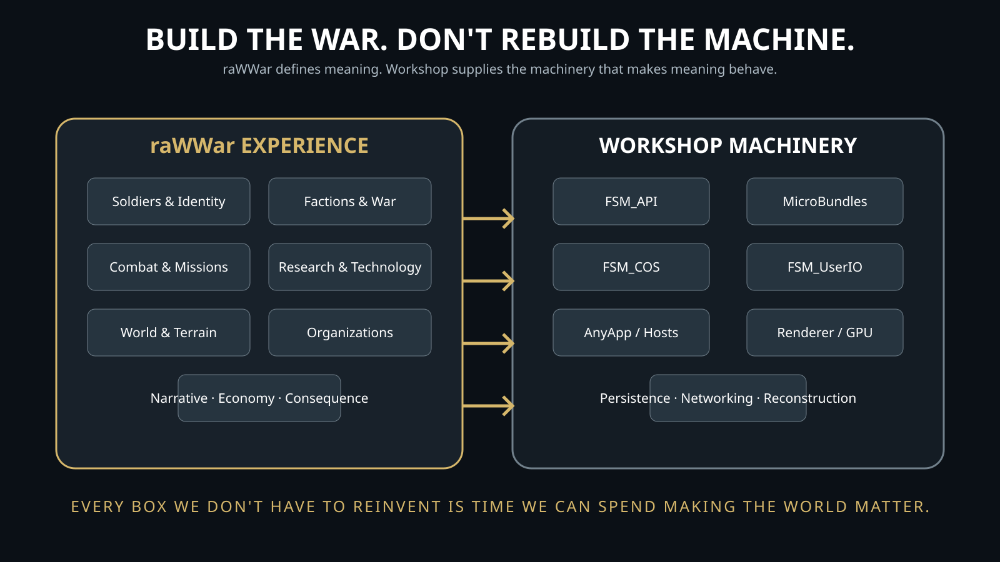

<!-- The Singularity Workshop moniker -->
<p align="center">
  <a href="https://github.com/TrentBest">
    
  </a>
</p>

# ✳️ 00 raWWar — The Singularity Workshop

[](LICENSE)
[](https://github.com/TrentBest/raWWar/actions/workflows/build.yml)


> **The flagship Experience for the Workshop.** raWWar is intended to be the recognizable, ambitious Experience shipped with the AnyApp system—the platform's Mario Brothers / Duck Hunt moment: not just a framework demo, but a world people can understand, enter, and care about.

The documentation is part of that demonstration. **SVGs make the world tangible; living diagrams explain its systems; rendering experiments explore how it can look and move; executable examples prove specific behaviors.** The strongest story will connect those layers, so readers can see both the destination and the machinery that makes it possible.

We will keep the evidence honest: concept art communicates intent, explanatory SVGs communicate structure, experiments prove only their measured scope, and examples prove only the behavior they actually execute. None is mislabeled as a finished playable game or end-to-end host launch.

**Current truth:** raWWar's design and supporting technology are actively being built and verified. A complete playable slice and end-to-end AnyApp host launch have not yet been delivered. The goal is to make the vision convincing now while making the path to implementation clear.

## 🟦 01 What


**raWWar is a first-person war Experience, not an application.** It is a living military world that continues whether or not the player is looking at it.

The player inhabits a soldier inside a military system: a person with identity, qualifications, relationships, responsibilities, equipment, opportunities, history, and consequences.

> **What happens when I become one of the people who has to live here?**

## 🟣 02 Why this Experience matters


> **The soldiers themselves are the stars of this game.**


The soldier shown here comes from raWWar's 38-part procedural exoskeleton blockout. [See all six embedded views and the live WebGPU lab](samples/SoldierField/WebGpuRunner/README.md); the pictures render directly in this README, with no local server required. The live lab is optional and remains a separate experiment from the Workshop's current Visualize contracts.


*One continuous war across a galaxy—not a stack of disposable maps.*

### The living-world thesis




A launch crew can be working while another squad trains, researchers run experiments, logistics moves material, command reviews the situation, and soldiers spend their downtime together.



**The world should always be doing something.** Wherever the player looks, there should be evidence of systems, people, procedures, decisions, work, failure, recovery, and consequence.

The universe is a **galaxy**. The Empire spans many star systems, and the campaign is a continuous war rather than a sequence of disposable maps. Warp drives exist, but a jump takes **days to initialize and prepare**; distance, logistics, reinforcement, and time therefore matter.

The opening campaign brings together faction choice and the Empress's first uncompromising order: take a poorly defended but resource-rich enemy world and uphold the tithe. The player can obey or disobey, with consequences for their relationship with Imperial authority and the larger galaxy. The exact placement of faction selection relative to the opening scene and the order remains an open design question; see [Open Question 22](docs/OPEN_QUESTIONS.md).



> **This is not “pick a sector and play a map.” This is living inside the war.**

### The experience that makes the platform tangible


- **New to raWWar:** begin with the [Game Design Document](docs/GAME_DESIGN_DOCUMENT.md).
- **Want the foundational design:** read the [Game Design Bible](docs/GAME_DESIGN_BIBLE.md).
- **Want to understand the technology boundary:** read [Experience Architecture](docs/EXPERIENCE_ARCHITECTURE.md).
- **Designing a system:** start at the [Design Documentation Index](docs/README.md), then follow the relevant deep dive.
- **Reviewing implementation status:** read [Technical Design](docs/TECHNICAL_DESIGN.md), [Production Plan](docs/PRODUCTION_PLAN.md), and [TODO.md](TODO.md).
- **Understanding procedural motion:** read [Gestures Design](docs/GESTURES_DESIGN.md) and the [standalone Gestures package](https://github.com/TrentBest/TheSingularityWorkshop.Gestures).
- **Understanding GPU presentation:** read [Renderer Integration](docs/RENDERER_INTEGRATION.md) and the [Visualize implementation](https://github.com/TrentBest/TheSingularityWorkshop.Visualize).
- **Building or verifying the repository:** use the commands in **See it in a minute** and the the evidence guidance below.

### The intended player experience


raWWar is always experienced from the first-person perspective, but the role the player inhabits can grow dramatically:

- **Soldier** — qualify, serve, fight, repair, research, build, explore, survive.
- **Officer** — lead people, make decisions, manage pressure, command operations.
- **Cooperative** — share a war with players whose interests and objectives may differ.
- **Multiplayer** — fight free-for-all, team-versus-team, or persistent conflicts.
- **Persistent universes** — enter a universe whose history continues without you.

These are not separate games. They are different ways of inhabiting the same war.



A soldier is not a class selected from a menu. Identity, qualification, responsibility, reputation, relationships, equipment, and history accumulate over time.

The repository distinguishes design certainty explicitly:

- **Canon** — established by the creator.
- **Candidate** — a direction under consideration.
- **Experiment** — something to prove through implementation.
- **Illumination Needed** — a question that still requires the creator's vision.

Implementation convenience must not silently become game design.

## 🩵 03 How the Experience is assembled


raWWar owns the things that make **raWWar** raWWar:

- soldiers and identity;
- factions and military organizations;
- qualifications and careers;
- equipment and vehicles;
- combat and missions;
- research and technology;
- construction and infrastructure;
- terrain, weather, and world history;
- economics and social life;
- narrative and consequence.

The Singularity Workshop provides reusable machinery so raWWar does **not** have to reinvent the same infrastructure:

- **FSM_API** — state-machine behavior and state/context primitives;
- **MicroBundleDomain / MicroBundles** — capability contracts and independently defined capabilities;
- **FSM_COS** — composition and RuntimeAssembly handoff;
- **FSM_UserIO** — platform-neutral semantic user interaction;
- **AnyApp and other hosts** — execution and manifestation;
- **Workshop Renderer** — observer-relative presentation;
- persistence, networking, reconstruction, and related infrastructure as those capabilities mature.



**FSM_COS is a central composition boundary, not the game, the host, or a renderer.** raWWar supplies meaning and domain rules; FSM_COS assembles requested capabilities; the host decides how the resulting runtime is executed or manifested. See [Experience Architecture](docs/EXPERIENCE_ARCHITECTURE.md).

### The architecture boundary




```text
raWWar domain meaning and rules
              ↓
      Experience manifest
              ↓
       MicroBundle roots
              ↓
           FSM_COS
              ↓
       RuntimeAssembly
              ↓
       AnyApp / host / manifestation
```

The manifest identifies the requested composition; dependency closure determines what else must be present. The Experience should not quietly turn every transitive dependency into a root request, nor reimplement reusable Workshop machinery.

The current integration work is not yet proof of end-to-end host loading: the checked-in authoring/runtime manifests are distinct from AnyApp's publication manifest, and immutable artifact identity/dependency closure remain open integration requirements. The local FSM_COS composition check is scoped to its test adapter; it does not prove that AnyApp can retrieve and launch the full Experience. See the [AnyApp manifest bridge investigation](docs/integration/ANYAPP_MANIFEST_BRIDGE.md) and the [raWWar-to-AnyApp artifact-closure request](docs/requests/REQUEST-FROM-raWWar-AnyApp-ArtifactClosure.md).

## 🟢 04 See it in a minute


For readers, start with the [Game Design Document](docs/GAME_DESIGN_DOCUMENT.md). For a compact view of the intended boundary, read [Experience Architecture](docs/EXPERIENCE_ARCHITECTURE.md).

For developers with the .NET 8 SDK installed, from the repository root:

```bash
dotnet build raWWar.sln --configuration Release
dotnet run --project examples/KeplerOrbit/raWWar.KeplerOrbitExample.csproj
```

These commands build the solution and run the checked-in explicit-time Kepler-orbit example. They do **not** launch a playable game or prove end-to-end AnyApp composition.

### Evidence and examples


Examples are engineering artifacts as well as documentation: they show how a capability is expected to be consumed and give contributors a concrete reference.

- [Examples index](examples/README.md) — checked-in usage examples and verification scope.
- [KeplerOrbit example](examples/KeplerOrbit/Program.cs) — explicit-time orbit queries, repeatability, periodicity, and invalid-boundary behavior.
- [Contract checks](tests/raWWar.ContractTests/Program.cs) — executable manifest, data, and architectural contract assertions.

Each example must say whether it is verified, source-shaped, or conceptual; name the version or commit it targets; cover meaningful boundaries; and state what it does not prove. An example is not automatically an integration test, playable feature, or release-readiness claim.

## 🟪 05 Available documentation and theory


- [Game Design Document](docs/GAME_DESIGN_DOCUMENT.md) — living master description of the player experience.
- [Game Design Bible](docs/GAME_DESIGN_BIBLE.md) — foundational principles and world rules.
- [Experience Architecture](docs/EXPERIENCE_ARCHITECTURE.md) — the boundary between raWWar and reusable Workshop machinery.
- [Design Hub](docs/DESIGN_HUB.md) — intended public visual navigation model.
- [Vision and Pillars](docs/VISION_AND_PILLARS.md) — the core experience.
- [Gestures Design](docs/GESTURES_DESIGN.md) — physical soldier movement as data and FSM behavior.
- [Advisors and Command Staff](docs/ADVISORS_AND_STAFF.md) — qualified people, candidate records, specialist advice, and command appointments.
- [Renderer Integration](docs/RENDERER_INTEGRATION.md) — observing the world without making presentation its source of truth.
- [TheSingularityWorkshop.Visualize](https://github.com/TrentBest/TheSingularityWorkshop.Visualize) — GPU-facing presentation contracts and the planned AnyApp/WPF first backend.
- [Visualize Gesture/pose pipeline](https://github.com/TrentBest/TheSingularityWorkshop.Visualize/blob/development/docs/GESTURES_AND_POSE_PIPELINE.md) — procedural motion to evaluated pose data to GPU presentation.
- [TheSingularityWorkshop.Gestures](https://github.com/TrentBest/TheSingularityWorkshop.Gestures) — the dedicated home for reusable Gesture models and procedural behavior; implementation maturity and supported contracts must be checked in that repository.
- [Visualizer architecture](https://github.com/TrentBest/TheSingularityWorkshop.Visualize/blob/development/docs/ARCHITECTURE.md) — host boundaries, GPU resource contracts, and Renderer integration.
- [Visualizer GPU backend strategy](https://github.com/TrentBest/TheSingularityWorkshop.Visualize/blob/development/docs/GPU_BACKEND_STRATEGY.md) — candidate graphics/compute APIs and measurement-led selection.
- [Visualizer implementation roadmap](https://github.com/TrentBest/TheSingularityWorkshop.Visualize/blob/development/docs/IMPLEMENTATION_ROADMAP.md) — from a WPF GPU surface to a living battlefield slice and browser path.
- [Visual asset catalogue](docs/images/README.md) — diagrams and artwork with their intended meaning.
- [Documentation conformance audit](docs/DOCUMENTATION_CONFORMANCE.md) — how this repository applies the shared Workshop documentation standard.

### Implementation status at a glance


| Item | Current description |
|---|---|
| Type | Manifest-oriented game Experience |
| Primary host direction | AnyApp first; MyVR and other manifestations follow |
| Implementation baseline | .NET 8 |
| Architecture | Experience domain + manifest + MicroBundles + FSM_COS composition + host |
| Status | Active design and engineering; the end-to-end playable Experience is not yet complete |
| License | See [LICENSE](LICENSE) |

### Engineering discipline


The repository is a design instrument, not a pile of feature promises. Its purpose is to make raWWar sufficiently clear that the next thing can actually be built.

The creator's descriptions are primary source material. The repository organizes those ideas, exposes contradictions, identifies missing rules, and turns the resulting design into a deterministic Experience shape.

The old engine-specific project shell has been removed. raWWar is not defined by a particular game engine or display technology. **AnyApp comes first; MyVR and other manifestations follow.**

For implementation claims, distinguish code and tests that exist today from design targets. The current `RaWWarMicroBundle.Load` remains a scaffold and `Arbitrate` returns `false`; the full station-and-rig first-person slice and end-to-end host loading remain future work. Consult [Technical Design](docs/TECHNICAL_DESIGN.md) and [TODO.md](TODO.md) for current evidence and blockers.

### The Workshop ecosystem


raWWar is one Experience in a modular ecosystem. It consumes reusable capabilities rather than making each Experience rebuild the same machinery.

- [FSM_API](https://github.com/TrentBest/FSM_API) — state-machine behavior.
- [MicroBundleDomain](https://github.com/TrentBest/TheSingularityWorkshop.MicroBundleDomain) — canonical MicroBundle domain contract.
- [FSM_COS](https://github.com/TrentBest/TheSingularityWorkshop.FSM_COS) — composition kernel and RuntimeAssembly boundary.
- [FSM_UserIO](https://github.com/TrentBest/FSM_UserIO) — semantic user interaction.
- [AnyApp](https://github.com/TrentBest/AnyApp) — host and application proving ground.
- [WebPage](https://github.com/TrentBest/WebPage) — browser manifestation and Workshop proving ground.

The shared Workshop documentation convention is being defined in [FSM_COS's Documentation Standard](https://github.com/TrentBest/TheSingularityWorkshop.FSM_COS/blob/development/DOCUMENTATION_STANDARD.md). raWWar applies the relevant section identifiers, color markers, boundary-first architecture, reader paths, evidence discipline, and example requirements while retaining its own game-design voice.

---

<p align="center">
  <em>The Singularity Workshop — Tools for the curious, the bold, and the systemically inclined.</em><br>
  <strong>Make the soldiers matter. Make the war alive.</strong>
</p>

---

<p align="center">
  <em>The Singularity Workshop — Tools for the curious, the bold, and the systemically inclined.</em><br>
  <strong>Make the soldiers matter. Make the war alive.</strong>
</p>
