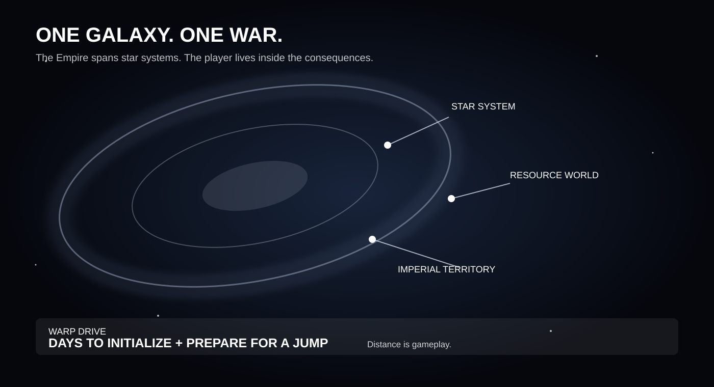
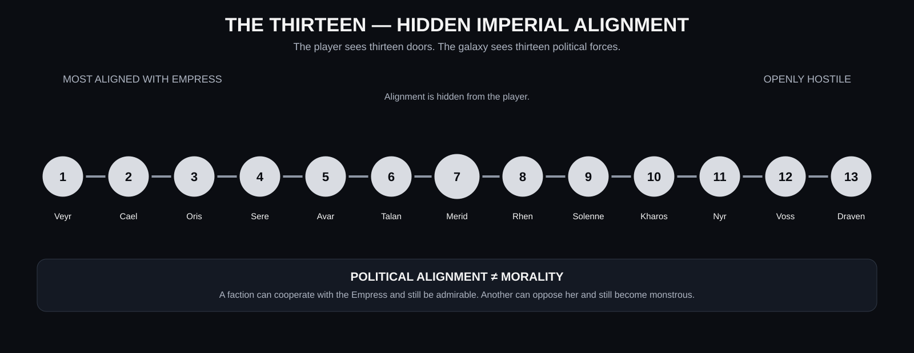
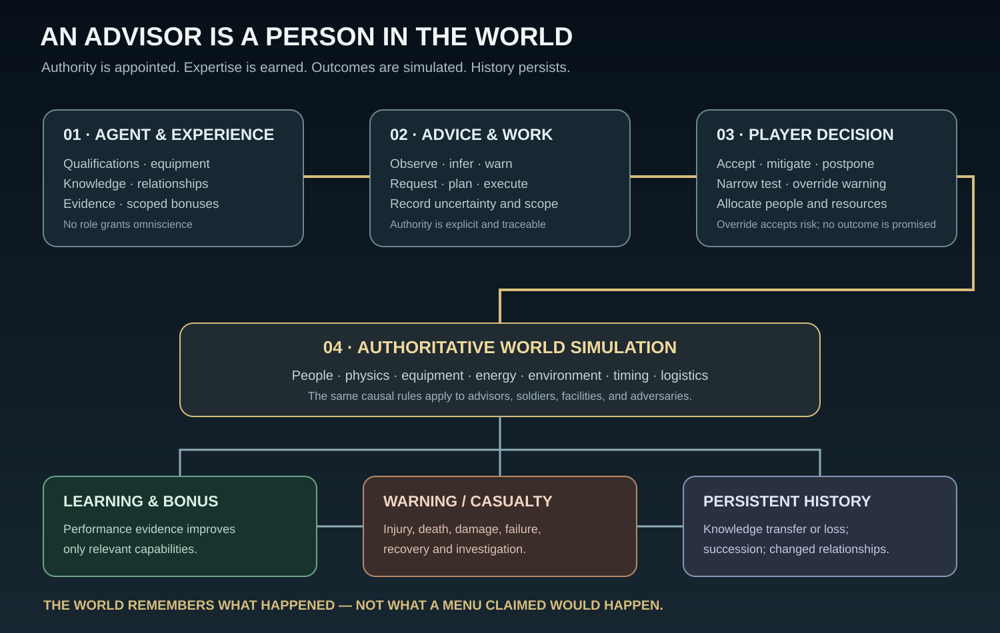
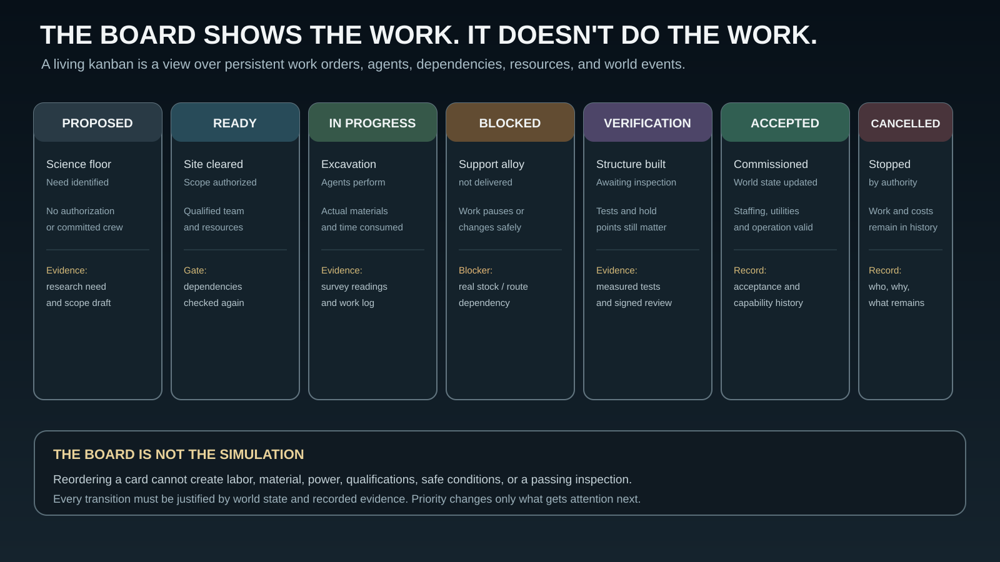

# raWWar — Public Design Hub

Status: Design for the future public WebPage presentation.

## Purpose

The raWWar design should eventually be presented as a living Workshop experience rather than as a single giant document.

The public presentation should allow a visitor to understand the game quickly, then descend into the machinery and design depth.

## Proposed navigation

### raWWar

The raWWar landing experience introduces the game visually and establishes the core proposition:

> **The soldiers themselves are the stars of this game.**

### Nested design hub

The raWWar design hub should expose:

- **Summary** — concise public explanation of the Experience.
- **Design Document** — the comprehensive master GDD.
- **Units** — soldiers, squads, formations, specialists, organizational roles.
- **Structures** — bases, buildings, facilities, launch pads, laboratories, barracks, command centers.
- **Capability Catalogue** — the growing catalogue of vehicles, structures, factories, crew compositions, qualifications, training tiers, and research dependencies.
- **Qualification Graph** — prerequisite paths, training tiers, instructor bottlenecks, and readiness.
- **Crew Composition Matrix** — how vehicles, facilities, factories, and construction work consume qualified people.
- **Industrial Dependency Graph** — materials, components, factories, production readiness, and fielding dependencies.
- **Building Catalogue** — the first physical building families, lifecycle states, capabilities, crews, and dependencies.
- **3D Base Planning** — drag-and-drop spatial planning, non-orthogonal placement, ghost/planned/construction/solid states, and construction procedures.
- [Construction & Configuration](CONSTRUCTION_AND_CONFIGURATION.md) — configuration before commitment, construction dependencies, experimentation, physical infrastructure, quality, and persistent base history.
- [Communications & Command](COMMUNICATIONS_AND_COMMAND.md) — real transmission/relay time, information age, chain of command, holographic war-table planning, and intent-driven battle orders.
- **Chassis & Vehicle Configuration** — chassis research, affixable modules, deterministic configurations, and production/crew dependencies.
- **Deterministic Simulation & Research** — frames versus authoritative states, scheduled simulation checkpoints, and deterministic 0–100 research timing.
- **Gameplay** — what the player actually does.
- **Research** — scientific work and technology progression.
- **Combat** — ground, air, and space warfare.
- **Play Modes** — campaign, cooperative, competitive, persistent, massively persistent.
- **Factions** — thirteen political and military organizations, their historical origins, hidden Imperial-alignment gradient, dispositions, dynamic faction relationships, political play, apex capabilities, and the continuously active galactic simulation.
- [Political Power, Speeches, and Factional Endgame](POLITICAL_POWER_AND_SPEECHES.md) — first-person political assemblies, speeches, alliances, coalition building, espionage/assassination consequences, shared frontier science, and thirteen faction-specific ultimate capabilities.

See [Faction Design](FACTIONS.md) for the working political catalogue and simulation model.

See [Empire History & Faction Origins](EMPIRE_HISTORY_AND_FACTION_ORIGINS.md) for the historical formation of the factions.

See [Faction Dispositions](FACTION_DISPOSITIONS.md) for the behavioral rating model.
- [Simulation Scale & Memory](SIMULATION_SCALE_AND_MEMORY.md) — byte-level FSM state, soldier complexity budgets, galaxy/system state fields, Event-Horizon scaling, and capacity targets.
- [Soldier Dissertation](SOLDIER_DISSERTATION.md) — the soldier as a persistent person: exoskeletons, training programs, qualifications, formation sizes, crew composition, equipment, experience, careers, survival, and first-person life.
- **Characters** — commanders, soldiers, researchers, and other important people.
- [Advisors and Command Staff](ADVISORS_AND_STAFF.md) — qualified candidates, service records, specialist advice, and command appointments.
- **Equipment** — exoskeletons, armor, weapons, tools, sensors, communications, modules.
- **Vehicles** — ground, air, orbital, and space vehicles.
- **Vehicle Configuration** — chassis capabilities, module interfaces, research-expanded configuration envelopes, and deterministic assembly.
- **Training** — qualifications, certifications, progression, officer development.
- **Economy** — pay, possessions, currency, ownership, recreation.
- **Terrain & Maps** — world geography, terrain generation, tactical and strategic maps.
- **World** — history, weather, environment, population, living systems.
- **Narrative** — story, factions, characters, environmental storytelling.
- **Audio** — music, sound, ambience, voice, environmental life.
- **Visual Design** — soldiers, equipment, vehicles, structures, environments, Gestures.
- **Technology** — FSM_API, FSM_COS, MicroBundles, Renderer, GPU computation, AnyApp.
- **Multiplayer** — cooperative, competitive, networking, synchronization.
- **Persistent Universes** — long-lived worlds, identity, history, economics, universe lifecycle.
- **Development** — current state, experiments, design gaps, milestones.

## Visual index

See the [Visual Asset Catalogue](images/README.md) for the current illustrated system map and guidance on adding new explanatory artwork. Two recent additions make advisor agency and operational work concrete:

## Content Laboratories

The design is now being expanded into concrete content records rather than keeping every vehicle, structure, and soldier inside one catalogue.

- Vehicles/ — individual vehicle concepts, configurations, logistics, crew survival, FPS/Commander symmetry, and science-fiction exploration.
- Structures/ — keyed buildings, physical capabilities, re-keying, construction, staffing, and operational dependencies.
- Soldiers/ — people, qualifications, careers, training, equipment, survival, and first-person roles.
- [Content Authoring Laboratories](CONTENT_AUTHORING_LABORATORIES.md) — the working model for turning broad design into concrete records.
- [Intent, Resources, and Logistics](INTENT_RESOURCES_AND_LOGISTICS.md) — intent-driven command, finite supplies, depletion, and organizational logistics.

These folders are deliberately expansive design laboratories. They are where ideas can collide before mature material is promoted into authoritative Experience definitions.

### One game, two perspectives

raWWar is not an RTS with an FPS bolted onto it.

The Commander and Soldier are looking at the **same authoritative world** from different positions.

A Commander can intend:

> Keep the forward missile batteries supplied.

A soldier can be the person loading those missiles, flying the transport, maintaining the launcher, or firing it.

A player can qualify to fly a starfighter and eventually pursue larger spacecraft and fleet command. Meanwhile the Commander can see those same pilots and ships as readiness, logistics, orders, losses, and strategic capability.

### Intent over micro-accounting

The player should express intent. The simulation performs the physical organization underneath that intent.

Resources, ammunition, production, transport, training, maintenance, and staffing remain real. They do not magically appear. But the player should not have to micromanage every crate merely to make a higher-level order meaningful.

When a required resource is depleted, a dependent process can wait or pause until the supply chain catches up.

> **Tell the organization what you want. The organization figures out how to do it.**

### Re-keyable infrastructure

Many buildings are keyed to their intended capability: a processing plant to a resource, storage to an inventory family, barracks to a training program, factories to production families, and research facilities to research domains.

Compatible structures can be re-keyed rather than demolished. The current Candidate rule is one-quarter of original construction time at twice the normal construction cost.

This makes base building easier and more fluid while preserving meaningful configuration decisions.

## Relationship to the master GDD

The master GDD is the comprehensive reading path.

The focused tabs are views into the same design knowledge.

They must not become independent competing sources of truth.

The intended model is:

**Master GDD → section → focused design view → deep-dive document**

For example:

**Design Document → Gestures → Gesture deep dive → authoring specification**

or:

**Design Document → Vehicles → Capability Catalogue → individual vehicle MicroBundle**

The Capability Catalogue is deliberately a living design instrument. It defines families and dependencies before the project freezes thousands of individual content records.

## Design-gap behavior

A focused tab must never manufacture missing design.

If a subject is not sufficiently defined, the UI should say so clearly.

Example:

> **This part of raWWar has not been illuminated yet.**
>
> The current design establishes that terrain is important, but the actual world-generation vision has not yet been defined.
>
> **Questions waiting for the creator:** What does the world look like? How large is it? How much is procedural? What landmarks matter?

This turns missing design into an invitation to continue the Workshop process.

## Future presentation

The final presentation should be visual-first, but its defining standard is **WYSIWYG: what we design is what we see**.

This is not a requirement to decorate Markdown with impressive pictures. The target is a trustworthy visual projection of the same semantic design and runtime-facing models that the Experience uses. Where the source model supports it, a visual should be generated through the Workshop's Renderer/Visualize path and manifested through GUI.SVG, rather than maintained as a second, hand-drawn version of the truth.

### WYSIWYG manifestation contract

1. **Author intent and meaning first.** Identify the entity, its stable identity, relationships, geometry, state, and relevant behavior before choosing how to draw it.
2. **Project the model into a view.** Renderer/Visualize owns the rendering transformation; GUI.SVG provides an inspectable SVG manifestation where that backend is appropriate. The SVG is a view of the model, not the authoritative source for game rules.
3. **Keep the picture connected to its source.** Generated visuals should identify their source model, generator/recipe, and evidence scope when practical. Avoid manually duplicating values or relationships that can be derived from the source.
4. **Make the view useful for reasoning.** Use legible layers, labels, relationships, motion, and interaction where they clarify the design. Richness serves comprehension; spectacle alone is not success.
5. **Verify claims at the right level.** A concept SVG proves only that a concept has been illustrated. A generated SVG proves the bounded model-to-view path that produced it. Tests prove their tested contracts. A running raWWar slice and successful AnyApp host launch require separate runtime evidence.

The intended authoring loop is:

**Intent → semantic model → Renderer/Visualize → GUI.SVG manifestation → inspection and refinement → executable checks / runtime proof**

This loop should eventually make diagrams, catalog views, engineering plans, and live demonstrations different projections of shared data where their semantics overlap. Do not force every view into one picture or imply that a static SVG alone proves simulation behavior, depth-tested 3D, interaction, or end-to-end gameplay.

**A bounded raWWar-specific source-connected visual already exists:** Soldier Field's stable 38-part `SOLDIER_PARTS` inventory in [`soldier-geometry.js`](../samples/SoldierField/WebGpuRunner/soldier-geometry.js) feeds `buildSoldierGeometry()`. The same generated triangle stream feeds the WebGPU lab and [`render-soldier-previews.mjs`](../samples/SoldierField/WebGpuRunner/render-soldier-previews.mjs), which projects it into six checked-in SVG views; CI regenerates and verifies those previews. This is real source-connected model-to-view behavior, not hand-maintained SVG art. Its current limits matter: the SVG projection is a separate, simple depth-sorted renderer, not yet the Workshop Renderer/Visualize → GUI.SVG path; the geometry is a silhouette blockout, not production character art; and neither the SVGs nor the WebGPU lab proves a complete playable raWWar slice or AnyApp launch.

The next integration step is to preserve that semantic source and connect an appropriate view to the Workshop Renderer/Visualize → GUI.SVG path, with reproducible output and tests that fail when the source model and checked-in manifestation diverge. The existing [Visualize-to-GUI.SVG proof](https://github.com/TrentBest/TheSingularityWorkshop.Visualize/blob/development/samples/PrimitiveGallery/generated/07-gui-svg-connected-points.svg) demonstrates an adjacent 2D geometry/resource/frame-to-SVG path; it does not establish that the raWWar Soldier Field asset already uses that backend. Other visuals whose source connection has not been demonstrated must remain labeled conceptual or illustrative.

Where useful, a section can contain:

- diagrams;
- concept art;
- interactive models;
- system relationships;
- timelines;
- data relationships;
- simulation demonstrations;
- videos;
- interactive Renderer demonstrations;
- expandable technical explanations.

The visitor should be able to read at three depths:

1. **What is it?**
2. **How does it work in the game?**
3. **How does the Workshop technology make it possible?**

This preserves the Workshop principle:

> **Edify, not mystify.**

## Publishing concept

The public design hub should eventually be driven from the same design sources used to build the Experience.

The goal is not to manually maintain a public copy of the design.

Instead, the publishing pipeline should eventually transform structured design material into the WebPage presentation.

The exact publishing architecture remains open.

## Current state

This document is a presentation/design concept only.

No WebPage implementation is implied by this document.

## Experience Architecture

Expose [Experience Architecture](EXPERIENCE_ARCHITECTURE.md) as a dedicated deep dive showing what raWWar owns, what FSM_API/FSM_COS/MicroBundles/AnyApp/Renderer provide, what Event Horizons mean, and what the Experience deliberately does not reinvent.

The public presentation should use architecture diagrams, responsibility tables, scale visualizations, and interactive examples rather than implementation prose alone.

> **The game is the Experience. The machinery is the Workshop.**

- [Faction Capability Matrix](FACTION_CAPABILITY_MATRIX.md) — faction-to-capability tendencies across vehicles, buildings, industry, logistics, research, and training.
- [Warp Navigation & Skills](WARP_NAVIGATION_AND_SKILLS.md) — gravitational hazards, route planning, crew skill, individual soldiers, training, and experience progression.
