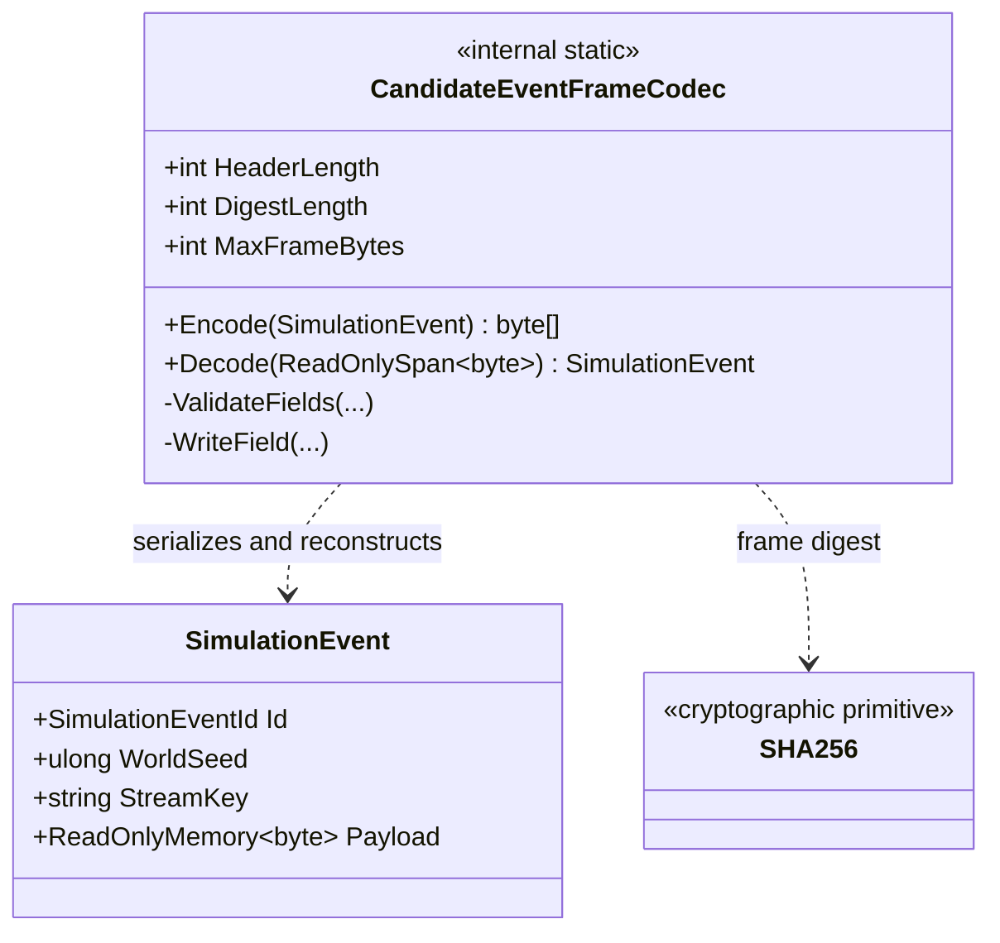

# CandidateEventFrameCodec — class diagram

## Use case

The file journal uses `Encode` for appends and `Decode` during recovery. Decode validates framing, bounds, text, checksum and recomputed event identity before returning an event.

## Boundary

Internal and provisional; no public format stability, authenticity, or cross-version compatibility guarantee is established.
