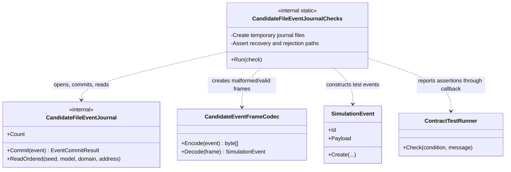

# CandidateFileEventJournalChecks — class diagram

## Use case

Validate journal behavior using isolated temporary files and named assertions.

## Boundary

The tests cover declared scenarios only; they are not a power-loss certification or production storage qualification.
