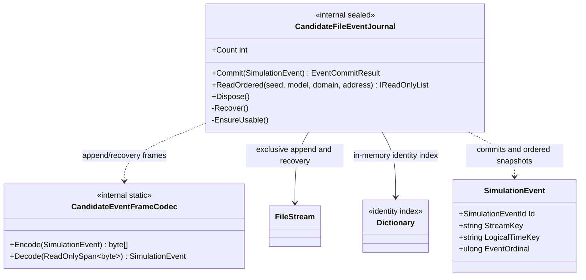

# CandidateFileEventJournal — class diagram

## Use case

Commit writes an encoded frame and flushes it before updating the index. Recovery validates each frame from the start of the file and rebuilds the index; uncertain write outcomes require reopening.

## Boundary

Single-process experimental persistence only. No multi-process coordination, world-state transaction, or actual power-loss test is claimed.
