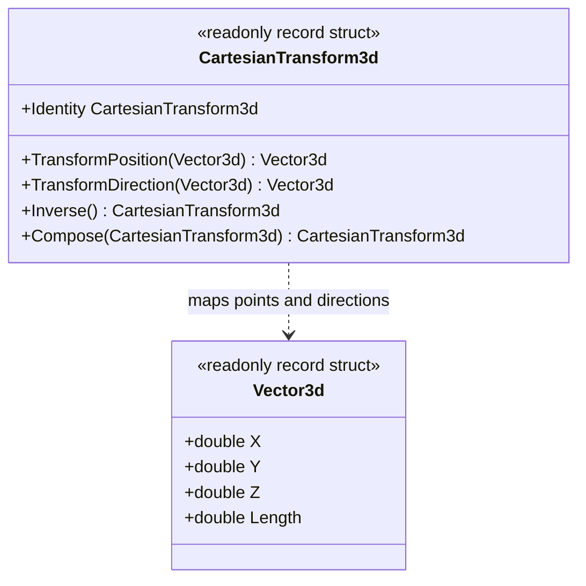

# CartesianTransform3d — class diagram

## Use case

Compose coordinate mappings or convert a point between explicit frames while keeping translation out of direction transforms.

## Boundary

No global axes or units are selected; inverse is restricted to orthonormal linear matrices.
