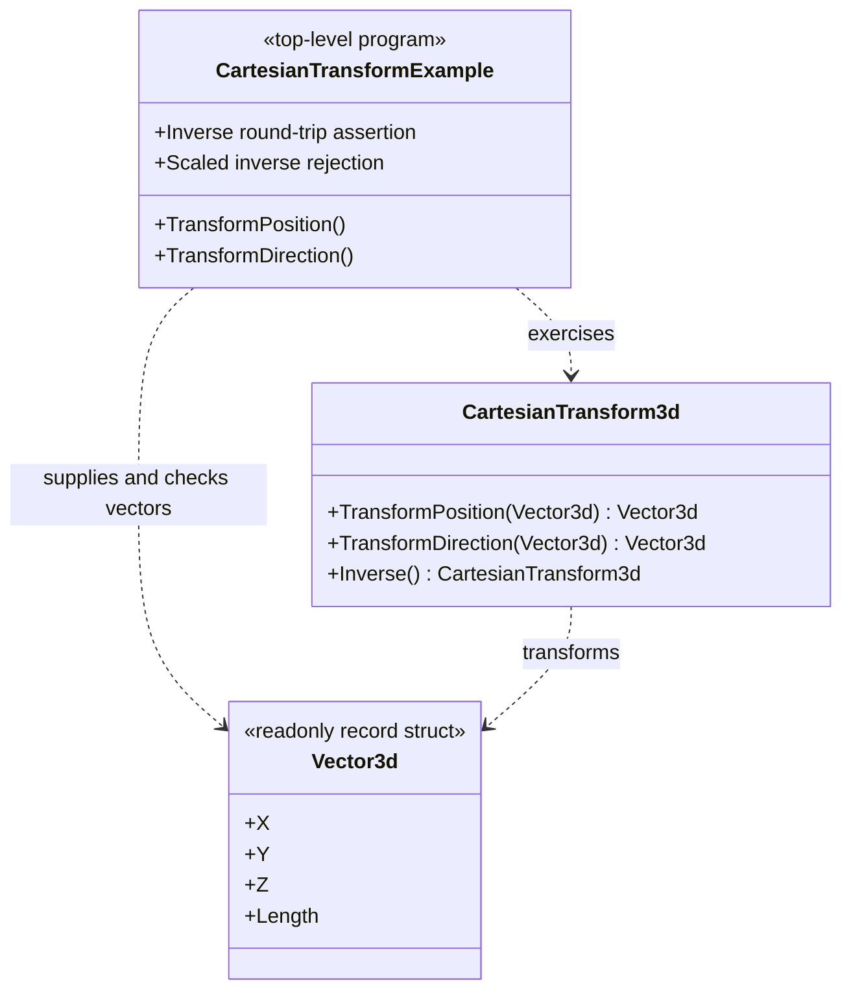

# CartesianTransform example — diagram

## Use case

Demonstrate coordinate conversion and assert the contract from a copyable executable.

## Boundary

This diagram describes example orchestration, not a production application or universal coordinate convention.
