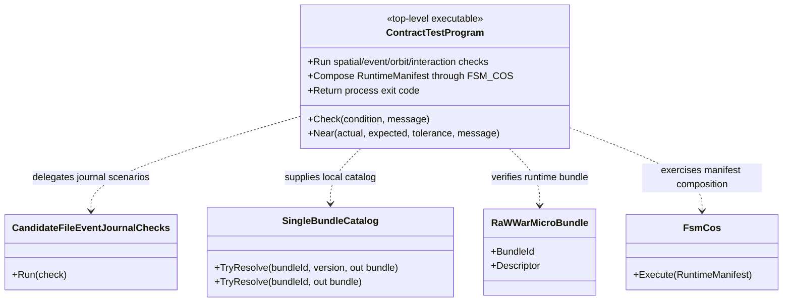

# raWWar.ContractTests Program — class diagram

## Use case

One executable entry point provides a visible pass/fail contract boundary across the current runtime.

## Boundary

The local catalog deliberately does not simulate repository retrieval or artifact materialization. The test suite does not itself authorize package publication.
