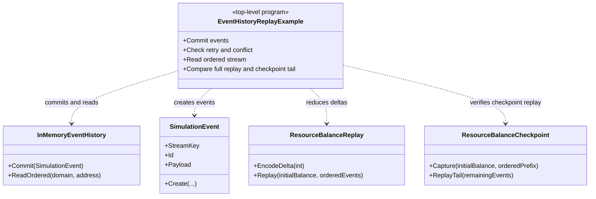

# EventHistoryReplay example — diagram

## Use case

Show the minimal event commit boundary and deterministic scoped replay.

## Boundary

In-memory sample only; the file journal has separate contract checks.
