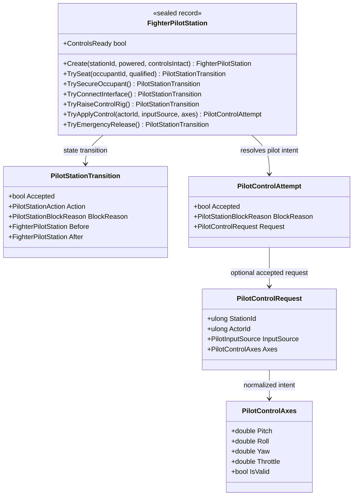

# FighterPilotStation — class diagram

## Use case

The station validates readiness and actor authority, returning either a block reason or a control request for a separate aircraft-control system.

## Boundary

State contract only; no animation, vehicle movement, or final control-law semantics.
