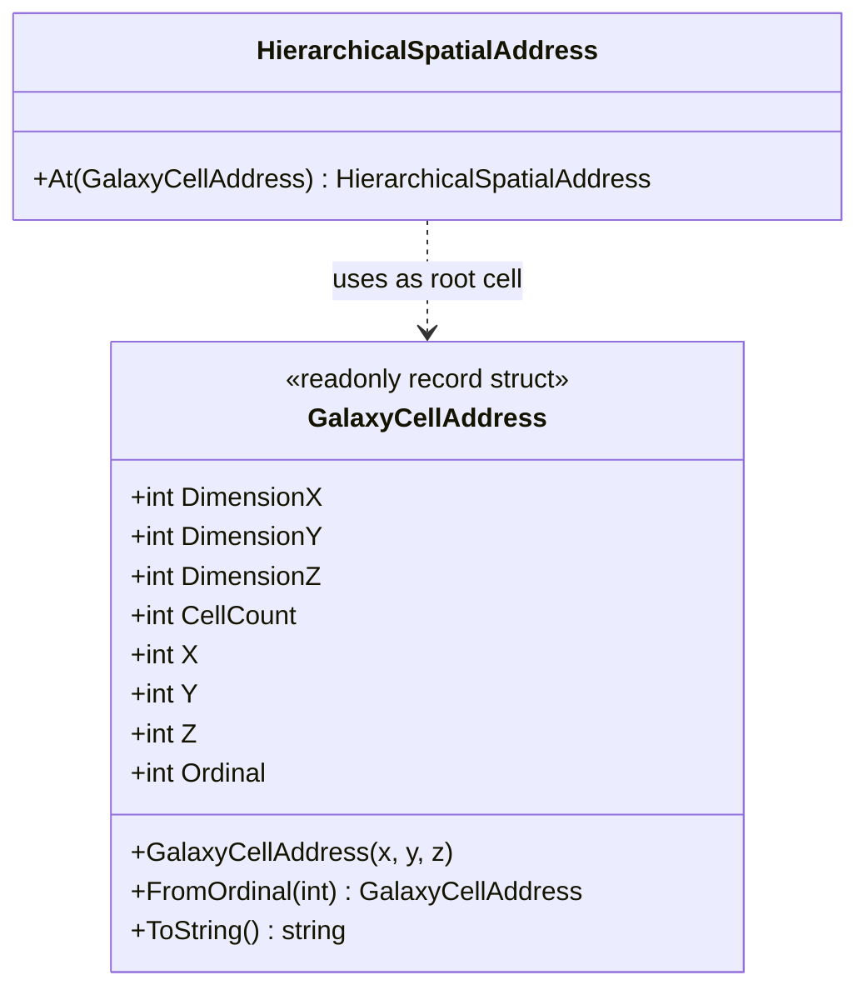

# GalaxyCellAddress — class diagram

## Use case

Convert the one-based galaxy-cell ordinal into coordinates, then use those coordinates as the root of a hierarchical spatial address.

## Boundary

Top-level address mapping only; recursive encoding and hashing are separate contracts.
