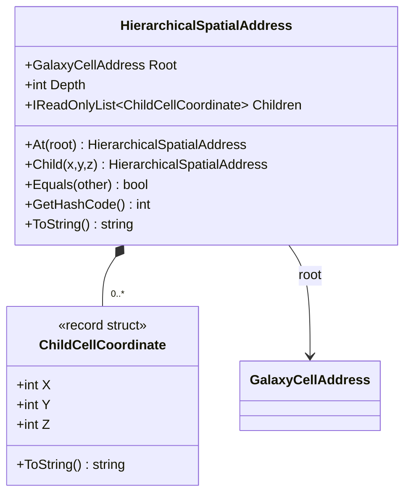

# UML — `HierarchicalSpatialAddress.cs`

**Source:** [`HierarchicalSpatialAddress.cs`](../../src/raWWar/Spatiotemporal/HierarchicalSpatialAddress.cs)

## Responsibility

Models a top-level `GalaxyCellAddress` followed by zero or more subdivision coordinates in a 10×10×10 child grid. It represents hierarchy and in-process value equality, not a globally unique flattened cell ordinal or canonical wire format.

## Class diagram

## Observed behavior

- Each child coordinate validates each axis against the dimension constants on `GalaxyCellAddress`.
- `At(root)` creates a depth-zero address; `Child(x,y,z)` returns a new address and does not mutate the parent.
- The child sequence is exposed through a read-only wrapper around the private array.
- Equality compares root, depth, and ordered child coordinates.
- `GetHashCode()` is process-local hash behavior only; the source explicitly warns not to use it as persistent or cross-process identity.
- `ToString()` is diagnostic display, not canonical serialization.

## Open contract boundary

The wire encoding, byte order, canonical address serialization, stable hashing, and physical-coordinate mapping are separate concerns and are not defined by this type.
