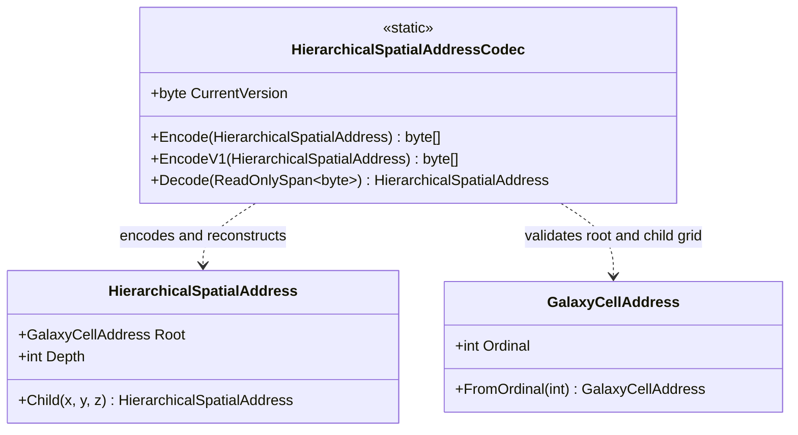

# HierarchicalSpatialAddressCodec — class diagram

## Use case

Encode a hierarchy using the explicit V1 layout, or decode and validate external bytes before using the reconstructed address.

## Boundary

Canonical identity bytes only; hashing and physical coordinate conversion are separate concerns.
