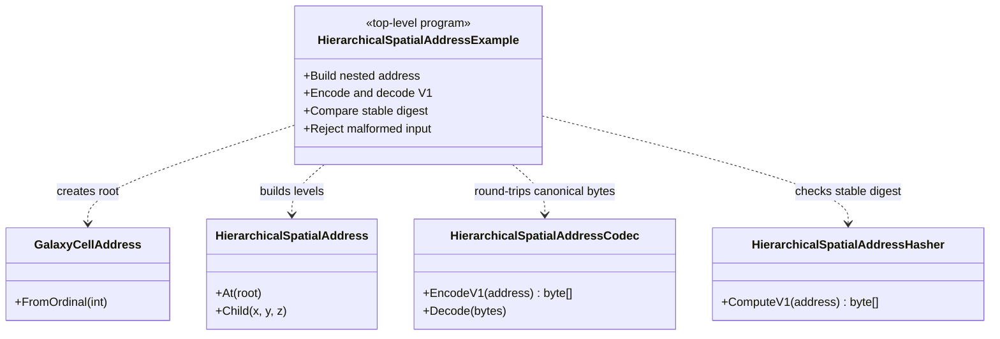

# HierarchicalSpatialAddress example — diagram

## Use case

Validate that hierarchical addresses have explicit, versioned serialization and hashing.

## Boundary

This is a console proof of the current V1 contract, not a claim about future codec versions.
