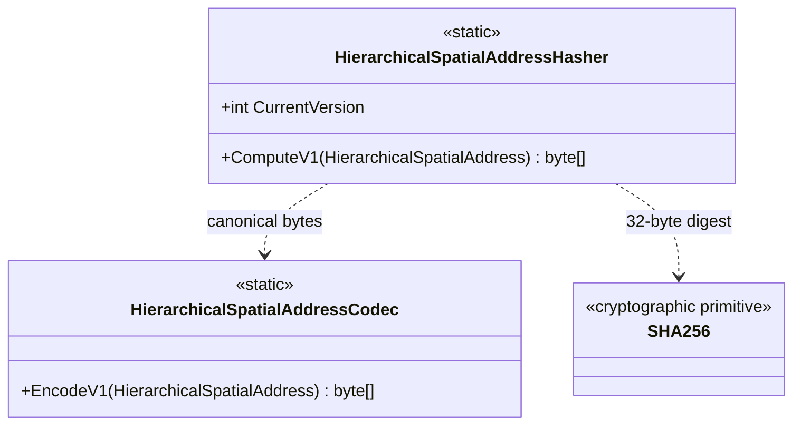

# HierarchicalSpatialAddressHasher — class diagram

## Use case

Hash canonical V1 address bytes when a compact deterministic identity digest is useful.

## Boundary

Digest only; no encryption, authentication, or coordinate conversion.
