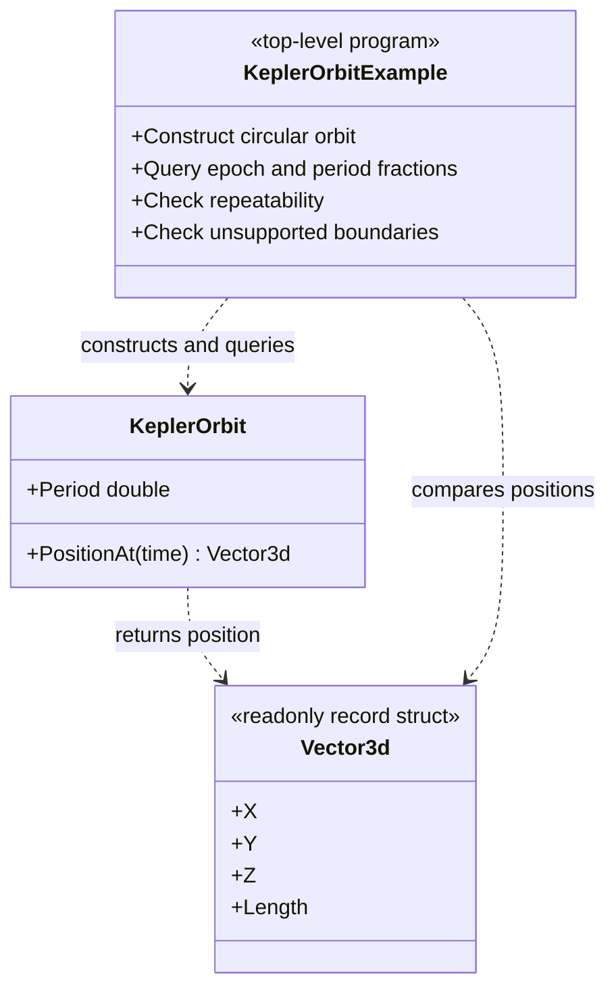

# KeplerOrbit example — diagram

## Use case

Make the explicit logical-time orbit API easy to copy and verify.

## Boundary

An orbital model example only; no renderer or simulation loop is implied.
