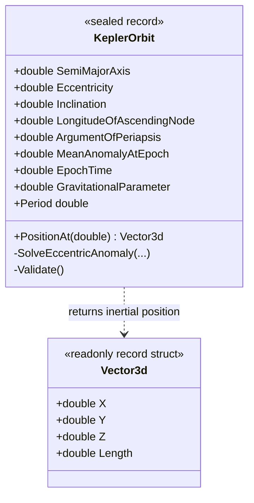

# KeplerOrbit — class diagram

## Use case

Evaluate an orbit at an explicit logical time, returning a framework-independent 3D vector.

## Boundary

Elliptic two-body model only; no frame-rate dependence or renderer integration.
