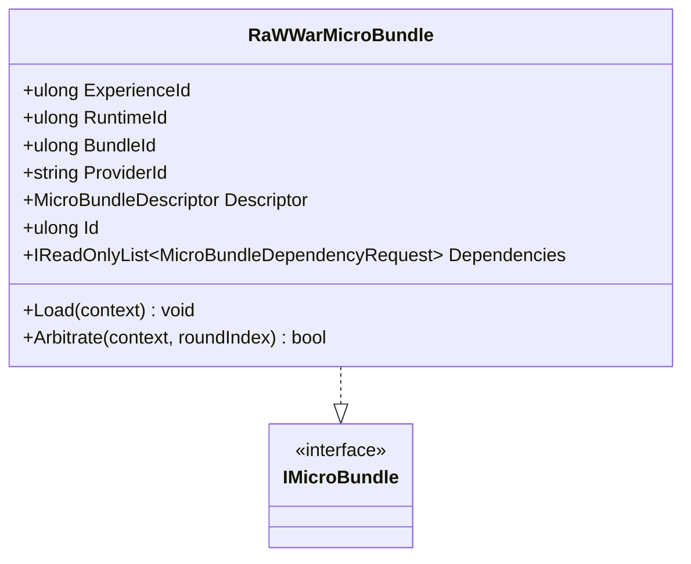

# UML — `RaWWarMicroBundle.cs`

**Source:** [`RaWWarMicroBundle.cs`](../../src/raWWar/RaWWarMicroBundle.cs)

## Responsibility

Provides the initial raWWar Experience payload as an `IMicroBundle`. The source explicitly describes the design as ahead of implementation: capability composition is not yet implemented in this class.

## Class diagram

## Observed behavior

- Descriptor declares bundle ID `3301`, version `1.0.0`, and provider `rawwar`.
- `Dependencies` returns an empty list.
- `Load` validates its context and otherwise performs no capability composition.
- `Arbitrate` validates its context and returns `false`.

## Evidence limits

This file does not implement a playable game loop or compose raWWar capabilities. Do not interpret the bundle descriptor as proof of end-to-end AnyApp host execution.
