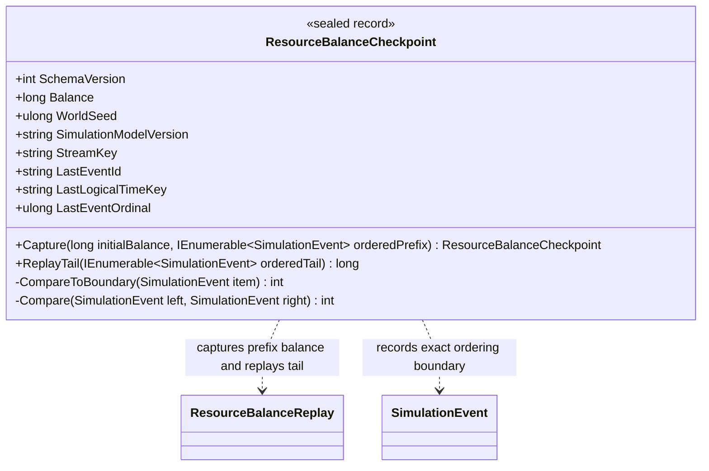

# ResourceBalanceCheckpoint — class diagram

## Use case

A caller captures a checkpoint after replaying a non-empty prefix and later applies only a validated tail whose events belong to the same stream and lie strictly after the saved boundary.

## Boundary

The record does not serialize itself, persist to disk, discover history, or provide atomic world-state snapshots.
