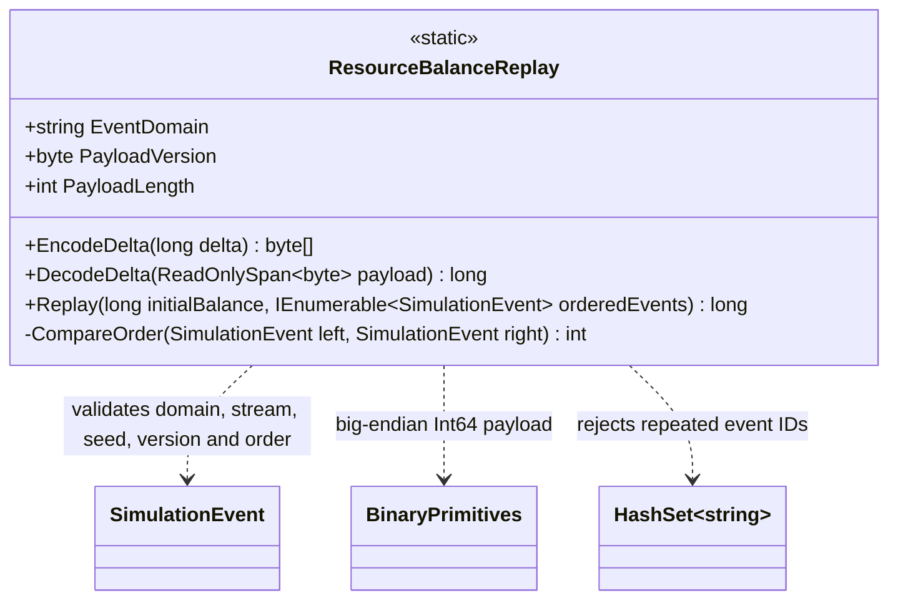

# ResourceBalanceReplay — class diagram

## Use case

The caller supplies an already ordered, address-scoped event sequence. The reducer validates the stream contract, decodes each fixed-width delta, and applies checked arithmetic.

## Boundary

The reducer is not a journal, checkpoint store, scheduler, or world-state transaction coordinator.
