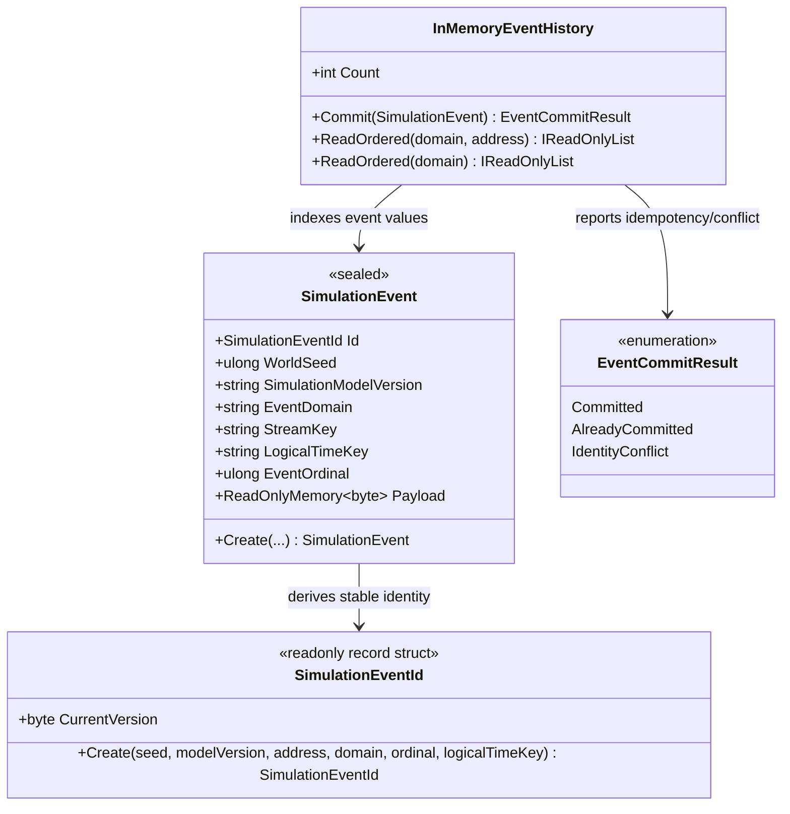

# SimulationEvent — class diagram

## Use case

A domain creates a proposed event, then commits it to the in-memory ledger or passes it to a journal. Consumers request a deterministic snapshot and apply their own domain-specific replay rules.

## Boundary

Identity excludes payload; conflict detection compares content separately. The in-memory ledger does not provide durability or atomic world-state updates.
