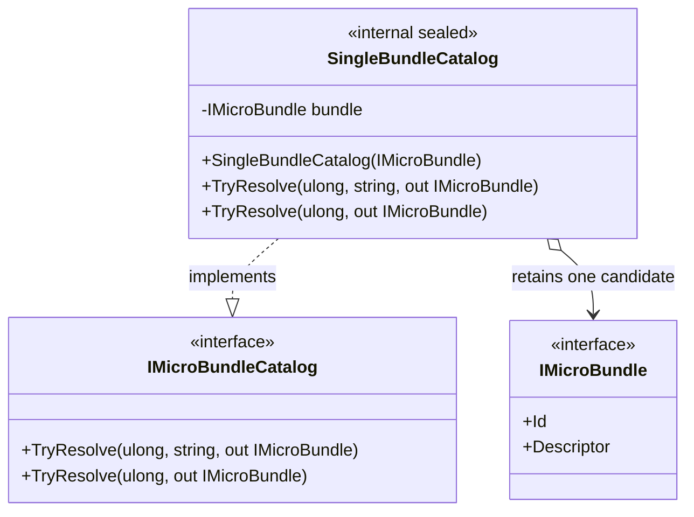

# SingleBundleCatalog — class diagram

## Use case

Resolve the locally constructed root bundle in a focused composition contract test.

## Boundary

Single-candidate lookup only; no repository or artifact-fetch semantics.
