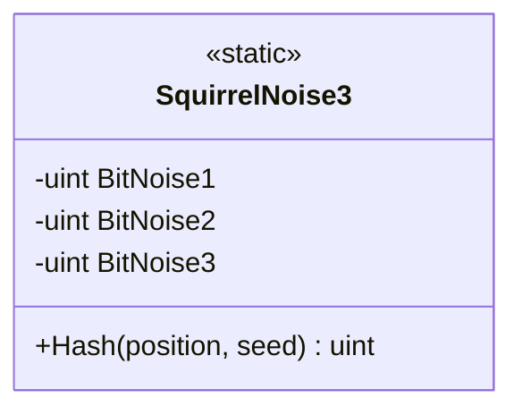

# UML — `SquirrelNoise3.cs`

**Source:** [`SquirrelNoise3.cs`](../../src/raWWar/Spatiotemporal/SquirrelNoise3.cs)

## Responsibility

Provides a stateless, random-access 32-bit pseudo-random hash of a signed position and unsigned seed, using the version-3 SquirrelNoise constants and wraparound arithmetic.

## Type diagram

## Observed behavior

- The algorithm executes inside an `unchecked` block; arithmetic intentionally wraps modulo (2^{32}).
- `Hash(int position, uint seed = 0)` returns a deterministic unsigned 32-bit value.
- The source documents that the algorithm is not cryptographic and does not define canonical spatial-address serialization.
- The constants and sequence are declared version-stable; algorithm changes require a new primitive version.

## Evidence limits

This type alone does not prove statistical quality, cryptographic safety, globally unique identities, or reproducible world serialization. Those require separate, appropriately scoped tests and contracts.
