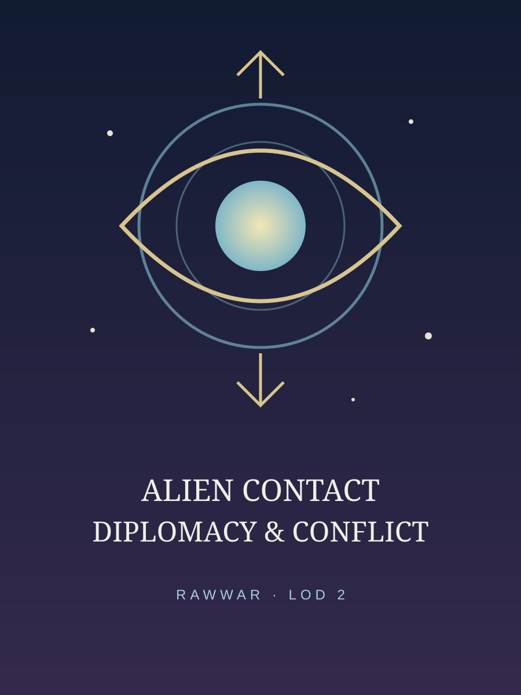

# raWWar — Living Warfare Sourcebooks

The raWWar sourcebook library is the SURPS-facing knowledge layer for warfare and organized force. It is authored and maintained here because raWWar owns its domain meaning, historical content, and simulation requirements. SURPS provides shared rulebook identity, LOD conventions, and optional composition.

## Domain foundation — LOD 1

**Warfare and Organized Force** maps the full domain: state warfare, civil conflict, raids, piracy, privateering, outlawry, resistance, insurgency, mercenaries, military institutions, logistics, doctrine, technology, civilian experience, and historical memory.

- [Read the sourcebook](warfare-and-organized-force.md)
- [Book descriptor](warfare-and-organized-force.book.json)

## Current LOD 2 manual

**Fortifications and Strongholds** covers the warfare-side design of defensive places: threat models, layered defense, siege endurance, sustainment, military engineering, civilian survival, maintenance, and recovery.

- [Read the sourcebook](fortifications-and-strongholds.md)
- [Book descriptor](fortifications-and-strongholds.book.json)

## Current LOD 2 strategic sourcebook

**The Art of War** is a dedicated study of the thirteen-chapter work traditionally attributed to Sun Tzu: textual history, attribution and transmission, chapter-by-chapter interpretation, strategic themes, reception, translation discipline, and tabletop/simulation applications.

- [Read the sourcebook](the-art-of-war.md)
- [Book descriptor](the-art-of-war.book.json)

## Current historical LOD 2 sourcebooks

### Greek Warfare

A cross-period study from Mycenaean worlds and archaic poleis through classical conflicts, Macedon, Alexander, and the Hellenistic kingdoms. It distinguishes documented history from epic, myth, and original adaptation.

- [Read the sourcebook](greek-warfare.md)
- [Book descriptor](greek-warfare.book.json)

### Persian Warfare

A comparative overview of the Achaemenid, Parthian, and Sasanian empires, emphasizing their distinct institutions and regional histories.

- [Read the sourcebook](persian-warfare.md)
- [Book descriptor](persian-warfare.book.json)

### Roman Warfare

A periodized overview from early Rome through Republic, Principate, later Empire, and eastern Roman continuities.

- [Read the sourcebook](roman-warfare.md)
- [Book descriptor](roman-warfare.book.json)

## Planned LOD 2 families

These are editorial families, not a rigid hierarchy. Each book will declare its scope and cross-reference other books where appropriate.

### Historical eras and conflicts
Ancient warfare; Greek and Persian wars; Roman wars; Chinese dynastic conflicts; Japanese warfare by period; Mongol campaigns; Viking-age warfare; medieval conflicts; early-modern warfare; Napoleonic wars; American Civil War; World Wars; Korea; Vietnam; Cold War conflicts; contemporary conflicts; and explicitly speculative future wars.

### Participants, peoples, states, and organizations
Roman republic and imperial forces; Mongol polities and armies; Viking-age communities; Germanic peoples and successor states; Imperial Japan; Nazi Germany and its institutions; Allied coalitions; resistance movements; partisan groups; pirates; privateers; mercenary companies; militias; and other organizations. These books must distinguish states, regimes, armed institutions, populations, factions, and individuals.

### Irregular, maritime, and contested force
Piracy, privateering, corsairs, outlawry, brigandage, Robin Hood traditions, insurgency, rebellion, resistance, local defense, and the contested boundary between political and criminal violence.

## Focused history and play

Campaigns, theaters, battles, sieges, operations, and missions form focused books. For example, a D-Day book should link the Normandy campaign, coalition planning, airborne and seaborne operations, German defensive systems, logistics, intelligence, and civilian experience rather than treating one day as an isolated abstraction.

## Reusable manuals

Weapons and ammunition; armor and protective equipment; vehicles, ships, aircraft, and spacecraft; fortifications and engineering; communications and sensors; intelligence; command and doctrine; training; logistics and supply; medicine; military law; recruitment and personnel systems.

## Editorial and technical rules

- Follow the [SURPS rulebook identity and cover standard](https://github.com/TrentBest/TheSingularityWorkshop.SingularityUniversalRoleplayingSystem/blob/development/docs/rulebook-identity-and-covers.md).
- Treat LOD as depth and specificity, not chronology or a forced parent-child structure.
- Label evidence, disputed interpretation, legend, speculation, and fictional adaptation distinctly.
- Do not essentialize nationalities, ethnicities, or populations.
- Make books usable by tabletop groups as well as simulation designers.
- Keep prose and descriptors as knowledge, not executable behavior.
- Link to authoritative providers; do not duplicate Physics, Gestures, or runtime implementations.
- SURPS remains opt-in. The disabled Experience path must remain valid.

The first book is an editorial foundation. Automated descriptor validation, shared badge integration, and runtime composition must be verified separately; this library does not claim those capabilities are already implemented.

## New LOD 2 sourcebooks — maritime, irregular, global, and speculative warfare

### Piracy and Maritime Raiding

A maritime study distinguishing piracy, privateering, corsairing, naval warfare, smuggling, and coastal raiding, with attention to the people and political economies surrounding the sea.

- [Read the sourcebook](piracy-and-maritime-raiding.md)
- [Book descriptor](piracy-and-maritime-raiding.book.json)

### Outlaws, Bandits, and Popular Resistance

A careful treatment of outlawry, brigandage, social banditry, rebellion, insurgency, community legitimacy, and Robin Hood as a layered folklore tradition rather than a verified biography.

- [Read the sourcebook](outlaws-bandits-and-popular-resistance.md)
- [Book descriptor](outlaws-bandits-and-popular-resistance.book.json)

### Chinese Warfare

A periodized orientation to Chinese military history that resists treating millennia of changing states and institutions as one unchanging system.

- [Read the sourcebook](chinese-warfare.md)
- [Book descriptor](chinese-warfare.book.json)

### Science Fiction Warfare

A first-class speculative domain covering future terrestrial conflict, orbital and planetary infrastructure, autonomous systems, cyber and information conflict, habitat defense, interstellar campaigns, and ethical consequences. It explicitly distinguishes established facts from extrapolation and invented setting rules.

- [Read the sourcebook](science-fiction-warfare.md)
- [Book descriptor](science-fiction-warfare.book.json)

### Japanese Warfare

Descriptor: [japanese-warfare.book.json](japanese-warfare.book.json)

A periodized study from early state formation through warrior governments, Sengoku conflict, unification, Tokugawa peace, modern transformation, imperial war, and postwar memory.

[Read Japanese Warfare](japanese-warfare.md)

### Orbital Warfare and Space Infrastructure

Descriptor: [orbital-warfare-and-space-infrastructure.book.json](orbital-warfare-and-space-infrastructure.book.json)

A systems-level study of orbital services, infrastructure dependencies, access, resilience, governance, escalation, and civilian consequences, with clear boundaries between known physics and speculative settings.

[Read Orbital Warfare and Space Infrastructure](orbital-warfare-and-space-infrastructure.md)

## Dedicated Iranian imperial sourcebooks

The Persian overview now has three focused companion volumes. These books distinguish the Achaemenid, Parthian/Arsacid, and Sasanian states rather than projecting one military system across nearly a millennium.

### Achaemenid Warfare
Achaemenid royal authority, provincial mobilization, multi-community forces, campaign logistics, Greek and Persian evidence, and imperial succession.
- [Read the sourcebook](achaemenid-warfare.md)
- [Book descriptor](achaemenid-warfare.book.json)

### Parthian Warfare
Arsacid elite politics, mounted capabilities, horse supply, Roman-Parthian campaigns, frontier diplomacy, and the role of cities and fortresses.
- [Read the sourcebook](parthian-warfare.md)
- [Book descriptor](parthian-warfare.book.json)

### Sasanian Warfare
Sasanian military institutions, cavalry and combined capabilities, frontier fortifications, siege endurance, diplomacy, and the seventh-century transformation.
- [Read the sourcebook](sasanian-warfare.md)
- [Book descriptor](sasanian-warfare.book.json)

## Steppe empires and Viking-age networks

### Mongol Warfare
A study of the Mongol Empire's political formation, steppe ecology, mounted mobility, command, intelligence, adaptation to siege warfare, regional campaigns, and successor khanates. It distinguishes the early unified empire from later states and avoids reducing diverse populations to a single identity.
- [Read the sourcebook](mongol-warfare.md)
- [Book descriptor](mongol-warfare.book.json)

### Viking-Age Warfare
A regional study of Scandinavian maritime activity, ships, raiding, trade, settlement, armed groups, and state formation across the North Atlantic, British Isles, Baltic, eastern river routes, and neighboring regions.
- [Read the sourcebook](viking-age-warfare.md)
- [Book descriptor](viking-age-warfare.book.json)

## Roman warfare — focused studies

### Roman Republican Warfare
Civic and allied manpower, changing republican institutions, command, Mediterranean expansion, naval adaptation, and the late-Republican civil-war crisis.
- [Read the sourcebook](roman-republican-warfare.md)
- [Book descriptor](roman-republican-warfare.book.json)

### The Roman Imperial Army
Imperial legions and auxiliary forces, recruitment, service and military society, frontier zones, logistics, imperial politics, and late antique transformation.
- [Read the sourcebook](roman-imperial-army.md)
- [Book descriptor](roman-imperial-army.book.json)

## Science-fiction warfare — planetary settlement systems

### Planetary Defense and Habitat Conflict
A high-level, civilian-centered systems study of planetary defense, habitat life-support resilience, governance, security, law, autonomy, and de-escalation. The book labels established, extrapolated, speculative, and fictional claims separately and deliberately avoids real-world infrastructure attack procedures.
- [Read the sourcebook](planetary-defense-and-habitat-conflict.md)
- [Book descriptor](planetary-defense-and-habitat-conflict.book.json)

## Latest LOD 2 expansion — Roman conflict and machine agency

### Roman Civil Wars

A focused study from the Social War through Sulla, Caesar, the triumvirates, and the Augustan settlement. It treats civil war as a crisis of legitimacy, military allegiance, finance, coalition politics, and civilian life.

- [Read the sourcebook](roman-civil-wars.md)
- [Book descriptor](roman-civil-wars.book.json)

### Eastern Roman Warfare

A periodized study of the eastern Roman state from late antiquity through 1453. It examines changing military institutions, fiscal capacity, diplomacy, fortifications, naval power, and regional strategy without treating a millennium as one static system.

- [Read the sourcebook](eastern-roman-warfare.md)
- [Book descriptor](eastern-roman-warfare.book.json)

### Autonomous Systems and Machine Agency

A science-fiction companion on delegated authority, human oversight, accountability, reliability, escalation, civilian protection, and the conditions under which machine entities might become political actors. It distinguishes established systems from extrapolated, speculative, and fictional premises.

- [Read the sourcebook](autonomous-systems-and-machine-agency.md)
- [Book descriptor](autonomous-systems-and-machine-agency.book.json)

These books continue the historical Roman sequence and develop science-fiction warfare as a first-class domain. They are knowledge and worldbuilding resources, not executable doctrine or instructions for attacking real systems.

## Latest LOD 2 expansion — interstellar systems and first contact

### Interstellar Logistics and Strategy

A strategic systems study of interstellar distance, light-time, transport, energy, life support, industrial capacity, network topology, political reach, and civilian sustainment. Known physical constraints are separated from extrapolated engineering and fictional travel rules.

- [Read the sourcebook](interstellar-logistics-and-strategy.md)
- [Book descriptor](interstellar-logistics-and-strategy.book.json)

### Alien Contact, Diplomacy, and Conflict

A framework for verifying contact, interpreting unfamiliar signals, biological uncertainty, representation, diplomacy, security dilemmas, escalation, restraint, and machine intermediaries. It treats alien intelligence as unconfirmed and avoids assuming either universal hostility or universal cooperation.

- [Read the sourcebook](alien-contact-diplomacy-and-conflict.md)
- [Book descriptor](alien-contact-diplomacy-and-conflict.book.json)

Both books are setting and research frameworks, not claims of imminent interstellar capability or confirmed extraterrestrial contact. Continue to label established, extrapolated, speculative, and fictional premises explicitly.

## LOD 3 — alien civilization histories and political systems

### Alien Civilizations and Political Systems

A reusable framework for building fictional civilizations through historical transitions, constitutional orders, institutions, factions, strategic culture, infrastructure, armed organizations, diplomacy, and campaign histories. It rejects species-wide personalities and distinguishes regimes, states, populations, institutions, and armed forces.

- [Read the sourcebook](alien-civilizations-and-political-systems.md)
- [Book descriptor](alien-civilizations-and-political-systems.book.json)

This LOD 3 volume deepens [Alien Contact, Diplomacy, and Conflict](alien-contact-diplomacy-and-conflict.md) by giving setting authors a way to construct internally diverse societies before writing contact or conflict. It also links to interstellar logistics, autonomous agency, and planetary habitat resilience. All civilization examples remain fictional; no extraterrestrial civilization is confirmed.
