# raWWar — Living Warfare Sourcebooks

The raWWar sourcebook library is the SURPS-facing knowledge layer for warfare and organized force. It is authored and maintained here because raWWar owns its domain meaning, historical content, and simulation requirements. SURPS provides shared rulebook identity, LOD conventions, and optional composition.

## Domain foundation — LOD 1

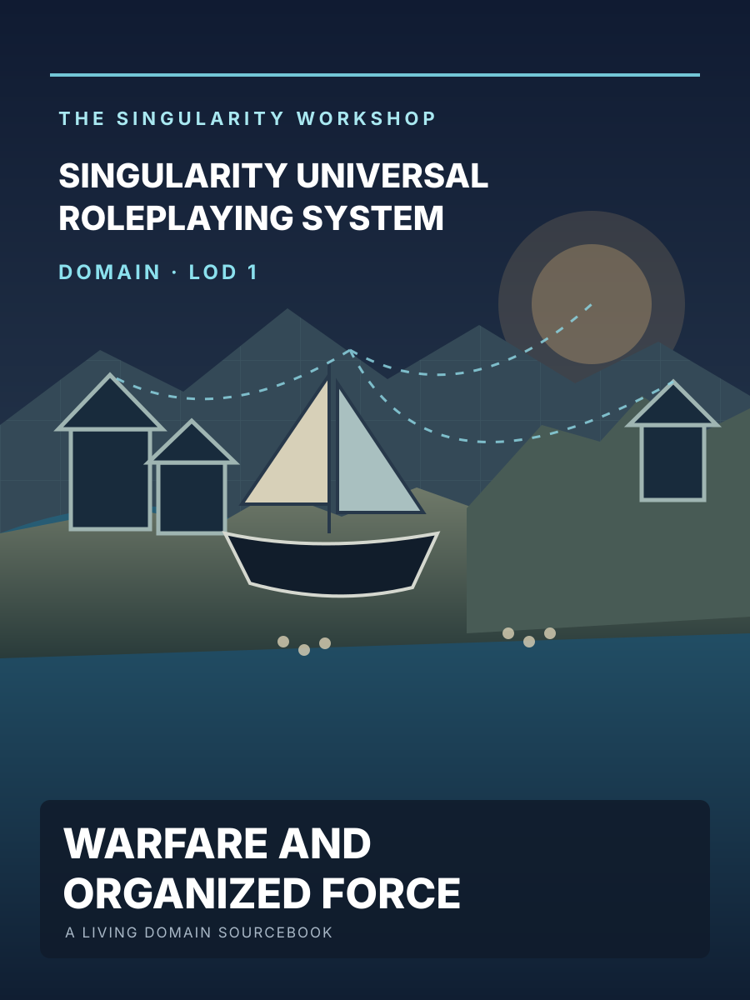

**Warfare and Organized Force** maps the full domain: state warfare, civil conflict, raids, piracy, privateering, outlawry, resistance, insurgency, mercenaries, military institutions, logistics, doctrine, technology, civilian experience, and historical memory.

- [Read the sourcebook](warfare-and-organized-force.md)
- [Book descriptor](warfare-and-organized-force.book.json)

## Current LOD 2 manual

**Fortifications and Strongholds** covers the warfare-side design of defensive places: threat models, layered defense, siege endurance, sustainment, military engineering, civilian survival, maintenance, and recovery.

- [Read the sourcebook](fortifications-and-strongholds.md)
- [Book descriptor](fortifications-and-strongholds.book.json)

## Current LOD 2 strategic sourcebook

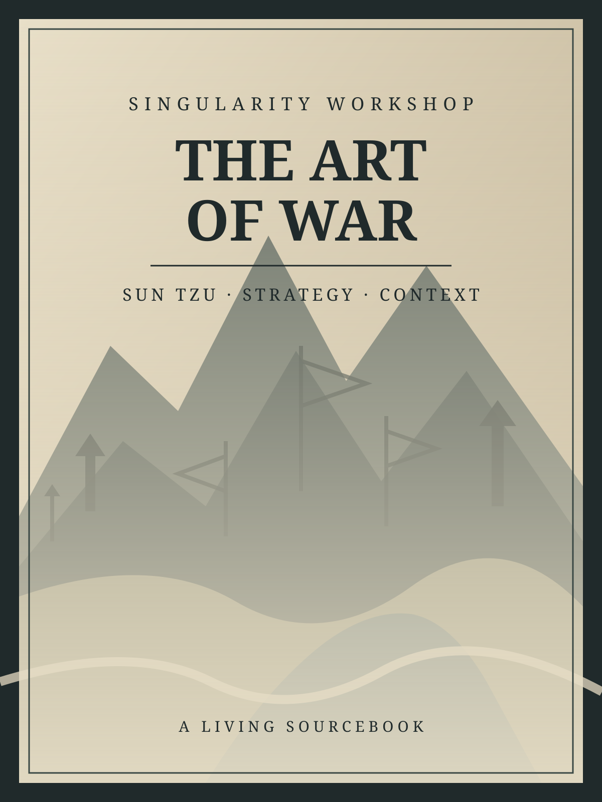

**The Art of War** is a dedicated study of the thirteen-chapter work traditionally attributed to Sun Tzu: textual history, attribution and transmission, chapter-by-chapter interpretation, strategic themes, reception, translation discipline, and tabletop/simulation applications.

- [Read the sourcebook](the-art-of-war.md)
- [Book descriptor](the-art-of-war.book.json)

## Current historical LOD 2 sourcebooks

### Greek Warfare

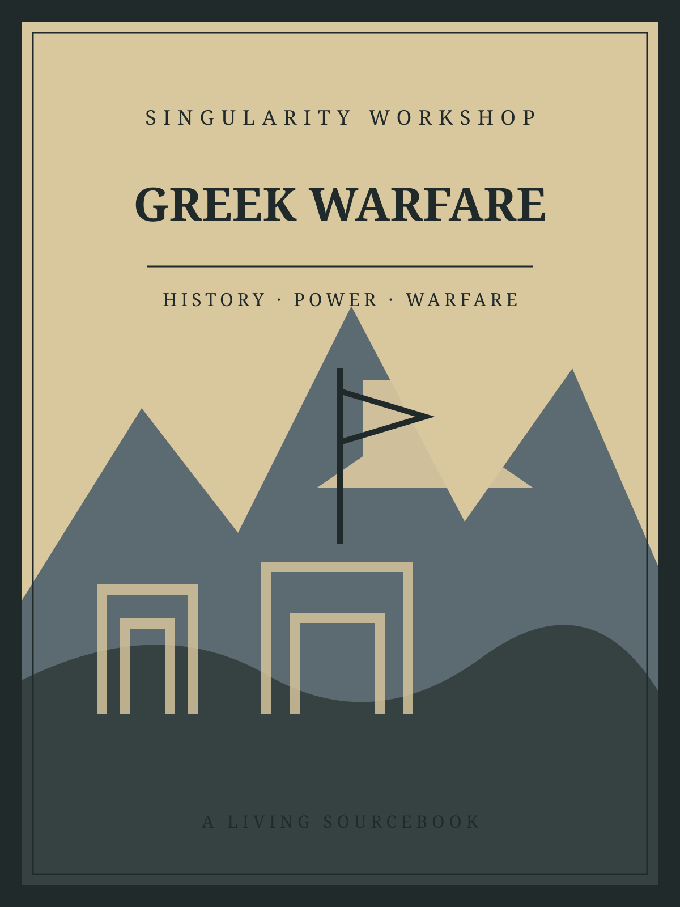

A cross-period study from Mycenaean worlds and archaic poleis through classical conflicts, Macedon, Alexander, and the Hellenistic kingdoms. It distinguishes documented history from epic, myth, and original adaptation.

- [Read the sourcebook](greek-warfare.md)
- [Book descriptor](greek-warfare.book.json)

### Persian Warfare

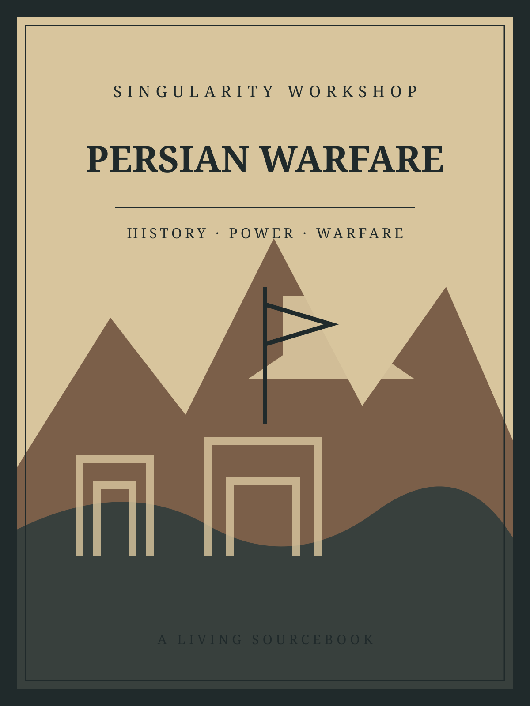

A comparative overview of the Achaemenid, Parthian, and Sasanian empires, emphasizing their distinct institutions and regional histories.

- [Read the sourcebook](persian-warfare.md)
- [Book descriptor](persian-warfare.book.json)

### Roman Warfare

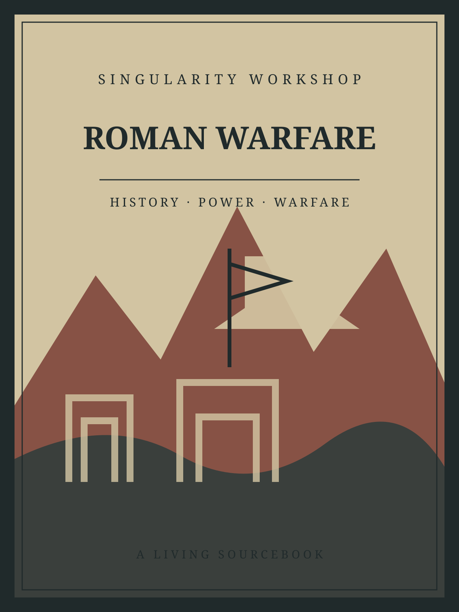

A periodized overview from early Rome through Republic, Principate, later Empire, and eastern Roman continuities.

- [Read the sourcebook](roman-warfare.md)
- [Book descriptor](roman-warfare.book.json)

## Planned LOD 2 families

These are editorial families, not a rigid hierarchy. Each book will declare its scope and cross-reference other books where appropriate.

### Historical eras and conflicts
Ancient warfare; Greek and Persian wars; Roman wars; Chinese dynastic conflicts; Japanese warfare by period; Mongol campaigns; Viking-age warfare; medieval conflicts; early-modern warfare; Napoleonic wars; American Civil War; World Wars; Korea; Vietnam; Cold War conflicts; contemporary conflicts; and explicitly speculative future wars.

### Participants, peoples, states, and organizations
Roman republic and imperial forces; Mongol polities and armies; Viking-age communities; Germanic peoples and successor states; Imperial Japan; Nazi Germany and its institutions; Allied coalitions; resistance movements; partisan groups; pirates; privateers; mercenary companies; militias; and other organizations. These books must distinguish states, regimes, armed institutions, populations, factions, and individuals.

### Irregular, maritime, and contested force
Piracy, privateering, corsairs, outlawry, brigandage, Robin Hood traditions, insurgency, rebellion, resistance, local defense, and the contested boundary between political and criminal violence.

## Focused history and play

Campaigns, theaters, battles, sieges, operations, and missions form focused books. For example, a D-Day book should link the Normandy campaign, coalition planning, airborne and seaborne operations, German defensive systems, logistics, intelligence, and civilian experience rather than treating one day as an isolated abstraction.

## Reusable manuals

Weapons and ammunition; armor and protective equipment; vehicles, ships, aircraft, and spacecraft; fortifications and engineering; communications and sensors; intelligence; command and doctrine; training; logistics and supply; medicine; military law; recruitment and personnel systems.

## Editorial and technical rules

- Follow the [SURPS rulebook identity and cover standard](https://github.com/TrentBest/TheSingularityWorkshop.SingularityUniversalRoleplayingSystem/blob/development/docs/rulebook-identity-and-covers.md).
- Treat LOD as depth and specificity, not chronology or a forced parent-child structure.
- Label evidence, disputed interpretation, legend, speculation, and fictional adaptation distinctly.
- Do not essentialize nationalities, ethnicities, or populations.
- Make books usable by tabletop groups as well as simulation designers.
- Keep prose and descriptors as knowledge, not executable behavior.
- Link to authoritative providers; do not duplicate Physics, Gestures, or runtime implementations.
- SURPS remains opt-in. The disabled Experience path must remain valid.

The first book is an editorial foundation. Automated descriptor validation, shared badge integration, and runtime composition must be verified separately; this library does not claim those capabilities are already implemented.

## New LOD 2 sourcebooks — maritime, irregular, global, and speculative warfare

### Piracy and Maritime Raiding

A maritime study distinguishing piracy, privateering, corsairing, naval warfare, smuggling, and coastal raiding, with attention to the people and political economies surrounding the sea.

- [Read the sourcebook](piracy-and-maritime-raiding.md)
- [Book descriptor](piracy-and-maritime-raiding.book.json)

### Outlaws, Bandits, and Popular Resistance

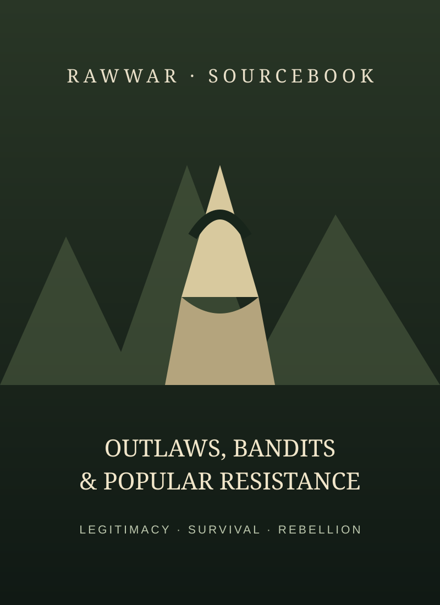

A careful treatment of outlawry, brigandage, social banditry, rebellion, insurgency, community legitimacy, and Robin Hood as a layered folklore tradition rather than a verified biography.

- [Read the sourcebook](outlaws-bandits-and-popular-resistance.md)
- [Book descriptor](outlaws-bandits-and-popular-resistance.book.json)

### Chinese Warfare

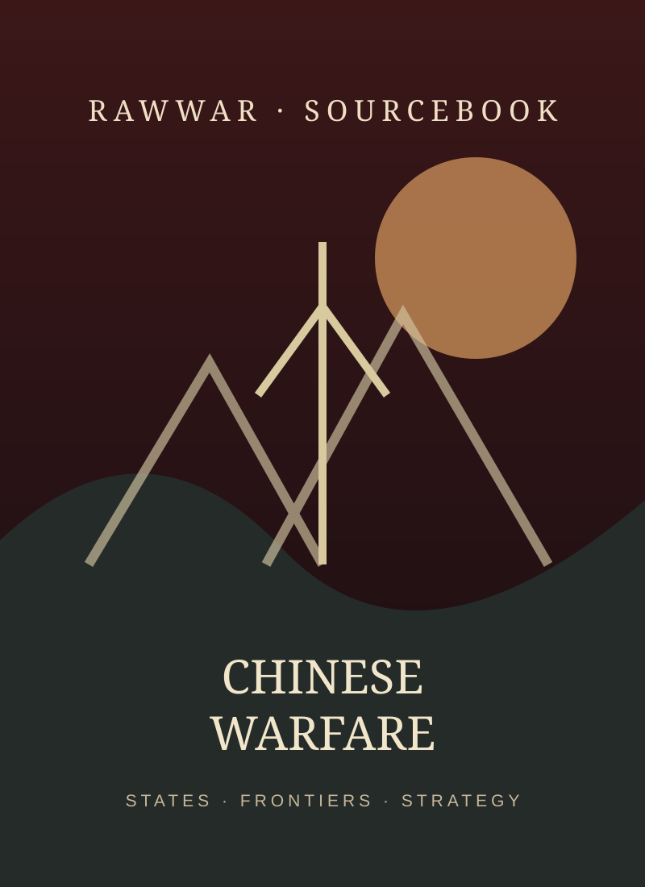

A periodized orientation to Chinese military history that resists treating millennia of changing states and institutions as one unchanging system.

- [Read the sourcebook](chinese-warfare.md)
- [Book descriptor](chinese-warfare.book.json)

### Science Fiction Warfare

A first-class speculative domain covering future terrestrial conflict, orbital and planetary infrastructure, autonomous systems, cyber and information conflict, habitat defense, interstellar campaigns, and ethical consequences. It explicitly distinguishes established facts from extrapolation and invented setting rules.

- [Read the sourcebook](science-fiction-warfare.md)
- [Book descriptor](science-fiction-warfare.book.json)

### Japanese Warfare

Descriptor: [japanese-warfare.book.json](japanese-warfare.book.json)

A periodized study from early state formation through warrior governments, Sengoku conflict, unification, Tokugawa peace, modern transformation, imperial war, and postwar memory.

[Read Japanese Warfare](japanese-warfare.md)

### Orbital Warfare and Space Infrastructure

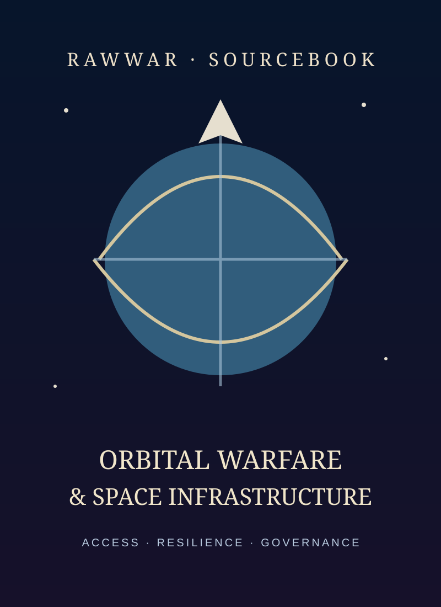

Descriptor: [orbital-warfare-and-space-infrastructure.book.json](orbital-warfare-and-space-infrastructure.book.json)

A systems-level study of orbital services, infrastructure dependencies, access, resilience, governance, escalation, and civilian consequences, with clear boundaries between known physics and speculative settings.

[Read Orbital Warfare and Space Infrastructure](orbital-warfare-and-space-infrastructure.md)

## Dedicated Iranian imperial sourcebooks

The Persian overview now has three focused companion volumes. These books distinguish the Achaemenid, Parthian/Arsacid, and Sasanian states rather than projecting one military system across nearly a millennium.

### Achaemenid Warfare
Achaemenid royal authority, provincial mobilization, multi-community forces, campaign logistics, Greek and Persian evidence, and imperial succession.
- [Read the sourcebook](achaemenid-warfare.md)
- [Book descriptor](achaemenid-warfare.book.json)

### Parthian Warfare
Arsacid elite politics, mounted capabilities, horse supply, Roman-Parthian campaigns, frontier diplomacy, and the role of cities and fortresses.
- [Read the sourcebook](parthian-warfare.md)
- [Book descriptor](parthian-warfare.book.json)

### Sasanian Warfare
Sasanian military institutions, cavalry and combined capabilities, frontier fortifications, siege endurance, diplomacy, and the seventh-century transformation.
- [Read the sourcebook](sasanian-warfare.md)
- [Book descriptor](sasanian-warfare.book.json)

## Steppe empires and Viking-age networks

### Mongol Warfare
A study of the Mongol Empire's political formation, steppe ecology, mounted mobility, command, intelligence, adaptation to siege warfare, regional campaigns, and successor khanates. It distinguishes the early unified empire from later states and avoids reducing diverse populations to a single identity.
- [Read the sourcebook](mongol-warfare.md)
- [Book descriptor](mongol-warfare.book.json)

### Viking-Age Warfare
A regional study of Scandinavian maritime activity, ships, raiding, trade, settlement, armed groups, and state formation across the North Atlantic, British Isles, Baltic, eastern river routes, and neighboring regions.
- [Read the sourcebook](viking-age-warfare.md)
- [Book descriptor](viking-age-warfare.book.json)

## Roman warfare — focused studies

### Roman Republican Warfare
Civic and allied manpower, changing republican institutions, command, Mediterranean expansion, naval adaptation, and the late-Republican civil-war crisis.
- [Read the sourcebook](roman-republican-warfare.md)
- [Book descriptor](roman-republican-warfare.book.json)

### The Roman Imperial Army
Imperial legions and auxiliary forces, recruitment, service and military society, frontier zones, logistics, imperial politics, and late antique transformation.
- [Read the sourcebook](roman-imperial-army.md)
- [Book descriptor](roman-imperial-army.book.json)

## Science-fiction warfare — planetary settlement systems

### Planetary Defense and Habitat Conflict
A high-level, civilian-centered systems study of planetary defense, habitat life-support resilience, governance, security, law, autonomy, and de-escalation. The book labels established, extrapolated, speculative, and fictional claims separately and deliberately avoids real-world infrastructure attack procedures.
- [Read the sourcebook](planetary-defense-and-habitat-conflict.md)
- [Book descriptor](planetary-defense-and-habitat-conflict.book.json)

## Latest LOD 2 expansion — Roman conflict and machine agency

### Roman Civil Wars

A focused study from the Social War through Sulla, Caesar, the triumvirates, and the Augustan settlement. It treats civil war as a crisis of legitimacy, military allegiance, finance, coalition politics, and civilian life.

- [Read the sourcebook](roman-civil-wars.md)
- [Book descriptor](roman-civil-wars.book.json)

### Eastern Roman Warfare

A periodized study of the eastern Roman state from late antiquity through 1453. It examines changing military institutions, fiscal capacity, diplomacy, fortifications, naval power, and regional strategy without treating a millennium as one static system.

- [Read the sourcebook](eastern-roman-warfare.md)
- [Book descriptor](eastern-roman-warfare.book.json)

### Autonomous Systems and Machine Agency

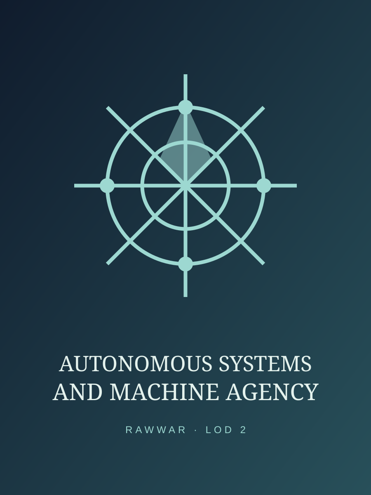

A science-fiction companion on delegated authority, human oversight, accountability, reliability, escalation, civilian protection, and the conditions under which machine entities might become political actors. It distinguishes established systems from extrapolated, speculative, and fictional premises.

- [Read the sourcebook](autonomous-systems-and-machine-agency.md)
- [Book descriptor](autonomous-systems-and-machine-agency.book.json)

These books continue the historical Roman sequence and develop science-fiction warfare as a first-class domain. They are knowledge and worldbuilding resources, not executable doctrine or instructions for attacking real systems.

## Latest LOD 2 expansion — interstellar systems and first contact

### Interstellar Logistics and Strategy

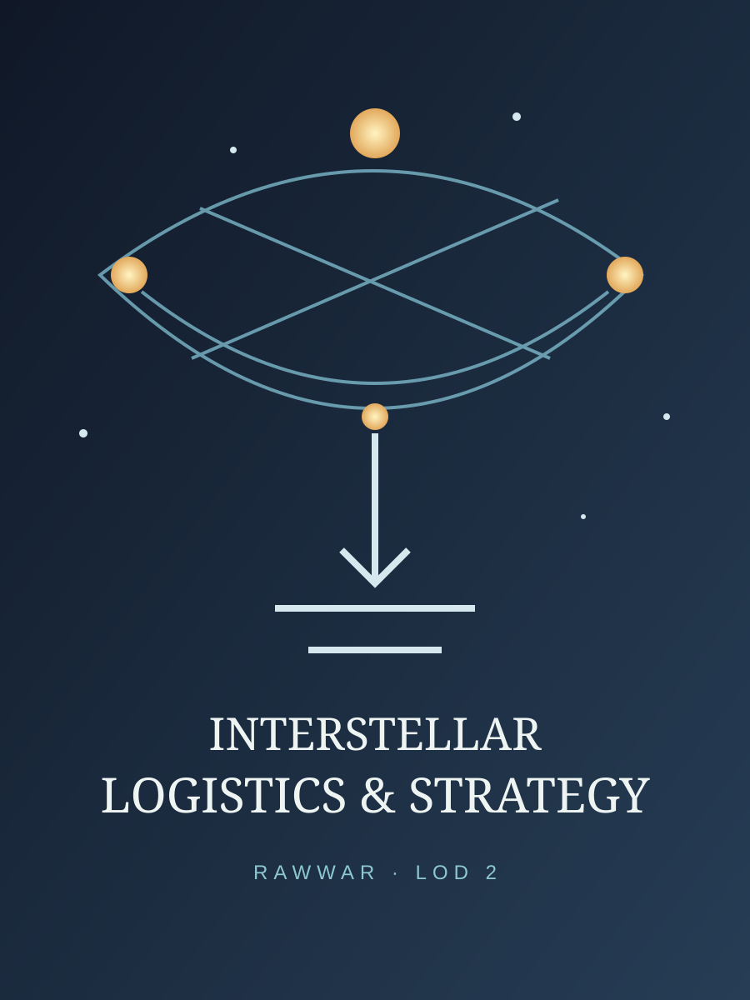

A strategic systems study of interstellar distance, light-time, transport, energy, life support, industrial capacity, network topology, political reach, and civilian sustainment. Known physical constraints are separated from extrapolated engineering and fictional travel rules.

- [Read the sourcebook](interstellar-logistics-and-strategy.md)
- [Book descriptor](interstellar-logistics-and-strategy.book.json)

### Alien Contact, Diplomacy, and Conflict

A framework for verifying contact, interpreting unfamiliar signals, biological uncertainty, representation, diplomacy, security dilemmas, escalation, restraint, and machine intermediaries. It treats alien intelligence as unconfirmed and avoids assuming either universal hostility or universal cooperation.

- [Read the sourcebook](alien-contact-diplomacy-and-conflict.md)
- [Book descriptor](alien-contact-diplomacy-and-conflict.book.json)

Both books are setting and research frameworks, not claims of imminent interstellar capability or confirmed extraterrestrial contact. Continue to label established, extrapolated, speculative, and fictional premises explicitly.

## LOD 3 — alien civilization histories and political systems

### Alien Civilizations and Political Systems

A reusable framework for building fictional civilizations through historical transitions, constitutional orders, institutions, factions, strategic culture, infrastructure, armed organizations, diplomacy, and campaign histories. It rejects species-wide personalities and distinguishes regimes, states, populations, institutions, and armed forces.

- [Read the sourcebook](alien-civilizations-and-political-systems.md)
- [Book descriptor](alien-civilizations-and-political-systems.book.json)

This LOD 3 volume deepens [Alien Contact, Diplomacy, and Conflict](alien-contact-diplomacy-and-conflict.md) by giving setting authors a way to construct internally diverse societies before writing contact or conflict. It also links to interstellar logistics, autonomous agency, and planetary habitat resilience. All civilization examples remain fictional; no extraterrestrial civilization is confirmed.

## LOD 3 — a worked alien civilization and campaign

### The Nacrean Compact and the Tidal Archive Crisis

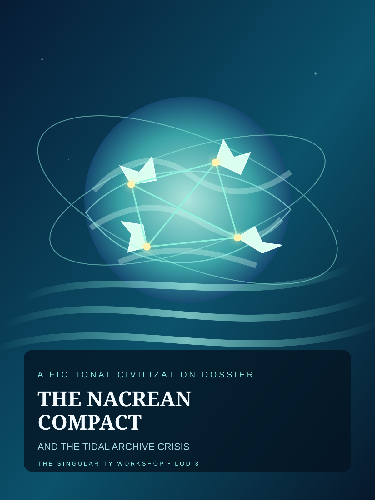

A fully fictional civilization dossier and campaign history. The Nacrean Compact is a distributed ocean-world polity with overlapping jurisdictions, competing coalitions, unequal political membership, shared life-support infrastructure, and a public archive whose disputed records trigger a constitutional crisis. The campaign explores evidence provenance, service continuity, emergency authority, civilian agency, lawful restraint, and negotiated institutional reform rather than assuming that conflict must culminate in battle.

- [Read the sourcebook](nacrean-compact-and-tidal-archive-crisis.md)
- [Book descriptor](nacrean-compact-and-tidal-archive-crisis.book.json)

This LOD 3 case study applies [Alien Civilizations and Political Systems](alien-civilizations-and-political-systems.md) and cross-links to alien contact, interstellar logistics, planetary habitat resilience, and autonomous systems governance. Its world, people, institutions, and history are fictional; no extraterrestrial civilization is confirmed.

## LOD 3 — connected Pelagos regional theatre

### The Serein Passage Treaties and the Three-Current Crisis

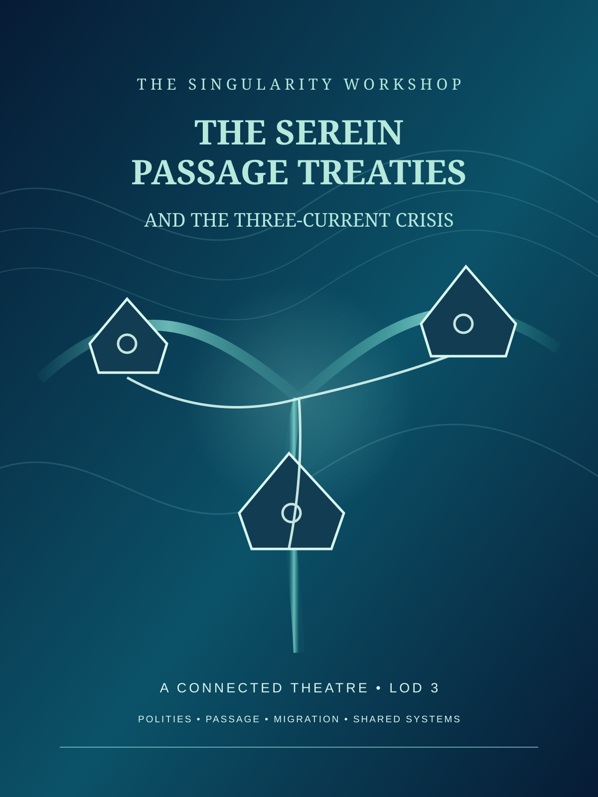

A connected fictional regional setting that expands the Nacrean Compact beyond a single polity. It introduces the Vey Shelf Assemblies, Orison Works League, Outer Drift Mutuals, and Serein Passage Commission; layered rescue and passage treaties; trade and migration networks; shared civilian infrastructure; and a multi-sided crisis over evidence, access, and regional legitimacy.

- [Read the sourcebook](serein-passage-treaties-and-three-current-crisis.md)
- [Book descriptor](serein-passage-treaties-and-three-current-crisis.book.json)

This volume is a direct companion to [The Nacrean Compact and the Tidal Archive Crisis](nacrean-compact-and-tidal-archive-crisis.md). It treats the basin as a connected political and logistical theatre rather than a map of isolated flags. Its setting is fictional; it does not imply confirmed extraterrestrial life.

## Medicine and healing — a new sourcebook family

### Medicine and Healing: History, Practice, and Play

A foundational LOD 2 manual treating medicine as history, science, care work, logistics, ethics, and a playable profession. It covers healing traditions across time, military casualty chains, triage, the medic's HUD, severe trauma, the fictional hypersonic scalpel, the difference between CPR and defibrillation, fantasy restoration rules, and evidence-labeled future medicine.

- [Read the sourcebook](medicine-and-healing.md)
- [Book descriptor](medicine-and-healing.book.json)

The book is explicitly educational and game-design material, not clinical training or a treatment protocol. Real medical care requires qualified professionals and current guidance. Its central game-design rule is that the medic connects the casualty to a care system: observation, prioritization, authorized intervention, reassessment, evacuation, handoff, and recovery.

Planned companion volumes:
- **Healing Across the Centuries** — global and periodized histories of care, surgery, public health, hospitals, and medical ideas.
- **Battlefield Medicine and the Casualty Chain** — military medical organizations, triage history, evacuation, and trauma systems.
- **Surgery, Amputation, and Prosthetic Futures** — historical surgery, anesthesia, infection control, limb loss, prosthetics, and rehabilitation.
- **Medicine at Sea, in Space, and on the Frontier** — remote care, constrained supply, delayed evacuation, and habitat medicine.
- **Fantasy Healing and the Laws of Restoration** — magic, resurrection, consent, costs, limits, and social consequences.
- **Future Medicine and Human-Machine Care** — robotics, AI decision support, regenerative medicine, and autonomous facilities.
- **Medical Ethics, Law, and Protected Care** — impartiality, consent, prisoners, civilians, medical personnel, and accountability.
- **Alien and Posthuman Physiology** — cross-species diagnosis, augmented bodies, and unknown biological risks.

### Healing Across the Centuries

A comparative historical companion covering care before medical professions, early urban traditions, classical and medieval worlds, global exchange, early modern medicine, nineteenth-century transformations, war, public health, disability, and recovery. It treats medical history as multiple changing traditions rather than a single march toward modernity.

- [Read the sourcebook](healing-across-the-centuries.md)
- [Book descriptor](healing-across-the-centuries.book.json)

This volume deepens [Medicine and Healing: History, Practice, and Play](medicine-and-healing.md). Further work should create carefully researched regional and period-specific studies rather than treating any broad civilization label as one uniform medical system.

## Formations, bases, and sustainment

This family treats formations, bases, and resupply as connected systems. Land, naval, and air formations have different physical and command constraints; camps and bases are service networks; resupply connects them to the wider economy and logistics chain.

### Formations I: Land Forces

Recursive land formations, from small teams through larger field organizations, with training, ghost slots, transitions, and scoring.

- [Read the sourcebook](formations-i-land-forces.md)
- [Book descriptor](formations-i-land-forces.book.json)
- [Cover](covers/formations-i-land-forces.svg)

### Formations II: Naval Forces

Fleet geometry, station keeping, convoys, amphibious groups, mixed-domain coordination, and maritime maneuver.

- [Read the sourcebook](formations-ii-naval-forces.md)
- [Book descriptor](formations-ii-naval-forces.book.json)
- [Cover](covers/formations-ii-naval-forces.svg)

### Formations III: Air Forces

Three-dimensional formation geometry, flight coordination, human factors, autonomy, and aerospace boundaries.

- [Read the sourcebook](formations-iii-air-forces.md)
- [Book descriptor](formations-iii-air-forces.book.json)
- [Cover](covers/formations-iii-air-forces.svg)

### Bases and Encampments

Temporary camps, Roman castra, mobile formations, fortified bases, services, civilian relationships, and continuity.

- [Read the sourcebook](bases-and-encampments.md)
- [Book descriptor](bases-and-encampments.book.json)
- [Cover](covers/bases-and-encampments.svg)

### The Art of Resupply

Supply networks, demand, transport, repair, medical logistics, contested routes, allocation, and sustainment.

- [Read the sourcebook](the-art-of-resupply.md)
- [Book descriptor](the-art-of-resupply.book.json)
- [Cover](covers/the-art-of-resupply.svg)

### Battlefield Medicine and the Casualty Chain

Casualty movement, triage context, evacuation, handoff, medic HUD, ghost actions, and fictional exoskeleton cardiac support.

- [Read the sourcebook](battlefield-medicine-and-the-casualty-chain.md)
- [Book descriptor](battlefield-medicine-and-the-casualty-chain.book.json)
- [Cover](covers/battlefield-medicine-and-the-casualty-chain.svg)
### Formations IV: Mounted and Cavalry Forces

Mounted organizations across historical and fictional settings, including cavalry, mounted infantry, scouts, couriers, chariots, remount systems, dismounted transitions, animal welfare, and the logistics that sustain living mounts.

- [Read the sourcebook](formations-iv-mounted-and-cavalry.md)
- [Book descriptor](formations-iv-mounted-and-cavalry.book.json)
- [Cover](covers/formations-iv-mounted-and-cavalry.svg)

This volume extends [Formations I: Land Forces](formations-i-land-forces.md) without treating mounted forces as infantry with animals attached. It cross-links the Mongol, Parthian, and Sasanian studies while preserving their distinct histories.

### Formations V: Mechanized and Armored Forces

Mechanized and armored organizations treated as connected systems of people, platforms, command, maintenance, recovery, supply, infrastructure, and civilian consequences.

- [Read the sourcebook](formations-v-mechanized-and-armored-forces.md)
- [Book descriptor](formations-v-mechanized-and-armored-forces.book.json)
- [Cover](covers/formations-v-mechanized-and-armored-forces.svg)

This volume extends [Formations I: Land Forces](formations-i-land-forces.md) and complements [Formations IV: Mounted and Cavalry Forces](formations-iv-mounted-and-cavalry.md). It preserves crew and dismounted-personnel identity independently from vehicle state, and links sustainment to [The Art of Resupply](the-art-of-resupply.md).

### Formations VI: Orbital and Space Forces

A dedicated formation manual for orbital and space organizations, distinct from naval and air formations. It treats orbital state, epoch, reference frame, relative motion, station keeping, communications delay, crew identity, autonomous authority, shared infrastructure, rescue, debris, and civilian consequences as connected concerns.

- [Read the sourcebook](formations-vi-orbital-and-space-forces.md)
- [Book descriptor](formations-vi-orbital-and-space-forces.book.json)
- [Cover](covers/formations-vi-orbital-and-space-forces.svg)

This volume complements [Orbital Warfare and Space Infrastructure](orbital-warfare-and-space-infrastructure.md), which covers the wider security, governance, and infrastructure domain. It also connects to [Interstellar Logistics and Strategy](interstellar-logistics-and-strategy.md) without conflating established orbital mechanics with speculative interstellar travel.

### Formations VII: Amphibious and Littoral Forces

A cross-domain formation manual centered on the sea-to-shore transition: embarked organizations, transfer assets, coastal and riverine environments, port infrastructure, command authority, sustainment throughput, medical movement, civilian dependencies, and humanitarian response.

- [Read the sourcebook](formations-vii-amphibious-and-littoral-forces.md)
- [Book descriptor](formations-vii-amphibious-and-littoral-forces.book.json)
- [Cover](covers/formations-vii-amphibious-and-littoral-forces.svg)

This volume joins [Formations I: Land Forces](formations-i-land-forces.md) and [Formations II: Naval Forces](formations-ii-naval-forces.md) without collapsing amphibious organizations into either domain. It connects shore sustainment to [The Art of Resupply](the-art-of-resupply.md) and persistent facilities to [Bases and Encampments](bases-and-encampments.md).

### Formations VIII: Special Operations and Irregular Forces

A comparative organizational study distinguishing specialized regular military units from irregular armed groups, resistance movements, insurgencies, partisan organizations, militias, auxiliaries, proxies, and clandestine civic networks. It centers political context, civilian agency, accountability, fragmentation, and demobilization, while excluding actionable operational tradecraft.

- [Read the sourcebook](formations-viii-special-operations-and-irregular-forces.md)
- [Book descriptor](formations-viii-special-operations-and-irregular-forces.book.json)
- [Cover](covers/formations-viii-special-operations-and-irregular-forces.svg)

This volume extends the formations family beyond conventional domain types and cross-links [Outlaws, Bandits, and Popular Resistance](outlaws-bandits-and-popular-resistance.md). It does not equate irregularity with illegitimacy or specialization with virtue.

### Formations IX: Engineering and Construction Forces

A reusable manual for engineering organizations and projects: bridge trains, temporary crossings, floating bridges, ferries, route infrastructure, field works, utilities, repair, recovery, civilian labor, and handover. The crossing is treated as a temporary service and maneuver dependency, not simply a permanent structure.

- [Read the sourcebook](formations-ix-engineering-and-construction-forces.md)
- [Book descriptor](formations-ix-engineering-and-construction-forces.book.json)
- [Cover](covers/formations-ix-engineering-and-construction-forces.svg)

### Formations X: Armadas and Flotillas

A fleet-formation manual spanning armadas, flotillas, squadrons, task forces, escorts, transports, auxiliaries, coalition command, sustainment, ports, repair, and civilian maritime systems. It treats fleet cohesion as organizational and logistical, not merely geometric.

- [Read the sourcebook](formations-x-armadas-and-flotillas.md)
- [Book descriptor](formations-x-armadas-and-flotillas.book.json)
- [Cover](covers/formations-x-armadas-and-flotillas.svg)

### Planetary Assault and Expeditionary Doctrine

A science-fiction doctrine framework for the transition from orbital presence to surface operations, expeditionary force composition, reception systems, foothold governance, planetary logistics, civilian protection, and escalation. It is not amphibious warfare with a different backdrop: orbital mechanics, atmosphere, gravity, biology, infrastructure, and local political authority change the problem.

- [Read the sourcebook](planetary-assault-and-expeditionary-doctrine.md)
- [Book descriptor](planetary-assault-and-expeditionary-doctrine.book.json)
- [Cover](covers/planetary-assault-and-expeditionary-doctrine.svg)

This planetary volume connects [Planetary Defense and Habitat Conflict](planetary-defense-and-habitat-conflict.md), [Orbital Warfare and Space Infrastructure](orbital-warfare-and-space-infrastructure.md), [Formations VI](formations-vi-orbital-and-space-forces.md), [Formations VII](formations-vii-amphibious-and-littoral-forces.md), and [Interstellar Logistics and Strategy](interstellar-logistics-and-strategy.md). It does not assume that an arrival establishes legitimate control.

## Resource, industry, and interstellar strategy — LOD 2

### Military Resources and Sustainment

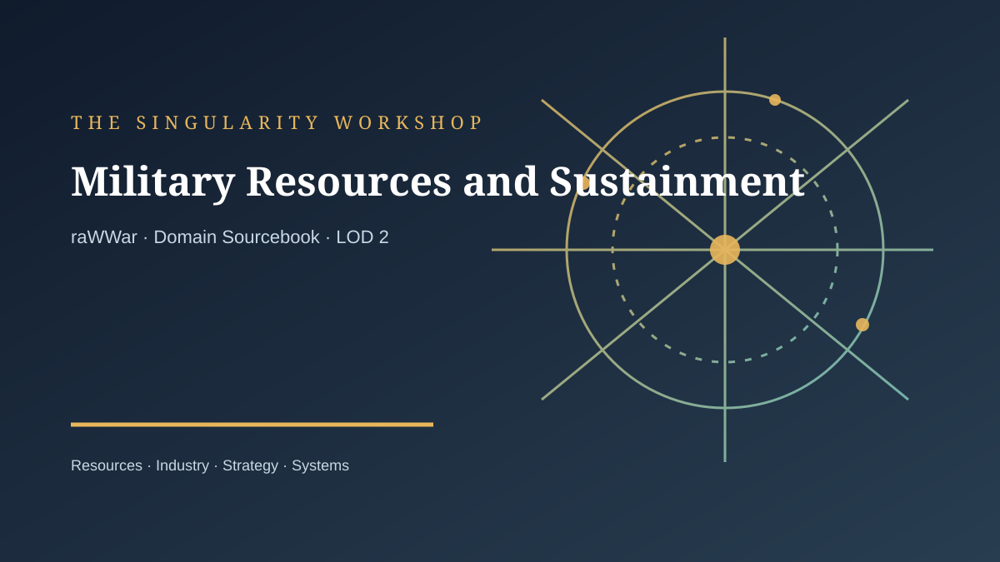

Descriptor: [military-resources-and-sustainment.book.json](military-resources-and-sustainment.book.json)

A lifecycle study of the resources that make organized forces possible: food, water, energy, materials, labor, finance, transport, maintenance, recovery, and the human and political consequences of scarcity.

[Read Military Resources and Sustainment](military-resources-and-sustainment.md)

### Extraction, Materials, and Industrial Foundations

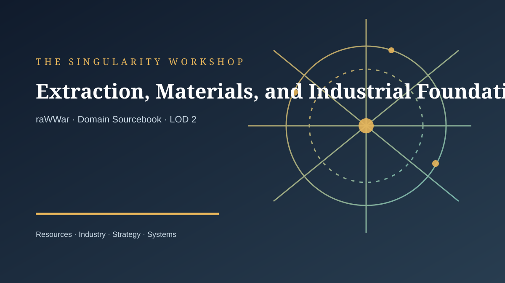

Descriptor: [extraction-materials-and-industrial-foundations.book.json](extraction-materials-and-industrial-foundations.book.json)

A comparative study of resource extraction and industrial transformation, from terrestrial agriculture, mines, forests, and refineries to extraterrestrial prospecting, in-situ resource use, and the economics of materials across different worlds.

[Read Extraction, Materials, and Industrial Foundations](extraction-materials-and-industrial-foundations.md)

### Orbital Industry and Strategic Resource Networks

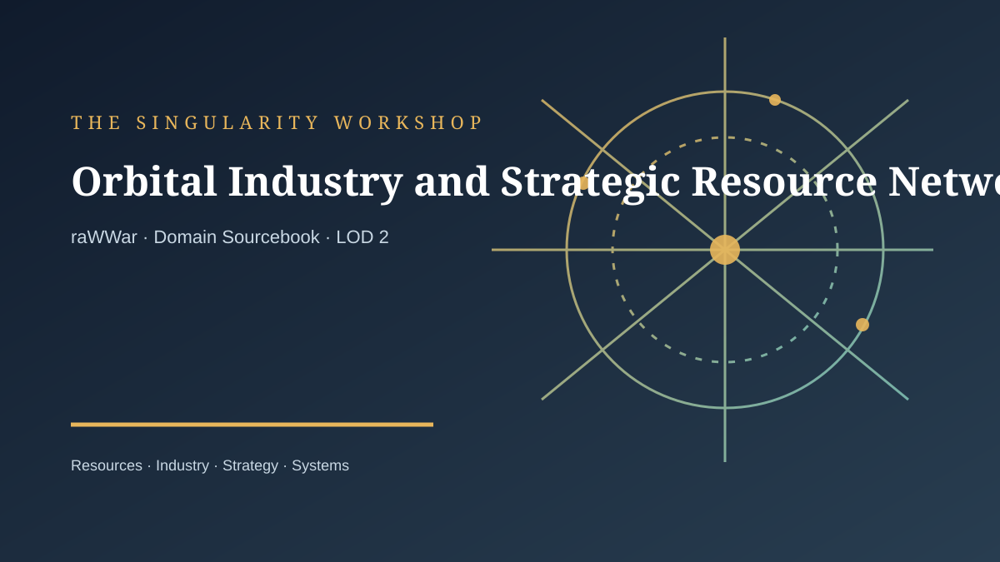

Descriptor: [orbital-industry-and-strategic-resource-networks.book.json](orbital-industry-and-strategic-resource-networks.book.json)

A systems-level study of off-world industrial infrastructure, asteroid prospecting and capture concepts, processing centers, depots, transport networks, and the physics, governance, and resilience constraints that shape a solar-system economy.

[Read Orbital Industry and Strategic Resource Networks](orbital-industry-and-strategic-resource-networks.md)

### Interstellar Economies and Multi-System War

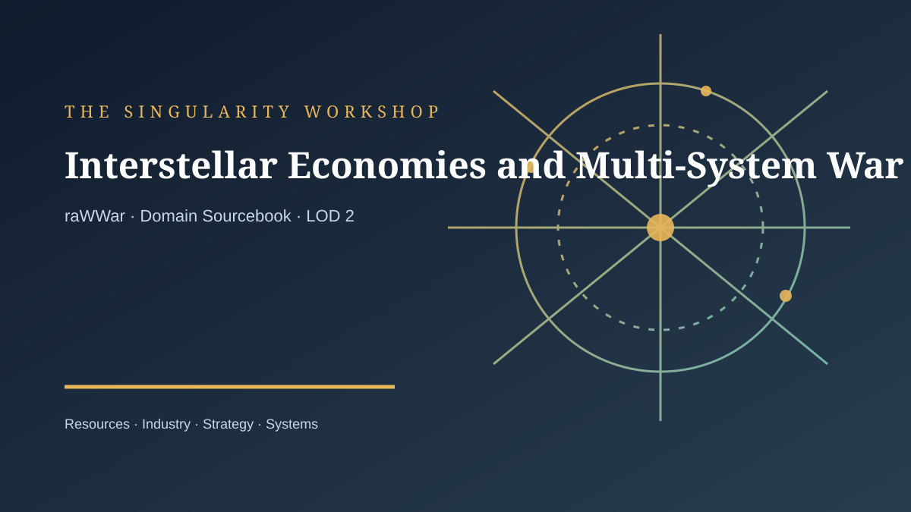

Descriptor: [interstellar-economies-and-multi-system-war.book.json](interstellar-economies-and-multi-system-war.book.json)

A long-horizon framework for imperial and interstellar political economies, multi-star-system logistics, strategic autonomy, mobilization, communication delay, and conflicts across civilizations spanning millions of worlds.

[Read Interstellar Economies and Multi-System War](interstellar-economies-and-multi-system-war.md)

## Military production and industrial mobilization — LOD 2

### Military Industry and Wartime Production

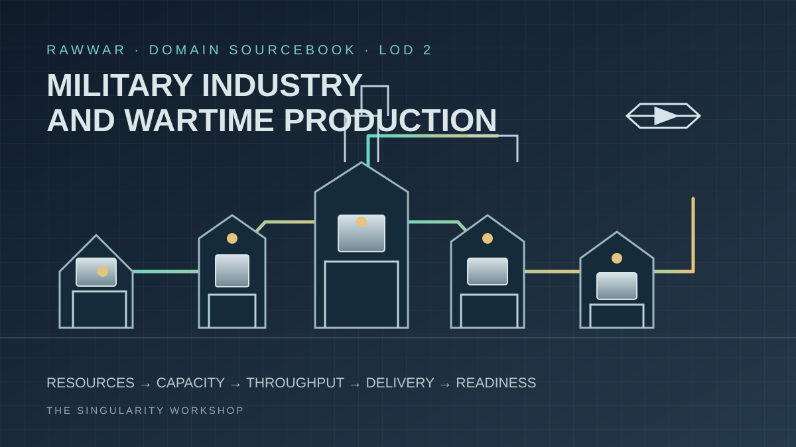

A systems-level study of how resources, labor, energy, capital, technical knowledge, procurement, and industrial institutions become military capability. It distinguishes installed capacity, available capacity, throughput, accepted delivery, and operational readiness, and examines shipyards, aircraft, spacecraft, orbital industry, mobilization, repair, quality, bottlenecks, and civilian trade-offs.

- [Read the sourcebook](military-industry-and-wartime-production.md)
- [Book descriptor](military-industry-and-wartime-production.book.json)

## Contemporary warfare — Russia–Ukraine war (LOD 2)

### The Russia–Ukraine War: Drone, Robotic, and Industrial Adaptation

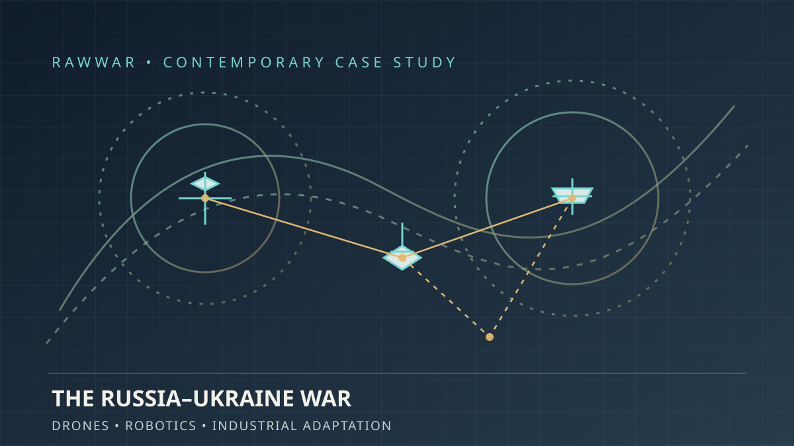

A living, evidence-disciplined case study of the 2014–present war, emphasizing drones, ground and maritime robotics, electronic warfare, air defense, industrial adaptation, logistics, civilian life, law, and the human cost. It distinguishes verified records, attributed claims, disputed assessments, and unknowns.

- [Read the sourcebook](russia-ukraine-war-drone-robotic-and-industrial-adaptation.md)
- [Book descriptor](russia-ukraine-war-drone-robotic-and-industrial-adaptation.book.json)
