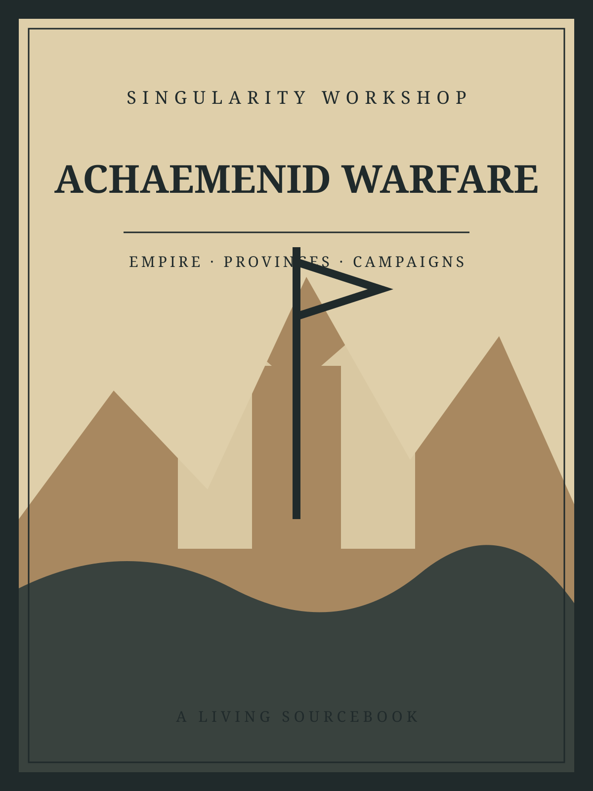

# SURPS — Domain — LOD 2 — Achaemenid Warfare

**Scope:** The Achaemenid Empire from its emergence under Cyrus II to its conquest by Alexander, with emphasis on institutions, campaigns, logistics, and regional diversity.  
**Status:** LOD 2 historical sourcebook / first edition.  
**Descriptor:** [achaemenid-warfare.book.json](achaemenid-warfare.book.json)

## 1. The empire and its military problem

The Achaemenid Empire (c. 550–330 BCE) governed an immense and diverse territory extending from the eastern Mediterranean and Egypt across Iran and Central Asia toward the Indus. Its armed power cannot be understood as a single standing army in the modern sense. The king's forces drew on royal household resources, provincial authorities, allied rulers, subject communities, garrisons, fleets, and specialists assembled for particular needs.

The central military problem was imperial coordination: how to mobilize people, animals, supplies, ships, intelligence, and local knowledge across great distances while preserving political authority. Scale created opportunity and friction at once. The empire's military history is therefore inseparable from administration, roads, taxation, diplomacy, local elites, and the negotiated obligations of subject territories.

## 2. Royal authority and provincial forces

Royal command was expressed through the king, court, commanders, satraps, and local authorities. Satrapal responsibilities and powers varied over time and place; avoid assuming that every province had an identical military structure or that every satrap was an autonomous warlord. Royal inspection, court politics, dynastic competition, local loyalties, and communication delays shaped the practical reach of central authority.

Imperial forces could include Persian and Median contingents, cavalry, infantry, archers, engineers, transport personnel, naval crews, and troops supplied by many subject peoples and allied rulers. Their equipment and battlefield roles differed. A list of ethnic contingents in a Greek narrative is not a complete order of battle, and an imperial muster should not be mistaken for a permanent standardized formation.

## 3. The army as a coalition of capabilities

Achaemenid military strength was composite. Cavalry provided mobility, reconnaissance, raiding, escort, and battlefield roles. Infantry formations varied in equipment, training, and tactical function. Missile troops could shape an engagement without independently deciding it. Engineers and labor forces enabled crossings, camps, roads, siege works, and logistical infrastructure. Naval power depended on coastal communities, shipbuilding, crews, ports, and political control of maritime resources.

The famous royal guard formations matter as symbols and institutions, but they should not eclipse the larger imperial system. Numbers reported by ancient authors are often rhetorically amplified or difficult to verify. Use ranges and confidence labels rather than treating every ancient total as census data.

## 4. Campaigns and strategic geography

A campaign's feasibility depended on season, route, water, fodder, pack animals, roads, river crossings, local provisioning, and the ability to coordinate forces arriving from different regions. The empire's road and relay systems supported communication and movement, but they did not eliminate distance or environmental constraints. Mountain corridors, deserts, river valleys, coastal routes, and steppe margins created different operational problems.

The Greek-Persian Wars are central episodes, not the entirety of Achaemenid military history. Campaigns in Egypt, Anatolia, Babylonia, Central Asia, and the eastern frontier reveal different combinations of imperial bargaining, local revolt, cavalry, fortified places, and supply. The empire also fought internal succession conflicts and rebellions; these should be studied as political crises with military dimensions rather than as simple foreign invasions.

## 5. The Greek sources and the imperial record

Herodotus, Xenophon, Ctesias, and later Greek and Roman authors preserve important evidence, but each has a perspective, literary purpose, and transmission history. Greek accounts often frame Persian forces through the concerns of Greek communities. They can exaggerate numbers, simplify institutions, and turn complex imperial politics into moral contrasts.

Balance them with royal inscriptions, administrative tablets, archaeology, coinage, seals, monuments, art, and regional histories. Persian royal inscriptions are political statements, not neutral reports; administrative documents illuminate particular transactions and places, not the whole empire. Every source type has strengths and limits.

## 6. Rebellion, succession, and imperial resilience

Achaemenid military history includes provincial revolts, contested accessions, court struggles, and the negotiation of loyalty. The empire's durability depended not only on battlefield victory but on restoring administration, securing routes, rewarding allies, and re-establishing legitimate authority. A revolt in one region might reflect local grievances, elite rivalry, dynastic opportunity, or external intervention; the causes should be reconstructed rather than presumed.

The conquest by Alexander was a sequence of campaigns and political transformations, not an inevitable outcome of a supposedly inferior system. Macedonian command, tactical adaptation, Persian political divisions, regional resistance, strategic choices, and the changing legitimacy of rulers all matter. The aftermath included continuities as well as ruptures.

## 7. Tabletop and simulation applications

An Achaemenid scenario should model imperial scale through political relationships and logistics rather than simply granting an enormous pool of identical troops. Useful variables include:
- provincial loyalty and local elite cooperation;
- mobilization time and contingent arrival windows;
- route capacity, water, fodder, and animal replacement;
- command latency and information quality;
- fleet access, port infrastructure, and seasonal conditions;
- garrison commitments that reduce field strength;
- legitimacy costs of coercion and the consequences of negotiated settlements.

Keep documented evidence separate from scenario assumptions. When a force total, route, or command relationship is uncertain, expose that uncertainty in the scenario rather than hiding it behind false precision.

## 8. Research anchors and source discipline

Begin with the Achaemenid chapters in modern scholarly histories of ancient Iran and the Persian Empire; consult royal inscriptions in translation, Persepolis Fortification and Treasury documentation, archaeological studies, and regional scholarship. Read Herodotus and Xenophon critically and in context. The [Metropolitan Museum of Art's Achaemenid Persian Empire essay](https://www.metmuseum.org/essays/the-achaemenid-persian-empire-550-330-b-c) is a useful accessible orientation, not a substitute for specialist literature.

Do not reproduce modern translations without permission. Summarize ancient texts in original prose and identify the edition or translation consulted when making close textual claims.

## 9. Cross-references

- [Persian Warfare](persian-warfare.md) — comparative overview of Achaemenid, Parthian, and Sasanian traditions.
- [Greek Warfare](greek-warfare.md) — Greek polities, Persian Wars, and the Macedonian campaigns.
- [The Art of War](the-art-of-war.md) — strategic thought and its historical reception.
- [Fortifications and Strongholds](fortifications-and-strongholds.md) — defensive places, sieges, and sustainment.
- Future focused studies: Persian Wars; Ionian Revolt; campaigns of Cyrus and Darius; Alexander's invasion; Achaemenid roads and logistics; imperial fleets; satrapal revolts.

Achaemenid warfare was an imperial system of many communities, institutions, and environments. Its power and vulnerabilities become visible only when the whole system—not a caricature of a single army—is studied.