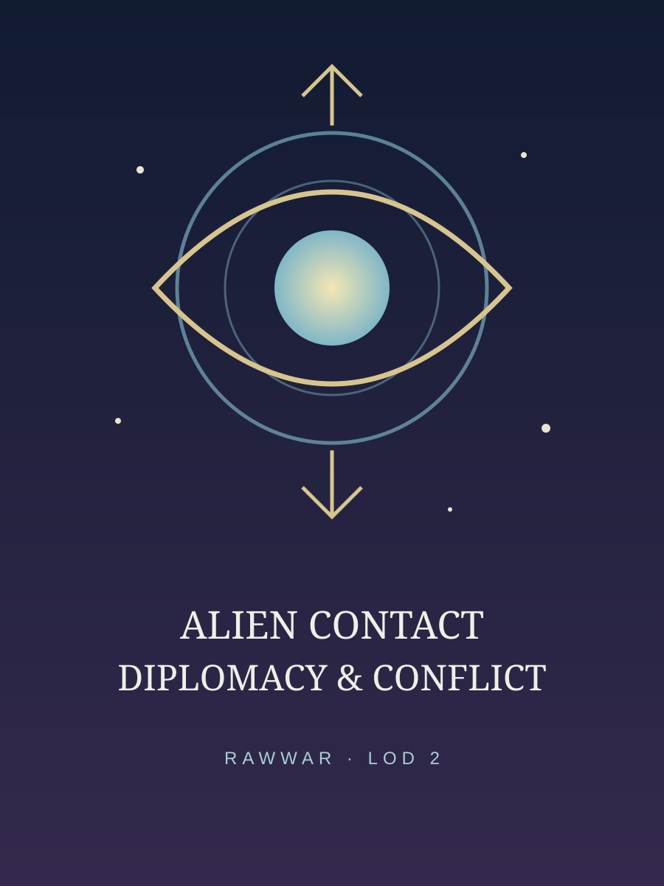

# Alien Contact, Diplomacy, and Conflict

**Domain:** raWWar  
**LOD:** 2  
**Status:** Speculative setting and research framework  
**Scope:** First contact, communication, diplomacy, political recognition, competition, conflict prevention, and the consequences of encountering non-human intelligence.

## Purpose

Contact with an extraterrestrial intelligence is not automatically a battle, an alliance, an invasion, or even a conversation. It is an encounter between agents whose biology, cognition, history, technologies, institutions, and concepts of personhood may be radically different—or unexpectedly familiar. The first strategic task is not to decide whether the other is friend or enemy. It is to establish what can be known, what remains uncertain, and how to avoid irreversible harm while learning.

This book treats alien contact as a political and social process with possible warfare consequences. It is not a prediction that extraterrestrial civilizations exist or that contact is imminent. It offers a disciplined framework for science fiction and simulation.

Related volumes:
- [Science Fiction Warfare](science-fiction-warfare.md) — broad future-facing domain.
- [Interstellar Logistics and Strategy](interstellar-logistics-and-strategy.md) — distance, networks, sustainment, and political reach.
- [Orbital Warfare and Space Infrastructure](orbital-warfare-and-space-infrastructure.md) — infrastructure and local space systems.
- [Autonomous Systems and Machine Agency](autonomous-systems-and-machine-agency.md) — non-human and machine agency.
- [The Art of War](the-art-of-war.md) — strategic thought, studied with historical and textual discipline.

## 1. Evidence labels and epistemic humility

Use four labels consistently:

- **Established:** supported by current evidence or deployed capability. We have detected many planets beyond the Solar System; we have no confirmed evidence of extraterrestrial life or an extraterrestrial civilization.
- **Extrapolated:** a reasoned extension of known biology, ecology, communication theory, or political behavior, but not demonstrated for extraterrestrial societies.
- **Speculative:** depends on unresolved science or major assumptions about life, cognition, technology, or social organization.
- **Fictional:** a defined premise of a particular setting, such as telepathy, universal translators, faster-than-light diplomacy, or a shared interspecies legal code.

Do not turn absence of evidence into proof of absence. Do not turn possibility into probability. A signal, artifact, organism, or anomalous observation should be evaluated through independent verification, alternative explanations, and transparent uncertainty.

## 2. What counts as contact?

Contact is not a single event. It may take several forms:

1. **Remote technosignature:** a signal or other observation that may indicate technology.
2. **Unintentional encounter:** detection of emissions, artifacts, probes, or environmental traces without an apparent invitation.
3. **Robotic interaction:** exchange with an autonomous or remotely operated artifact.
4. **Biological encounter:** detection or recovery of non-terrestrial biological material.
5. **Deliberate communication:** an apparent attempt to exchange information.
6. **Physical encounter:** sustained interaction between representatives or communities.
7. **Political relationship:** recognition, negotiation, treaty, trade, rivalry, or conflict.

Each stage has different standards of evidence and risk. A machine probe may not represent a living civilization's current policy. A signal may be ancient. A biological sample may be non-sentient. A single representative may lack authority to bind a population.

## 3. The problem of interpretation

### 3.1 Shared signals do not guarantee shared meanings

Mathematics, physical constants, periodic phenomena, and carefully structured messages may provide common reference points. They do not automatically create shared concepts of ownership, consent, harm, identity, time, or obligation.

A translation system should expose uncertainty rather than hide it. It should distinguish:
- directly observed patterns;
- inferred reference;
- inferred intent;
- culturally loaded interpretation;
- unresolved ambiguity.

A fluent translation can still be wrong. A system that produces confident language is not necessarily demonstrating understanding.

### 3.2 Different senses and bodies

An intelligence may perceive through modalities unfamiliar to humans: chemical gradients, electric fields, magnetic structures, distributed touch, light polarization, or collective sensory networks. Its concept of an individual may not map neatly onto a human body.

Do not assume that a recognizable face, voice, gesture, or biological resemblance is necessary for personhood. Equally, do not assume that every complex pattern is an individual mind. Build tests for agency, continuity, memory, preference, and response without imposing one human template.

### 3.3 Time and cognition

A species with a different metabolic rate, lifespan, reproductive cycle, or computational substrate may experience time differently. A reply delayed by years may be normal rather than hostile. Rapid exchanges may overwhelm an entity that communicates slowly. A society of short-lived individuals may make commitments differently from one whose members persist for centuries.

These are extrapolations, not established facts about alien life.

## 4. First-contact protocol as a civic process

A credible first-contact process should not be controlled by a single military commander, corporation, laboratory, or charismatic intermediary. It requires distributed expertise and legitimate oversight.

A setting may include:
- scientific verification teams;
- linguistic and semiotic researchers;
- biological and environmental safety authorities;
- diplomats and legal scholars;
- representatives of affected communities;
- elected or otherwise accountable political institutions;
- independent review and public communication.

The first actions should be reversible where possible: observe, preserve evidence, limit contamination, document decisions, and communicate uncertainty. Avoid unilateral actions that could be interpreted as threats or that foreclose later choices.

A protocol should state who can pause contact, who can authorize a message, who represents affected populations, and how dissent is recorded.

## 5. Biological and ecological boundaries

**Established:** planetary environments can contain hazardous organisms and chemical conditions; terrestrial biological systems have complex ecological dependencies. **Speculative:** the biology, biochemistry, and pathogenic potential of extraterrestrial life.

Do not assume alien microbes will infect humans, nor that they will be harmless. Biological compatibility is a scientific question, not a narrative default. A setting should define its contamination rules and keep them consistent.

Prudent worldbuilding questions:
- Can the organisms share chemistry or metabolic pathways?
- What environmental conditions support them?
- Can material transfer alter either ecosystem?
- Are containment procedures scientifically credible within the setting?
- Who bears the cost of quarantine?
- How are the rights of a potentially sentient organism represented?
- What happens when safety restrictions conflict with rescue or diplomacy?

Do not use “alien biology” as a shortcut for arbitrary magic unless that is an explicit fictional rule.

## 6. Diplomacy without assumed equivalence

Diplomacy is the management of relationships among agents with interests and some capacity to make or honor commitments. It does not require identical institutions. It does require enough shared reference to identify representatives, communicate proposals, recognize consequences, and assess whether an agreement is being followed.

Potential diplomatic forms include:
- non-interference arrangements;
- scientific exchange;
- protected observation zones;
- transit and navigation agreements;
- resource-use protocols;
- mutual aid and rescue;
- quarantine and environmental safeguards;
- dispute resolution;
- limited recognition or reciprocal representation.

A treaty should specify scope, parties, authority, verification, duration, withdrawal, amendment, and consequences of breach. If one party is a distributed network, hive-like collective, machine polity, or non-hierarchical society, the question “Who can sign?” may have no simple answer.

## 7. Political recognition and representation

Recognition is not merely naming the other. It concerns who can speak, who is represented, and which decisions bind whom.

Distinguish:
- an individual envoy;
- a local community;
- a species or biological lineage;
- a political state;
- a coalition;
- a machine or distributed network;
- a diaspora;
- a non-state organization;
- a group that rejects the proposed representative.

No single actor should be assumed to speak for all members of a species. Internal disagreement is likely in any complex society, though the form it takes is setting-dependent. Avoid assigning one motive, culture, or political position to an entire species.

## 8. Competition and conflict

Conflict can arise from incompatible claims, fear, misinterpretation, resource scarcity, security dilemmas, historical grievance, internal political competition, or accidents. None is inevitable.

A useful escalation model:
1. **Uncertainty:** actors do not know what the other is or intends.
2. **Interpretive divergence:** signals or actions acquire incompatible meanings.
3. **Political contest:** institutions disagree over access, recognition, risk, or authority.
4. **Coercive pressure:** threats, exclusion, sanctions, or demonstrations of capability.
5. **Limited confrontation:** a bounded incident causes harm or loss.
6. **Wider conflict:** coalitions, retaliation, or incompatible objectives expand the dispute.
7. **Settlement or rupture:** parties establish new rules, disengage, or continue a costly rivalry.

The stages are analytical, not inevitable or strictly linear. De-escalation can occur at every stage. A story should identify the choices and institutions that make escalation more or less likely.

This volume stays at the level of political dynamics, protection, and consequences. It does not provide tactical instructions for harming real people or exploiting real systems.

## 9. Security dilemmas and signaling

One actor's defensive precaution may appear offensive to another. A communications relay may look like surveillance; a protective escort may look like an invasion force; a quarantine boundary may look like territorial exclusion. The problem is intensified when the parties cannot reliably infer each other's capabilities or intentions.

Useful confidence-building measures include:
- advance notification of major movements;
- transparent descriptions of system capabilities;
- agreed observation procedures;
- hotlines or delayed-message equivalents;
- incident investigation;
- reciprocal limits on ambiguous deployments;
- protected scientific and civilian channels;
- independent verification.

A signal is meaningful only if the recipient can interpret it and the sender can credibly follow through. Avoid assuming that a gesture has universal meaning.

## 10. War, restraint, and civilian protection

If conflict occurs, the setting should define how parties distinguish combatants, civilians, autonomous systems, infrastructure, and environments. Human legal frameworks do not automatically bind fictional alien societies, but they provide a useful starting point for exploring restraint, reciprocity, and accountability.

Questions to address:
- What constitutes a civilian community?
- Can an entire habitat or ecosystem be treated as a protected space?
- How are noncombatant machine agents treated?
- Who is responsible for autonomous actions?
- Can a combatant reliably distinguish a defensive system from a civilian service?
- What obligations survive a ceasefire?
- How are displaced populations, prisoners, wounded persons, and damaged environments protected?

Do not equate technological superiority with moral or political legitimacy. Do not make extermination the default endpoint of disagreement.

## 11. Contact and the interstellar logistics problem

Diplomacy is constrained by the same distance and infrastructure discussed in [Interstellar Logistics and Strategy](interstellar-logistics-and-strategy.md). A message may arrive after the sender's government has changed. An envoy may be unable to obtain fresh instructions. A treaty may need to remain valid across generations.

A setting should specify:
- communication delay and reliability;
- travel time and delegation authority;
- whether envoys can make binding commitments;
- how identity and mandate are verified;
- what happens when a political entity fragments;
- how agreements are preserved across institutional succession.

If the setting uses FTL communication or travel, define who controls the network, what it costs, how it can fail, and whether access is equal.

## 12. Machine intermediaries and artificial persons

Contact may occur through autonomous probes, synthetic interpreters, or machine societies. A probe may be a tool, an envoy, a successor, a child, or an independent political actor. Its status cannot be inferred solely from its hardware or origin.

Use the framework in [Autonomous Systems and Machine Agency](autonomous-systems-and-machine-agency.md): distinguish assistance, delegated execution, conditional autonomy, coordinated autonomy, strategic agency, and political agency. Establish what evidence supports each classification and who has authority to recognize it.

A machine's creator does not necessarily control every later action. Nor does independence automatically establish legal personhood. These are separate technical, moral, and political questions.

## 13. Tabletop and simulation interpretation

Represent contact as a changing relationship, not a simple friendliness score. Useful dimensions include:
- confidence in observations;
- translation confidence;
- mutual predictability;
- trust in representatives;
- perceived threat;
- political legitimacy;
- shared interests;
- institutional capacity to honor agreements;
- ecological or biological risk;
- communication latency.

Keep these dimensions distinct. A society may trust a particular envoy but distrust the government behind them. Two parties may cooperate scientifically while competing over transit. A successful treaty may be unpopular with one faction.

Scenario seeds:
- a signal is verified, but its origin predates the apparent civilization;
- an autonomous probe requests asylum from its creators;
- a quarantine decision protects one world while stranding a delegation;
- two factions claim authority to negotiate for the same distributed society;
- a defensive maneuver is misread because the parties use incompatible spatial conventions;
- a treaty survives a regime change but not a change in the meaning of identity.

## 14. Research discipline and limitations

There is no confirmed extraterrestrial contact. Exoplanet science, astrobiology, signal detection, communication theory, anthropology, diplomacy, and international relations can inform careful extrapolation, but none provides a validated model of alien society.

Historical encounters between human societies may illuminate asymmetries of power, translation, disease, trade, coercion, and representation. They must not be used as a direct template that casts one species as a real-world ethnicity or culture. Avoid one-to-one allegories that reproduce stereotypes. Treat every civilization as internally diverse and historically contingent.

## 15. Design checklist

- Is the evidence for contact independently verified?
- Is uncertainty visible rather than concealed by a fluent translator?
- Are individual, community, species, and political authority distinguished?
- Are biological claims cautious and internally consistent?
- Are representatives' mandates and limits explicit?
- Can contact pause or proceed through reversible steps?
- Are security concerns and civilian protections represented on all sides?
- Are machine intermediaries classified by demonstrated agency, not appearance?
- Are travel and communication delays consistent with the setting?
- Are established, extrapolated, speculative, and fictional claims labeled?

The central principle: **first contact is not a test of whether the unknown deserves trust; it is a test of whether known actors can act responsibly while they do not yet know.**
