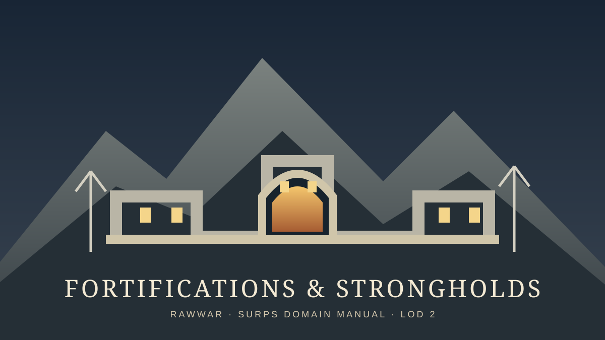

# Singularity Universal Roleplaying System - Domain - LOD 2 - Fortifications and Strongholds

**Status:** LOD 2 reusable warfare manual. This book defines the warfare-side questions for defensive places; it does not define a universal fortress shape, guarantee that a structure is safe, or replace the domain books that own a people, city, terrain, or underground topology.

## 1. Why a stronghold exists

A stronghold is an answer to a threat environment. Its design begins with what a community must survive, what it can build and maintain, what resources and routes it can protect, and what happens if its defenses fail.

The threat may be an organized army, raiders, hostile fauna, environmental catastrophe, a siege, a neighboring power, or several pressures at once. A setting must state which threats are real, which are remembered, which are misunderstood, and which are only feared.

Extreme fortification is not automatically irrational or admirable. In a world where defeat means annihilation, enslavement, displacement, or the loss of essential life-support systems, extraordinary defensive investment may be a rational survival choice. The book must also show its price: labor, material, restricted movement, political authority, maintenance, opportunity cost, and the lives shaped by permanent readiness.

## 2. The defense system is larger than the wall

A fortress is not a wall with a garrison. It is a connected system of:

- **Approach and warning:** terrain, sight lines, scouts, sensors, signals, patrols, and time to respond.
- **Access control:** gates, bridges, tunnels, locks, checkpoints, alternate entrances, and evacuation routes.
- **Layered defense:** outer works, obstacles, protected positions, fallback lines, reserves, and controlled interior movement.
- **Command and communication:** authority, succession, decision rights, alarms, records, and coordination under disruption.
- **People:** defenders, engineers, medics, cooks, craftspeople, children, elders, visitors, and those unable or unwilling to serve.
- **Sustainment:** water, food, air, heat, sanitation, medicine, power, repair materials, and waste removal.
- **Mobility and logistics:** movement of people, supplies, wounded, equipment, and construction materials through constrained routes.
- **Recovery:** firefighting, rescue, repair, decontamination, rebuilding, burial, and restoration of ordinary life.

A defense plan that protects the gate but starves the population, blocks emergency egress, or disables essential ventilation is not a successful defense plan.

## 3. Threat model before architecture

Every authored stronghold should identify its threat model before detailing its defenses.

Record:
- threat actor or hazard and its capabilities;
- motive, opportunity, access, and likely objectives;
- warning indicators and uncertainty;
- attack or disaster scale and duration;
- vulnerable people, places, systems, and dependencies;
- likely failure paths and consequences;
- defensive capabilities, limits, and readiness;
- recovery options and external support.

Do not assume every threat is military. A water failure, fire, disease, cave-in, supply interruption, internal political fracture, or loss of trusted information may be more consequential than an assault.

## 4. Siege, isolation, and endurance

A siege is a contest over time, information, access, morale, and sustainment—not merely an exchange of projectiles.

An endurance model should make its assumptions visible:
- population by relevant need and dependency;
- stored and renewable food and water;
- air quality, ventilation, heating/cooling, and sanitation;
- medical capacity and consumables;
- power, fuel, and repair stocks;
- agricultural or industrial production that can continue under isolation;
- storage losses, contamination, spoilage, and waste;
- route capacity, protected movement, and evacuation limits;
- morale, legitimacy, cohesion, and conflict within the population.

A displayed endurance estimate is only as reliable as its inputs. Unknowns must remain unknown; do not produce false precision from decorative inventory values.

## 5. Military function and civilian life

The stronghold exists to protect a community, not to turn every inhabitant into a soldier. Distinguish:
- professional defenders and command staff;
- trained reserves and emergency responders;
- essential civilian operators;
- people who contribute through care, production, communication, or repair;
- dependents and visitors;
- dissenters, conscientious objectors, prisoners, and displaced people where relevant.

Military authority, emergency powers, law, and accountability should be explicit. Survival pressure can explain severe measures without making them automatically just. Show who decides, who bears the cost, how decisions are challenged, and how ordinary civic life resumes.

## 6. Engineering, construction, and maintenance

Military engineering covers siting, access, obstacles, fieldworks, protected infrastructure, repair, demolition, and adaptation. It must coordinate with the domain that owns the actual physical place.

- Terrain and physical material properties belong to **Physics**.
- Underground chambers, passages, shafts, and connectivity belong to **FSM_Dungeon**.
- The inhabitants, institutions, and culture belong to their people/civilization domain.
- Markets, civic places, resident relationships, and city population belong to **Singularity City**.
- Warfare doctrine, threat assessment, defensive organization, siege, and military engineering belong to **raWWar**.

Geometry is not proof of structural integrity. A visually convincing wall, arch, tunnel, or support does not establish load capacity, blast resistance, fire resistance, or habitability. Those claims require validated physical models and evidence from the relevant provider.

## 7. LOD and composition

LOD indicates the depth and specificity of the knowledge being requested; it is not a mandatory sequence that every observer must load.

- **LOD 0:** a stronghold may exist; perhaps its broad location or reputation is known.
- **LOD 1:** general fortification and warfare concepts can inform distant observation, rumors, or ordinary encounters.
- **LOD 2:** this manual is loaded when the defensive system, threat model, siege, or military engineering meaningfully matters.
- **LOD 3+:** a specific authored stronghold or campaign instance carries its own history, geography, organizations, population, and persistent state.

A nearby town can trade with a fortified mountain community without exposing the fortress interior. A traveler may know that a stronghold guards a pass without knowing its garrison, plans, or hidden routes. Entering the stronghold or simulating its defense requires the appropriate destination and warfare detail.

## 8. Worked crossover: a dwarven mountain stronghold

The SURPS [Dwarven Strongholds, LOD 2](https://github.com/TrentBest/TheSingularityWorkshop.SingularityUniversalRoleplayingSystem/blob/development/docs/books/dwarven-mountain-fortress.md) case study is a worked cross-domain destination, not a raWWar-owned definition of dwarven culture.

Its composition is deliberately divided:
- SURPS Dwarves defines the people and cultural context.
- raWWar defines why the stronghold is defended, what threats shaped it, how defense and sustainment are organized, and what warfare means to the inhabitants.
- Singularity City defines the neighboring market, civic places, visitors, and everyday population relationships.
- FSM_Dungeon defines underground topology and constructed/natural spaces.
- Physics defines the mountain substrate and validated physical consequences.

The fortress should communicate the world that made it necessary. Its defenses may be formidable because the surrounding world is genuinely lethal. But it must still contain homes, workshops, schools, markets, care, governance, celebration, grief, and disagreement. Survival is the reason for the system; life is what the system exists to preserve.

## 9. Evidence and implementation boundary

A book, diagram, SVG, or authored cutaway is knowledge presentation—not proof of a working simulation. A future implementation should separately verify:
- threat and warning transitions;
- command and communication failure;
- route availability and capacity;
- supply accounting and endurance assumptions;
- defensive readiness and maintenance;
- civilian safety, evacuation, and recovery;
- provenance of authored and generated data.

Do not claim a fortress is secure because it looks secure. Do not claim a population can survive a siege because a page displays a number.

## References

- [Warfare and Organized Force, LOD 1](warfare-and-organized-force.md)
- [SURPS Dwarven Strongholds, LOD 2](https://github.com/TrentBest/TheSingularityWorkshop.SingularityUniversalRoleplayingSystem/blob/development/docs/books/dwarven-mountain-fortress.md)
- [SURPS Dwarves, LOD 1](https://github.com/TrentBest/TheSingularityWorkshop.SingularityUniversalRoleplayingSystem/blob/development/docs/books/dwarves.md)
- [Singularity City sourcebooks](https://github.com/TrentBest/TheSingularityWorkshop.SingularityCity/tree/development/docs/books)
- [FSM_Dungeon fortress contract](https://github.com/TrentBest/FSM_Dungeon/blob/development/docs/DWARVEN_MOUNTAIN_FORTRESS.md)
- [Physics mountain-volume design brief](https://github.com/TrentBest/TheSingularityWorkshop.Physics/blob/development/docs/GEOLOGY_MOUNTAIN_VOLUME_AND_FORTRESS.md)
