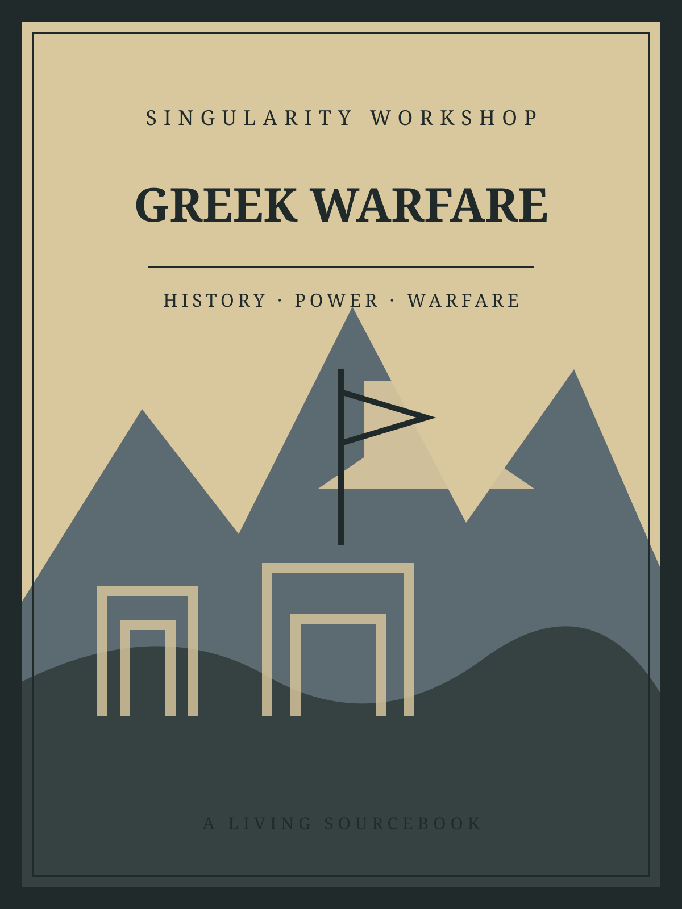

# SURPS — Domain — LOD 2 — Greek Warfare

**Scope:** Greek-speaking communities and political powers from the Late Bronze Age through the Hellenistic kingdoms and their incorporation into Roman power.  
**Status:** LOD 2 historical family / first edition.  
**Descriptor:** [greek-warfare.book.json](greek-warfare.book.json)

## 1. A world, not one army

There was no single, continuous Greek empire spanning all Greek history. The Greek world consisted of many communities, poleis, leagues, monarchies, colonies, and kingdoms with different political systems and military resources. Macedonian conquest under Philip II and Alexander created a major imperial project, followed by Hellenistic kingdoms whose armies and institutions changed across regions and generations.

This book treats "Greek warfare" as a connected but internally diverse field. It distinguishes Mycenaean palace societies, Homeric tradition, archaic poleis, classical city-states, Macedon, Alexander's campaigns, successor kingdoms, and later Greek-speaking forces under Roman rule. It does not project the hoplite phalanx onto every period or every Greek-speaking community.

## 2. Evidence and storytelling

Evidence includes archaeology, inscriptions, military equipment, art, fortifications, coinage, papyri, and literary sources. Herodotus, Thucydides, Xenophon, Polybius, Diodorus, Plutarch, and later authors each wrote from particular contexts and perspectives. Their accounts are not interchangeable eyewitness transcripts. Mythic and epic traditions preserve cultural memory and imaginative models of heroism; they are not literal campaign records without independent corroboration.

The library should label:
- archaeological or epigraphic evidence;
- ancient narrative and historiography;
- later biography and literary tradition;
- modern scholarly interpretation;
- myth, epic, and folklore;
- original fictional adaptation.

## 3. Period map

### 3.1 Late Bronze Age and Mycenaean worlds

Palatial centers, elite warrior identities, chariotry, fortifications, maritime networks, and palace administration provide the context for Late Bronze Age conflict. Linear B records illuminate administration but do not provide a complete military chronicle. The Homeric epics are much later literary compositions drawing on layered traditions; their armor, institutions, and battle scenes cannot simply be treated as direct descriptions of a single Bronze Age war.

### 3.2 Archaic communities

From the early first millennium BCE, communities developed different forms of political organization and military participation. Hoplite equipment and close-order infantry became important in some regions, but the chronology, social reach, and battlefield implications of a single "hoplite revolution" remain debated. Elite cavalry, archers, slingers, light infantry, naval forces, mercenaries, and local variations must remain visible.

### 3.3 Classical poleis and the Persian Wars

The conflicts conventionally grouped as the Greco-Persian Wars (including Marathon, Thermopylae, Salamis, Plataea, and associated operations) involved multiple Greek communities and a vast Achaemenid imperial system. Greek accounts often center Greek political choices; a balanced book must also study Persian command, logistics, imperial administration, naval and land forces, subject contingents, and the empire's own strategic objectives.

### 3.4 Peloponnesian War and the fifth-century transformation

The conflict between Athens and Sparta and their allies (431–404 BCE) was not simply a series of hoplite battles. Naval power, tribute, finance, sieges, disease, revolts, diplomacy, mercenaries, raids, and operations across the Aegean and beyond shaped the war. The decades before and after it saw changes in combined arms, siegecraft, generalship, and military finance.

### 3.5 Fourth-century warfare and Macedon

Thebes, Sparta, Athens, Thessaly, Macedon, and other powers pursued shifting alliances and military reforms. Philip II's kingdom built a formidable combined military system involving sarissa-armed infantry, cavalry, allied forces, siege capabilities, and political diplomacy. Avoid explaining Macedonian success through a single weapon or formation.

### 3.6 Alexander and the successor kingdoms

Alexander's campaigns (334–323 BCE) connected Macedonian and Greek forces to a vast expedition across Anatolia, Egypt, the Achaemenid heartlands, Central Asia, and northwestern South Asia. After his death, successor struggles produced the Hellenistic kingdoms, including the Antigonid, Ptolemaic, and Seleucid realms. Their armies included diverse regional traditions, specialist troops, war elephants, mercenaries, fleets, siege engines, and evolving institutions.

### 3.7 Greek forces under Roman power

Greek military communities and individuals continued to serve, resist, negotiate, and adapt under Roman hegemony and imperial rule. "Greek warfare ends with Rome" is an inaccurate boundary. Regional forces, revolts, auxiliaries, naval service, and the later eastern Roman world require their own treatments.

## 4. Institutions and military practice

Study citizen levies, elite retinues, mercenary service, allied contingents, cavalry, hoplites, peltasts, archers, slingers, naval crews, marines, siege specialists, engineers, and logistics workers. Military participation was shaped by wealth, citizenship, gender, status, political rights, and coercion. The experience of a citizen hoplite was not the experience of an enslaved laborer, rower, camp follower, foreign mercenary, or conquered resident.

The phalanx was powerful under particular conditions but not a universal answer. Terrain, unit depth, cohesion, training, command, flanks, cavalry, missiles, supply, fatigue, and the opponent's choices all mattered. Naval warfare and siege warfare were central to many Greek conflicts, not side topics.

## 5. Strategy, politics, and society

War was entangled with citizenship, class, imperial tribute, slavery, land, trade, religious practice, alliances, factional politics, and public memory. A victory could strengthen a democracy, enrich a leader, destabilize an alliance, or impose severe costs on subject communities. A sourcebook must ask who paid, who decided, who fought, who benefited, and who was displaced.

Greek strategic thought should be read in its context. Thucydides' account of the Peloponnesian War is a major work of political and military analysis, but it is also a crafted history with its own method and limitations. Compare ancient accounts with archaeology, inscriptions, and modern scholarship.

## 6. Mythic and imaginative Greece

The Greek mythic corpus is a rich source of original tabletop and worldbuilding material: heroic cycles, divine interventions, monster traditions, legendary sieges, oracles, cursed lineages, underworld journeys, and stories of lost or transformed peoples. These can inspire new scenarios and alternate worlds, but each adaptation must declare whether it is:
- a retelling of an ancient mythic tradition;
- a later literary or artistic version;
- a historical hypothesis;
- an original fictional invention.

Do not conflate Homer's Troy with archaeological Troy, or mythic heroes with securely documented historical commanders. Ancient mythic motifs can be reimagined, but modern copyrighted retellings, game settings, films, and distinctive character designs must not be copied.

## 7. Tabletop and simulation use

A campaign built from this book should model independent poleis and kingdoms with their own interests, not a single "Greek faction." Include alliances, rivalries, assemblies, monarchies, mercenary contracts, naval capacity, citizen obligations, supply, harvest calendars, local terrain, and the politics of command. A battle scenario should specify which evidence and reconstruction it follows, and which elements are adapted for play.

## 8. Further reading and source anchors

- [The Metropolitan Museum of Art — Warfare in Ancient Greece](https://www.metmuseum.org/essays/warfare-in-ancient-greece)
- [Cambridge History of Greek and Roman Warfare — Battle](https://www.cambridge.org/core/books/abs/cambridge-history-of-greek-and-roman-warfare/battle/A86402F9DD0B031B30CAF98D8C190083)
- Matthew A. Sears, *Understanding Greek Warfare* (Routledge, 2019).
- Louis Rawlings, "War and Warfare in Ancient Greece," in *The Oxford Handbook of Warfare in the Classical World*.
- Thucydides, *History of the Peloponnesian War*; Xenophon, *Hellenica* and *Anabasis*; Herodotus, *Histories* — read critically as ancient sources, not neutral modern reports.

## 9. Cross-references

- [Warfare and Organized Force, LOD 1](warfare-and-organized-force.md)
- [The Art of War, LOD 2](the-art-of-war.md)
- Future: Persian Warfare; Macedonian Warfare; Alexander's Campaigns; The Persian Wars; The Peloponnesian War; Hellenistic Warfare; Greek Myth and Legendary Conflict; Ancient Naval Warfare; Siegecraft and Artillery.

The Greek world is not one timeless army. It is a changing network of communities and empires whose wars were shaped by politics, resources, geography, technology, and human choices.
