# raWWar — SURPS Sourcebook Library

The raWWar sourcebooks describe warfare as a broad domain of organized force, contested authority, protection, raiding, resistance, and consequence. They are domain-owned here and may be composed by SURPS when an Experience explicitly enables it.

## Domain — LOD 1

Descriptor: [warfare-and-organized-force.book.json](warfare-and-organized-force.book.json)

A broad map of the domain, including state and non-state warfare, piracy, privateering, outlawry, resistance, insurgency, mercenaries, historical interpretation, tabletop play, and simulation boundaries.

[Read Warfare and Organized Force](warfare-and-organized-force.md)

## LOD 2 — Strategy and reusable warfare manuals

### The Art of War

Descriptor: [the-art-of-war.book.json](the-art-of-war.book.json)

A dedicated study of the thirteen-chapter work traditionally attributed to Sun Tzu: textual history, attribution, chapter-by-chapter reading, strategic themes, reception, translation discipline, and tabletop/simulation applications.

[Read The Art of War](the-art-of-war.md)

### Greek Warfare

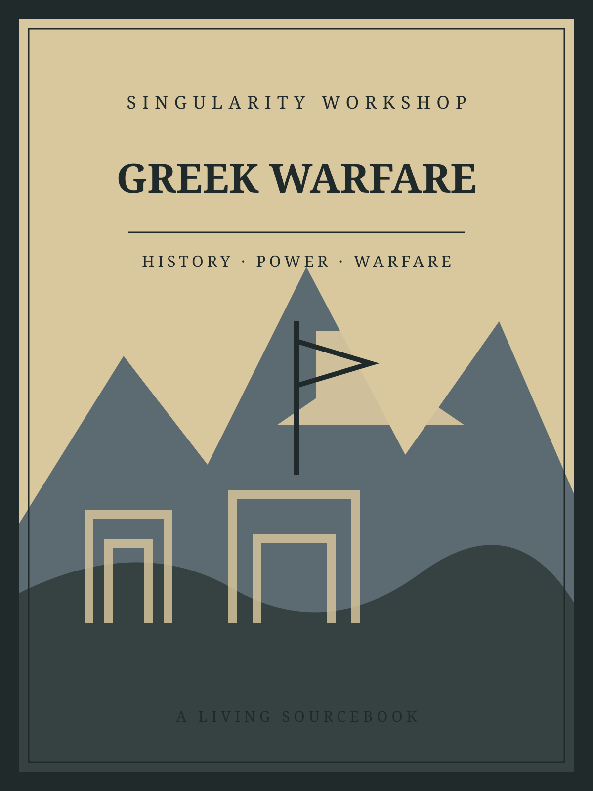

Descriptor: [greek-warfare.book.json](greek-warfare.book.json)

A period-spanning survey from Mycenaean worlds and archaic poleis through the classical conflicts, Macedon, Alexander, and Hellenistic kingdoms, with historical and mythic material kept distinct.

[Read Greek Warfare](greek-warfare.md)

### Persian Warfare

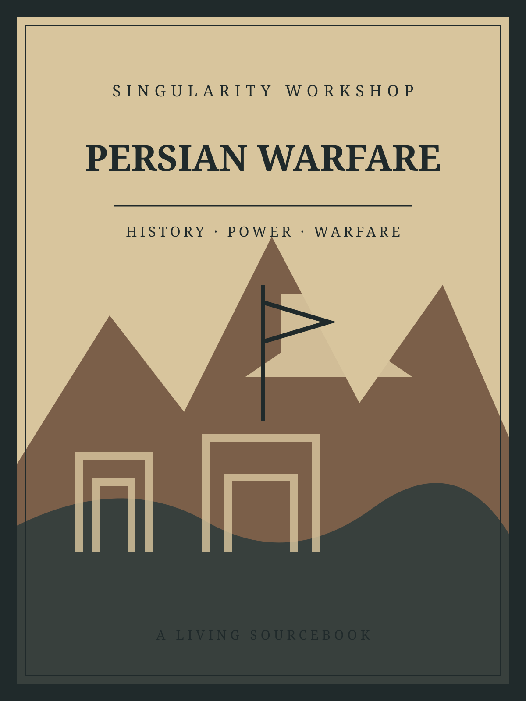

Descriptor: [persian-warfare.book.json](persian-warfare.book.json)

A comparative overview that distinguishes Achaemenid, Parthian, and Sasanian empires and their changing military, political, and regional contexts.

[Read Persian Warfare](persian-warfare.md)

### Roman Warfare

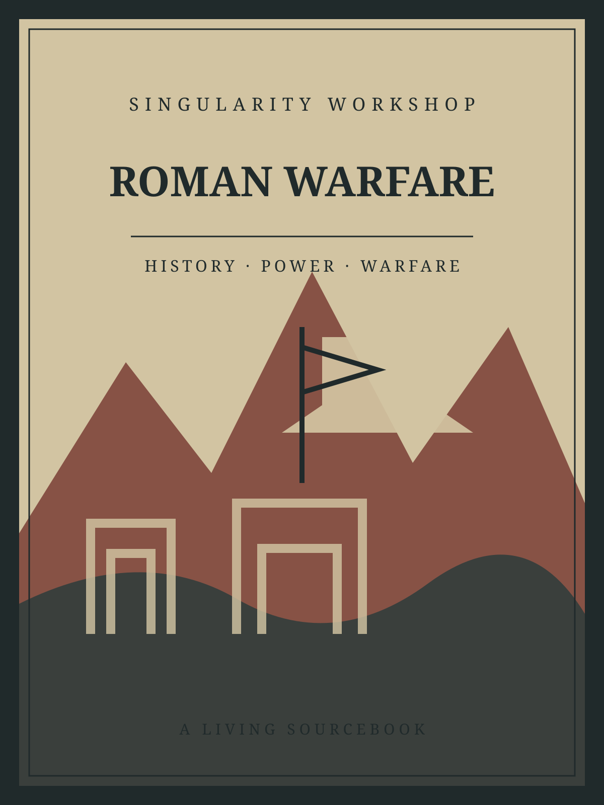

Descriptor: [roman-warfare.book.json](roman-warfare.book.json)

A broad survey from early Rome through Republic, Principate, later Empire, and eastern Roman continuities, with period-specific institutions and evidence.

[Read Roman Warfare](roman-warfare.md)

### Fortifications and Strongholds

Descriptor: [fortifications-and-strongholds.book.json](fortifications-and-strongholds.book.json)

A reusable warfare-side manual for threat models, layered defense, siege endurance, military engineering, sustainment, civilian survival, maintenance, and recovery. Its worked crossover is the SURPS Dwarven Strongholds case study.

[Read Fortifications and Strongholds](fortifications-and-strongholds.md)

## The catalogue will expand across linked families

- **Historical eras and conflicts:** Greek and Persian worlds, Roman wars, Chinese and Japanese conflicts, Mongol campaigns, Viking-age warfare, colonial conflicts, Napoleonic wars, World Wars, Korea, Vietnam, contemporary and speculative future conflicts.
- **Participants and organizations:** political entities, regimes, militaries, coalitions, resistance groups, pirates, privateers, mercenaries, and militias—always distinguished from whole populations.
- **Irregular and maritime force:** piracy, privateering, outlaw bands, brigandage, Robin Hood traditions, insurgency, rebellion, resistance, and local defense.
- **Strategic thought:** *The Art of War* and comparative traditions of command, statecraft, intelligence, logistics, and military theory.
- **Campaigns, battles, and missions:** linked treatments at progressively narrower scopes.
- **Reusable manuals:** weapons, vehicles, ships, aircraft, fortifications, communications, doctrine, training, logistics, medicine, and engineering.

A book can cross-reference several others. LOD marks depth, not chronology or a mandatory hierarchy. Historical fact, disputed interpretation, legend, speculation, and fictional adaptation must remain distinguishable.

See [the sourcebook collection and editorial plan](README.md).

## New LOD 2 additions — maritime, irregular, global, and speculative warfare

### Piracy and Maritime Raiding

Descriptor: [piracy-and-maritime-raiding.book.json](piracy-and-maritime-raiding.book.json)

A study of piracy, privateering, corsairing, naval conflict, coastal raiding, maritime communities, and contested authority at sea.

[Read Piracy and Maritime Raiding](piracy-and-maritime-raiding.md)

### Outlaws, Bandits, and Popular Resistance

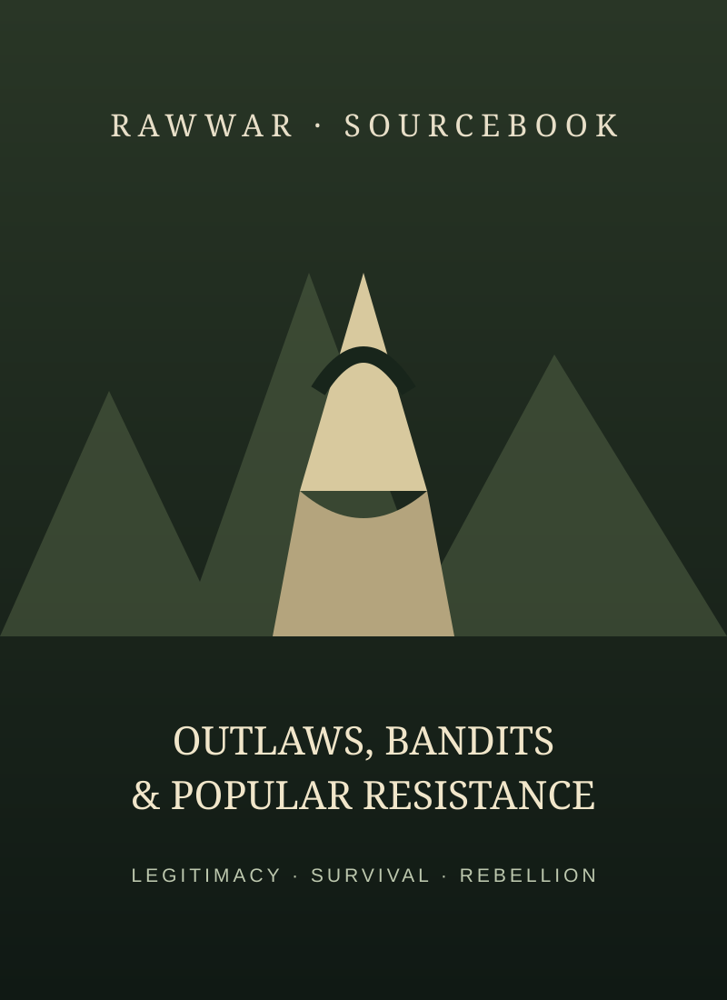

Descriptor: [outlaws-bandits-and-popular-resistance.book.json](outlaws-bandits-and-popular-resistance.book.json)

Examines outlawry, brigandage, popular resistance, rebellion, insurgency, community legitimacy, and the Robin Hood tradition without confusing folklore with biography.

[Read Outlaws, Bandits, and Popular Resistance](outlaws-bandits-and-popular-resistance.md)

### Chinese Warfare

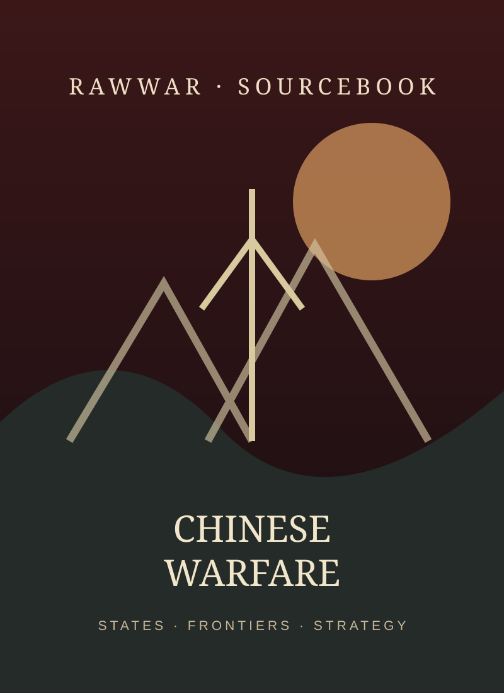

Descriptor: [chinese-warfare.book.json](chinese-warfare.book.json)

A broad, periodized orientation to the many states, dynasties, military institutions, strategic traditions, frontiers, and technologies of Chinese history.

[Read Chinese Warfare](chinese-warfare.md)

### Science Fiction Warfare

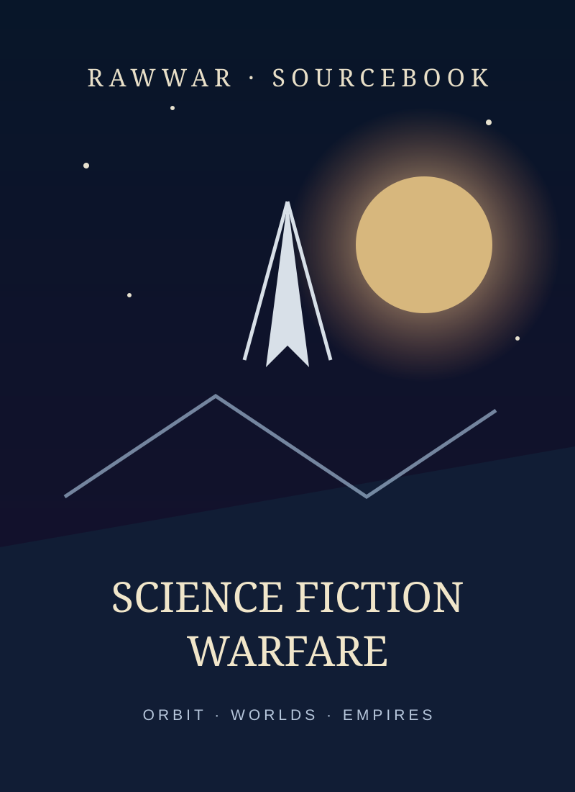

Descriptor: [science-fiction-warfare.book.json](science-fiction-warfare.book.json)

A first-class speculative warfare domain spanning near-future conflict, orbital infrastructure, planetary defense, autonomous systems, interstellar logistics, alien polities, and posthuman political orders. It labels established science, extrapolation, speculation, and fictional rules separately.

[Read Science Fiction Warfare](science-fiction-warfare.md)

### Japanese Warfare

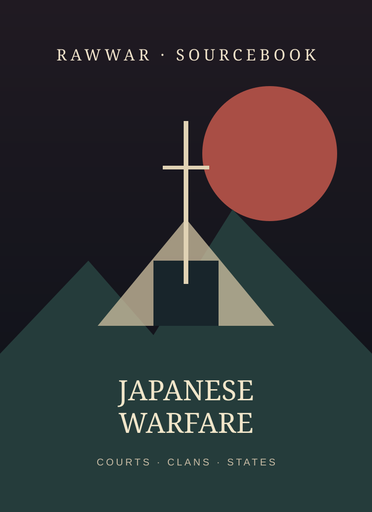

Descriptor: [japanese-warfare.book.json](japanese-warfare.book.json)

A periodized study from early state formation through warrior governments, Sengoku conflict, unification, Tokugawa peace, modern transformation, imperial war, and postwar memory.

[Read Japanese Warfare](japanese-warfare.md)

### Orbital Warfare and Space Infrastructure

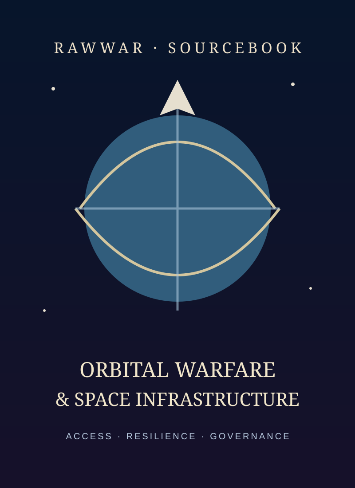

Descriptor: [orbital-warfare-and-space-infrastructure.book.json](orbital-warfare-and-space-infrastructure.book.json)

A systems-level study of orbital services, infrastructure dependencies, access, resilience, governance, escalation, and civilian consequences, with clear boundaries between known physics and speculative settings.

[Read Orbital Warfare and Space Infrastructure](orbital-warfare-and-space-infrastructure.md)

## New LOD 2 — Iranian imperial traditions in depth

### Achaemenid Warfare

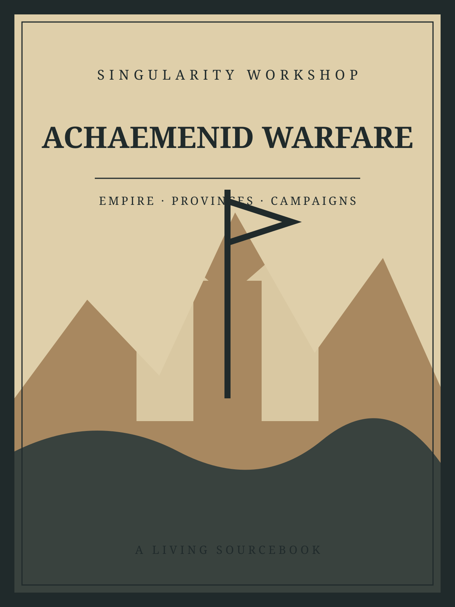

Descriptor: [achaemenid-warfare.book.json](achaemenid-warfare.book.json)

A dedicated study of Achaemenid imperial forces, provincial mobilization, royal authority, logistics, campaigns, and the limits of Greek-centered narratives.

[Read Achaemenid Warfare](achaemenid-warfare.md)

### Parthian Warfare

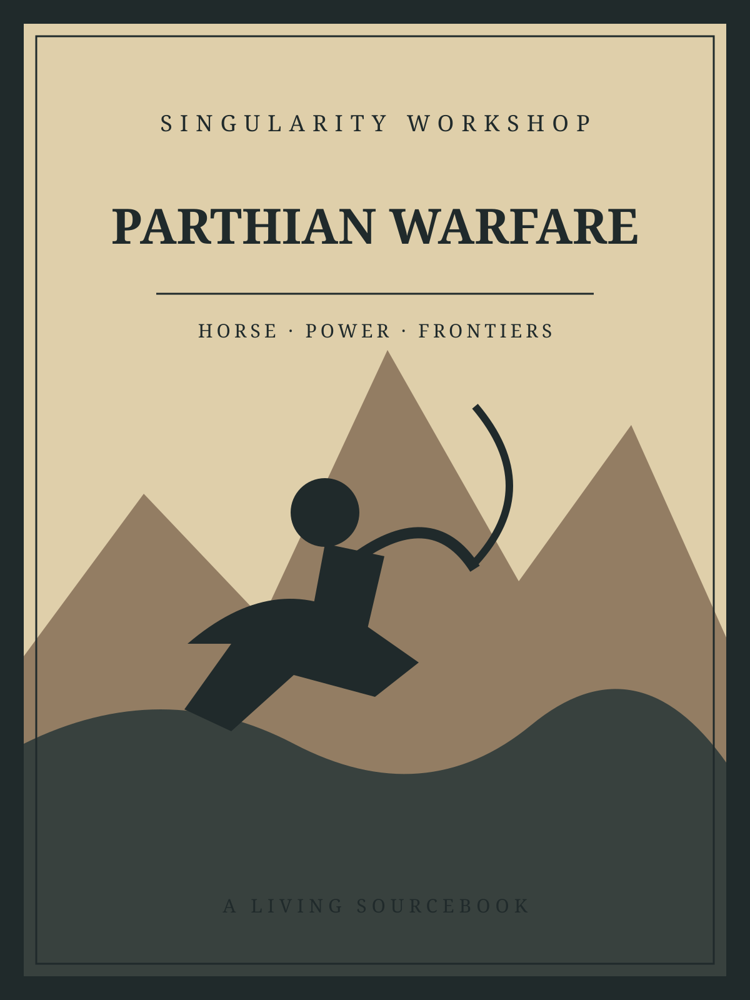

Descriptor: [parthian-warfare.book.json](parthian-warfare.book.json)

A study of Arsacid political-military networks, mounted forces, horse logistics, frontier diplomacy, and the long contest with Rome.

[Read Parthian Warfare](parthian-warfare.md)

### Sasanian Warfare

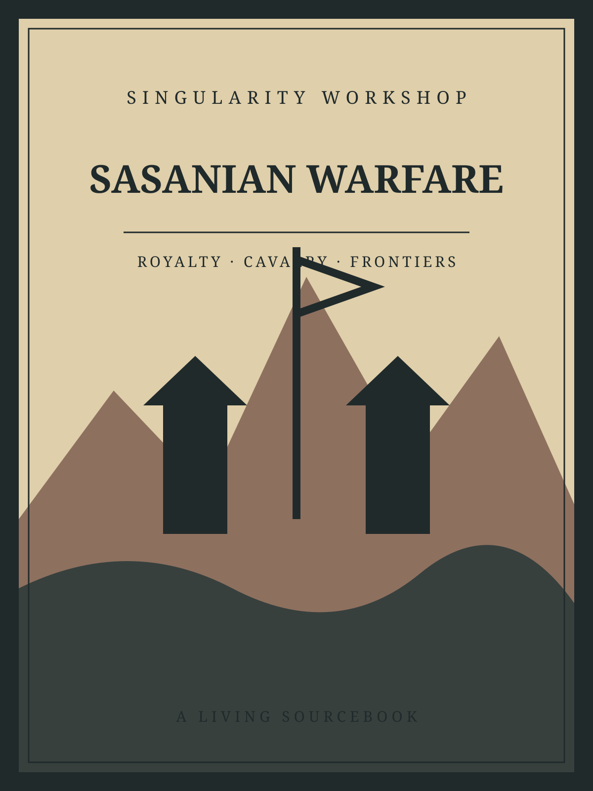

Descriptor: [sasanian-warfare.book.json](sasanian-warfare.book.json)

A study of Sasanian military institutions, elite cavalry, frontier systems, siegecraft, imperial finance, and wars with Rome and the eastern Roman Empire.

[Read Sasanian Warfare](sasanian-warfare.md)

## New LOD 2 — steppe empires and Viking-age networks

### Mongol Warfare

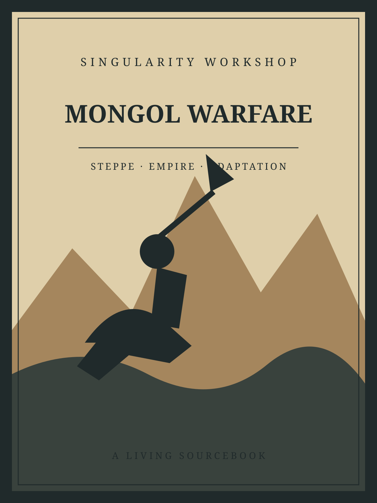

Descriptor: [mongol-warfare.book.json](mongol-warfare.book.json)

A study of steppe political formation, mounted mobility, command, intelligence, siege adaptation, regional campaigns, and successor khanates.

[Read Mongol Warfare](mongol-warfare.md)

### Viking-Age Warfare

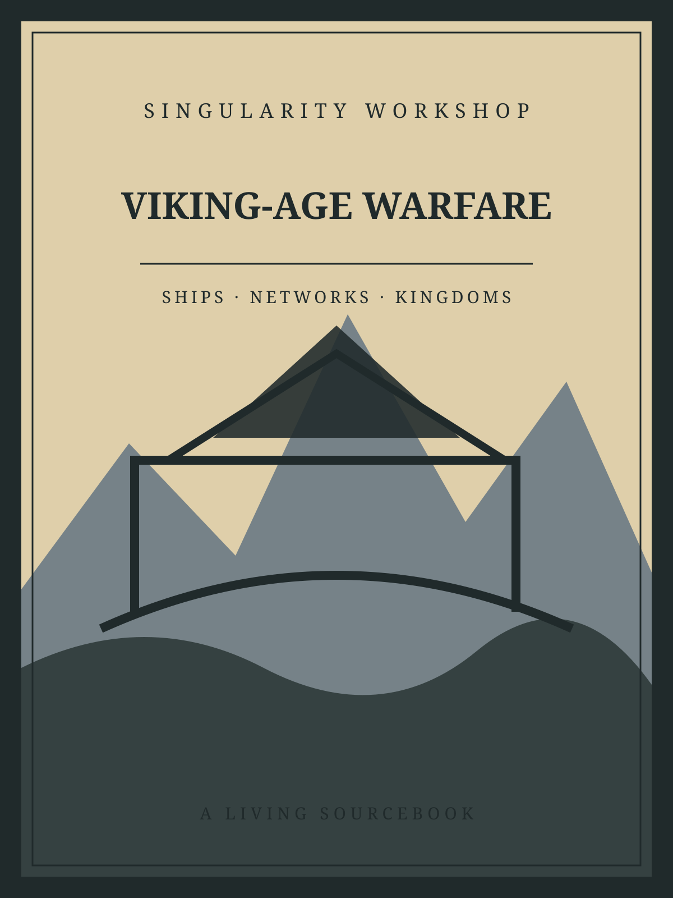

Descriptor: [viking-age-warfare.book.json](viking-age-warfare.book.json)

A regional study of Scandinavian maritime activity, raiding, trade, settlement, ships, armed groups, and political transformation across connected regions.

[Read Viking-Age Warfare](viking-age-warfare.md)

## Roman history — focused LOD 2 companions

### Roman Republican Warfare

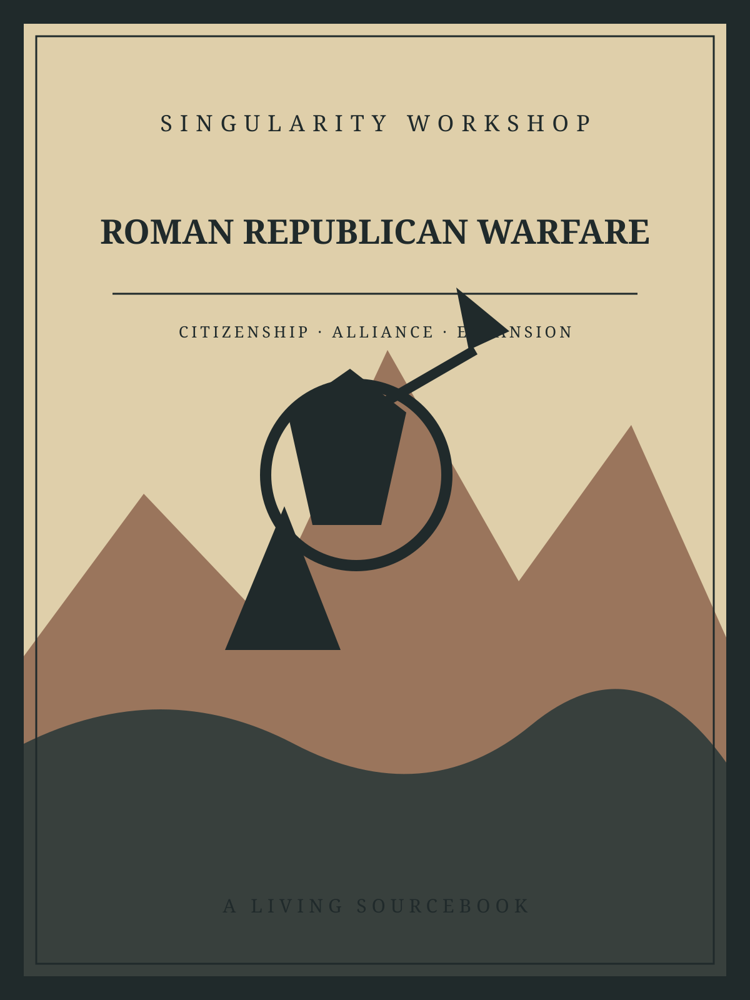

Descriptor: [roman-republican-warfare.book.json](roman-republican-warfare.book.json)

A study of civic and allied manpower, republican command, Mediterranean expansion, naval adaptation, and the civil-war crisis.

[Read Roman Republican Warfare](roman-republican-warfare.md)

### The Roman Imperial Army

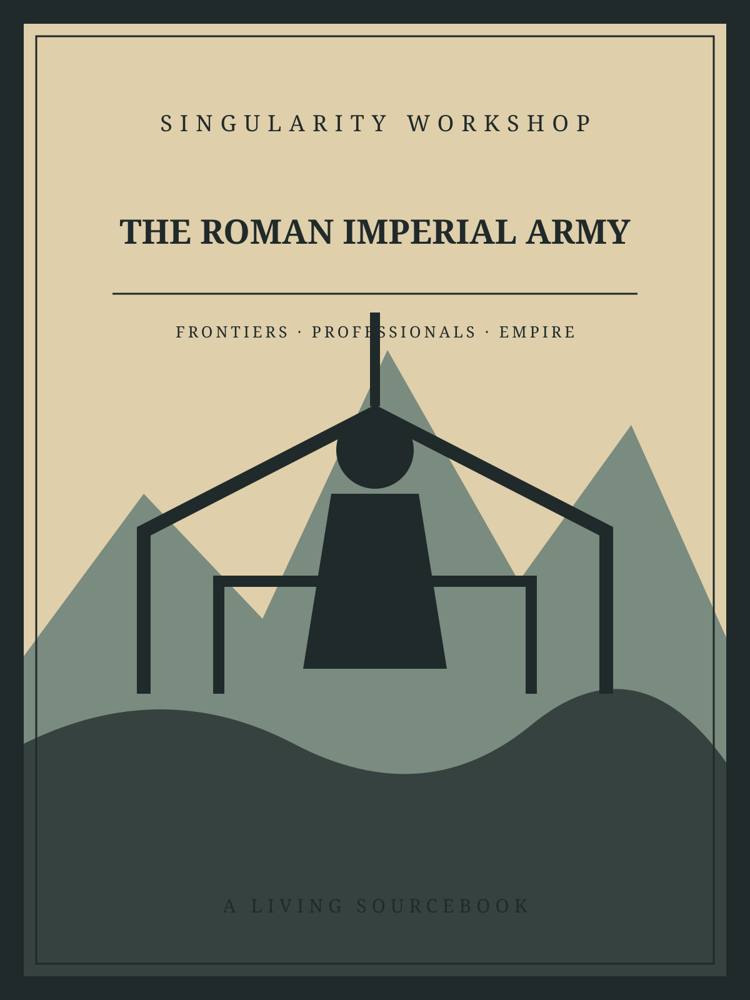

Descriptor: [roman-imperial-army.book.json](roman-imperial-army.book.json)

A study of imperial military institutions, frontier systems, recruitment, logistics, military society, and late antique transformation.

[Read The Roman Imperial Army](roman-imperial-army.md)

## Science-fiction warfare — planetary settlement systems

### Planetary Defense and Habitat Conflict

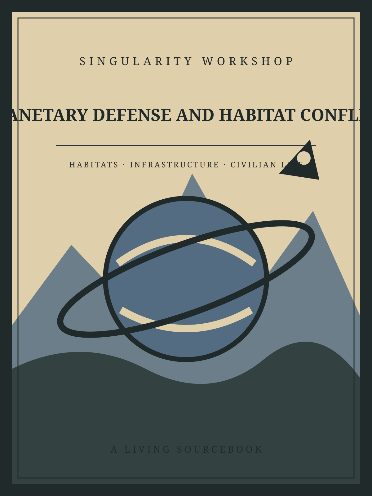

Descriptor: [planetary-defense-and-habitat-conflict.book.json](planetary-defense-and-habitat-conflict.book.json)

A systems-level treatment of planetary protection, habitat resilience, governance, civilian survival, and conflict de-escalation.

[Read Planetary Defense and Habitat Conflict](planetary-defense-and-habitat-conflict.md)

## Roman civil-war and Eastern Roman companions

### Roman Civil Wars

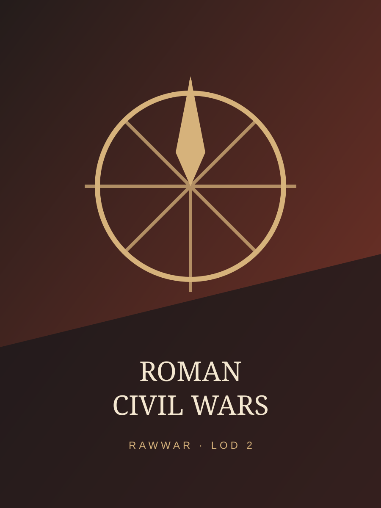

Descriptor: [roman-civil-wars.book.json](roman-civil-wars.book.json)

A study of the Social War, Sulla, Caesar, the triumviral struggles, and the Augustan settlement, emphasizing legitimacy, coalition politics, finance, and civilian consequences.

[Read Roman Civil Wars](roman-civil-wars.md)

### Eastern Roman Warfare

Descriptor: [eastern-roman-warfare.book.json](eastern-roman-warfare.book.json)

A periodized account of eastern Roman military transformation from late antiquity to 1453, including fiscal foundations, frontier systems, diplomacy, fortifications, and changing regional contexts.

[Read Eastern Roman Warfare](eastern-roman-warfare.md)

## Science-fiction warfare — machine agency

### Autonomous Systems and Machine Agency

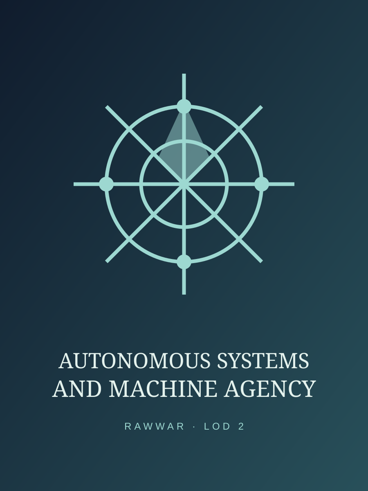

Descriptor: [autonomous-systems-and-machine-agency.book.json](autonomous-systems-and-machine-agency.book.json)

Examines delegation, oversight, accountability, reliability, escalation, civilian protection, and speculative machine political agency. It separates established capability from extrapolation, speculation, and fictional premises.

[Read Autonomous Systems and Machine Agency](autonomous-systems-and-machine-agency.md)

## Science-fiction warfare — interstellar society and first contact

### Interstellar Logistics and Strategy

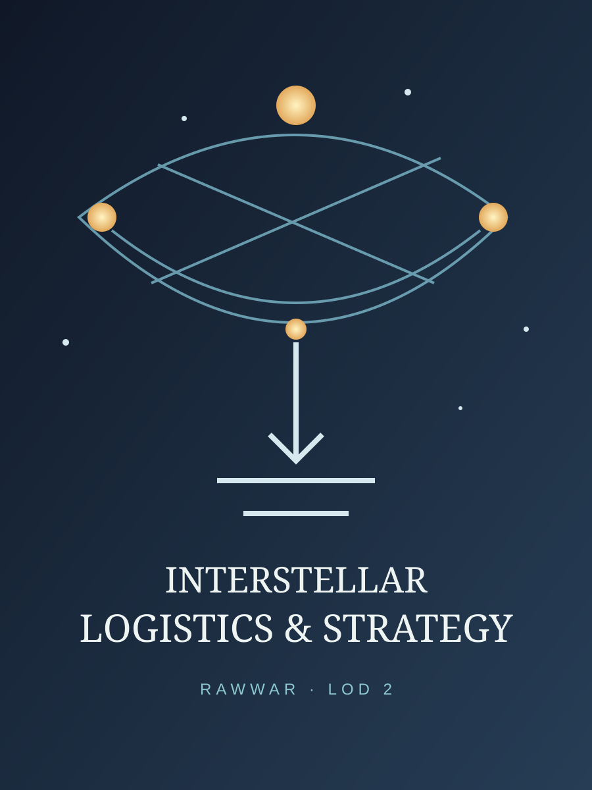

Descriptor: [interstellar-logistics-and-strategy.book.json](interstellar-logistics-and-strategy.book.json)

A systems-level study of distance, communications delay, transport, energy, life support, industrial ecology, network resilience, sovereignty, and civilian sustainment across interstellar settings. It distinguishes known physics from extrapolated engineering and fictional travel systems.

[Read Interstellar Logistics and Strategy](interstellar-logistics-and-strategy.md)

### Alien Contact, Diplomacy, and Conflict

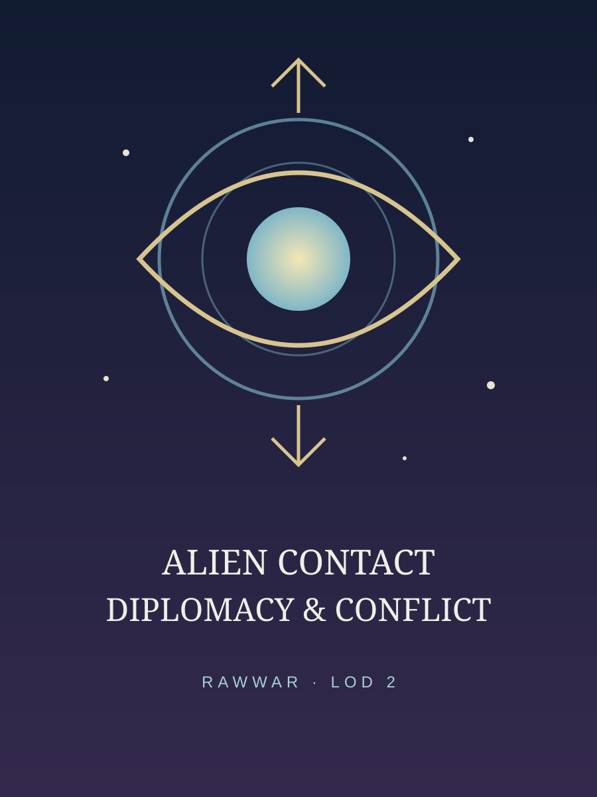

Descriptor: [alien-contact-diplomacy-and-conflict.book.json](alien-contact-diplomacy-and-conflict.book.json)

A disciplined framework for evidence, translation, biological uncertainty, political recognition, diplomacy, security dilemmas, conflict prevention, machine intermediaries, and civilian protection. It does not assume extraterrestrial life or inevitable hostility.

[Read Alien Contact, Diplomacy, and Conflict](alien-contact-diplomacy-and-conflict.md)

## Science-fiction warfare — LOD 3 civilization design

### Alien Civilizations and Political Systems

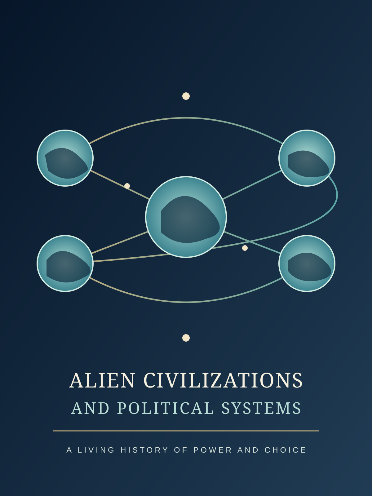

Descriptor: [alien-civilizations-and-political-systems.book.json](alien-civilizations-and-political-systems.book.json)

A reusable framework for fictional civilization histories, political systems, legitimacy, institutions, factions, strategic culture, infrastructure, armed organizations, diplomacy, and campaign design. It avoids treating a species as a single political actor or personality.

[Read Alien Civilizations and Political Systems](alien-civilizations-and-political-systems.md)

## Science-fiction warfare — LOD 3 civilization case study

### The Nacrean Compact and the Tidal Archive Crisis

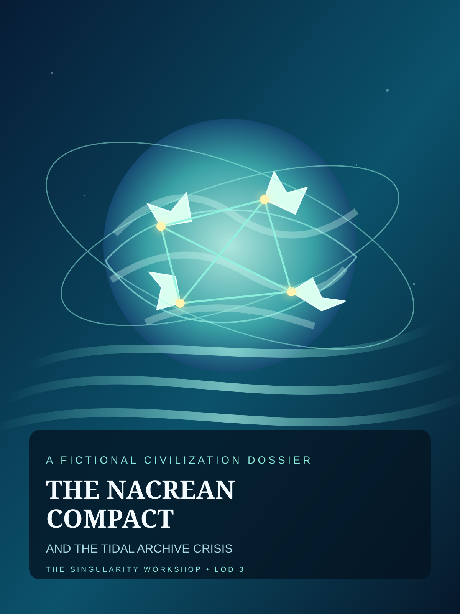

Descriptor: [nacrean-compact-and-tidal-archive-crisis.book.json](nacrean-compact-and-tidal-archive-crisis.book.json)

A fictional civilization dossier and campaign history about a distributed ocean-world polity, contested political membership, shared infrastructure, archive integrity, emergency powers, and a constitutional crisis resolved through evidence, negotiation, and institutional repair.

[Read The Nacrean Compact and the Tidal Archive Crisis](nacrean-compact-and-tidal-archive-crisis.md)

## Science-fiction warfare — connected regional theatre (LOD 3)

### The Serein Passage Treaties and the Three-Current Crisis

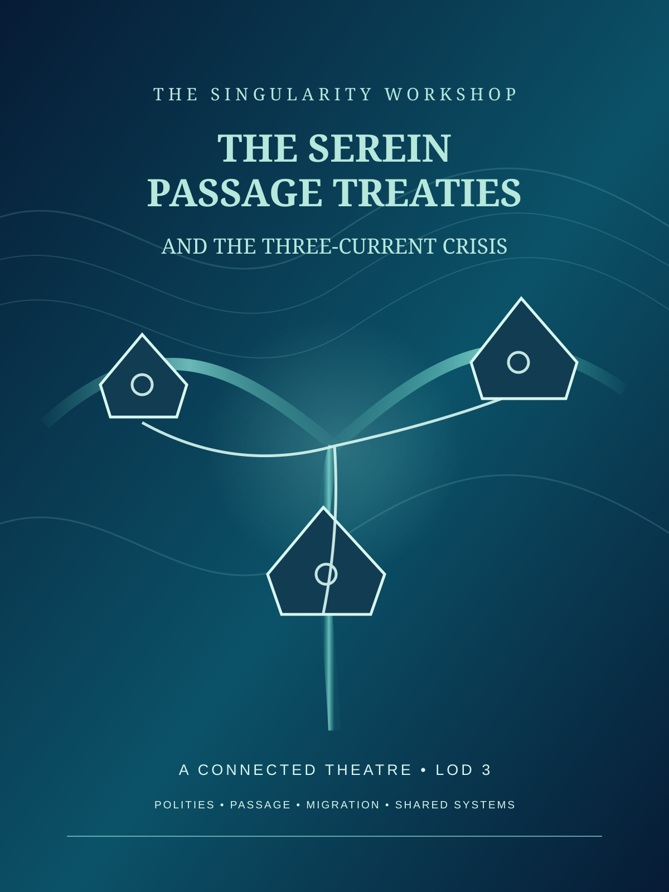

Descriptor: [serein-passage-treaties-and-three-current-crisis.book.json](serein-passage-treaties-and-three-current-crisis.book.json)

A connected Pelagos regional theatre linking the Nacrean Compact with the Vey Shelf Assemblies, Orison Works League, Outer Drift Mutuals, and Serein Passage Commission. It develops shared passage treaties, trade and migration networks, civilian infrastructure, historical disputes, and a multi-sided crisis over route evidence and regional legitimacy.

[Read The Serein Passage Treaties and the Three-Current Crisis](serein-passage-treaties-and-three-current-crisis.md)

## Medicine and healing — history, practice, and play (LOD 2)

### Medicine and Healing: History, Practice, and Play

Descriptor: [medicine-and-healing.book.json](medicine-and-healing.book.json)

A foundation for a dedicated medicine series: healing across history, battlefield casualty care, triage, the medic's HUD, trauma and rehabilitation, fantasy healing systems, and evidence-labeled future medicine. It distinguishes real clinical principles from fictional raWWar equipment and game abstractions.

[Read Medicine and Healing: History, Practice, and Play](medicine-and-healing.md)

Planned companions include Healing Across the Centuries; Battlefield Medicine and the Casualty Chain; Surgery, Amputation, and Prosthetic Futures; Medicine at Sea, in Space, and on the Frontier; Fantasy Healing and the Laws of Restoration; Future Medicine and Human-Machine Care; Medical Ethics, Law, and Protected Care; and Alien and Posthuman Physiology.

### Healing Across the Centuries

Descriptor: [healing-across-the-centuries.book.json](healing-across-the-centuries.book.json)

A comparative world history of caregivers, medical knowledge, institutions, surgery, public health, war, disability, and changing meanings of recovery. It avoids a single ladder of progress and distinguishes archaeological, textual, institutional, retrospective, and legendary evidence.

[Read Healing Across the Centuries](healing-across-the-centuries.md)

## Formations, bases, and sustainment — reusable manuals (LOD 2)

### Formations I: Land Forces


Descriptor: [formations-i-land-forces.book.json](formations-i-land-forces.book.json)

Recursive land formations, from small teams through larger field organizations, with training, ghost slots, transitions, and scoring.

[Read Formations I: Land Forces](formations-i-land-forces.md)

### Formations II: Naval Forces


Descriptor: [formations-ii-naval-forces.book.json](formations-ii-naval-forces.book.json)

Fleet geometry, station keeping, convoys, amphibious groups, mixed-domain coordination, and maritime maneuver.

[Read Formations II: Naval Forces](formations-ii-naval-forces.md)

### Formations III: Air Forces


Descriptor: [formations-iii-air-forces.book.json](formations-iii-air-forces.book.json)

Three-dimensional formation geometry, flight coordination, human factors, autonomy, and aerospace boundaries.

[Read Formations III: Air Forces](formations-iii-air-forces.md)

### Bases and Encampments


Descriptor: [bases-and-encampments.book.json](bases-and-encampments.book.json)

Temporary camps, Roman castra, mobile formations, fortified bases, services, civilian relationships, and continuity.

[Read Bases and Encampments](bases-and-encampments.md)

### The Art of Resupply


Descriptor: [the-art-of-resupply.book.json](the-art-of-resupply.book.json)

Supply networks, demand, transport, repair, medical logistics, contested routes, allocation, and sustainment.

[Read The Art of Resupply](the-art-of-resupply.md)

### Battlefield Medicine and the Casualty Chain

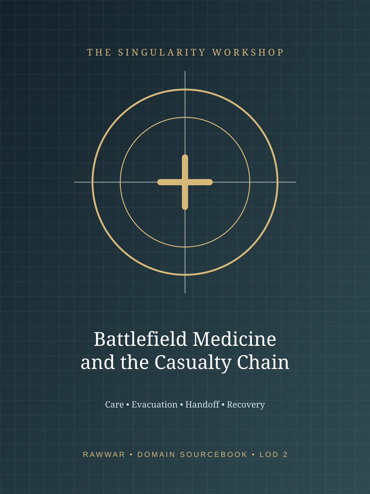

Descriptor: [battlefield-medicine-and-the-casualty-chain.book.json](battlefield-medicine-and-the-casualty-chain.book.json)

Casualty movement, triage context, evacuation, handoff, medic HUD, ghost actions, and fictional exoskeleton cardiac support.

[Read Battlefield Medicine and the Casualty Chain](battlefield-medicine-and-the-casualty-chain.md)
## Formations IV — mounted and cavalry forces (LOD 2)

### Formations IV: Mounted and Cavalry Forces

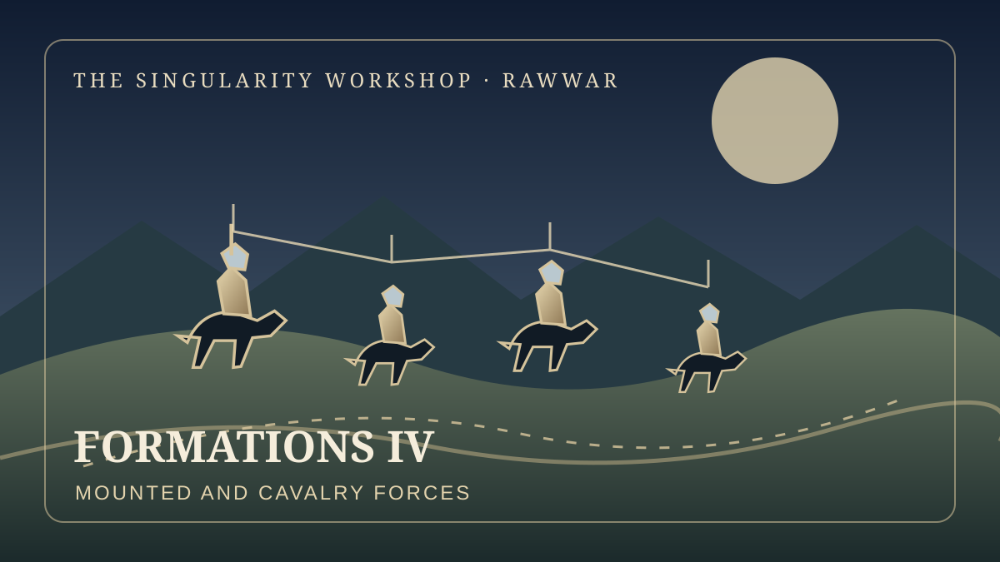

Descriptor: [formations-iv-mounted-and-cavalry.book.json](formations-iv-mounted-and-cavalry.book.json)

A reusable study of mounted organizations across periods and regions: cavalry, mounted infantry, scouts, couriers, chariots, animal logistics, remount systems, dismounted transitions, animal welfare, and simulation requirements. It treats mounts as living participants rather than equipment.

[Read Formations IV: Mounted and Cavalry Forces](formations-iv-mounted-and-cavalry.md)

## Formations V — mechanized and armored forces (LOD 2)

### Formations V: Mechanized and Armored Forces

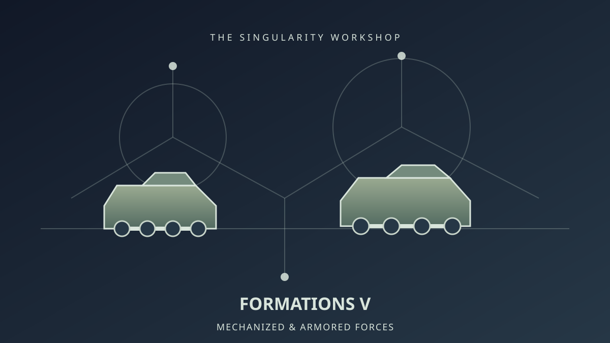

Descriptor: [formations-v-mechanized-and-armored-forces.book.json](formations-v-mechanized-and-armored-forces.book.json)

A systems-level manual for armored and mechanized organizations: crews, vehicles, dismounted personnel, command, route and infrastructure constraints, fuel and stores, maintenance, recovery, industrial depth, medical support, civilian effects, autonomy, and transparent simulation contracts.

[Read Formations V: Mechanized and Armored Forces](formations-v-mechanized-and-armored-forces.md)

## Formations VI — orbital and space forces (LOD 2)

### Formations VI: Orbital and Space Forces

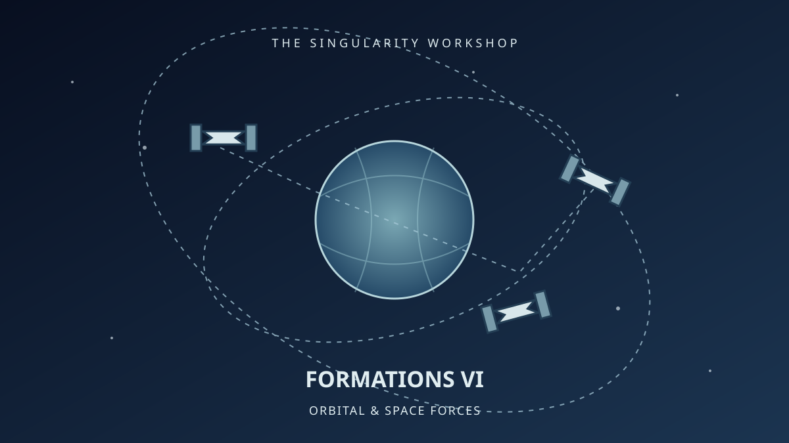

Descriptor: [formations-vi-orbital-and-space-forces.book.json](formations-vi-orbital-and-space-forces.book.json)

A dedicated formation manual for spacecraft, crews, autonomous systems, stations, habitats, service networks, orbital relationships, communications delay, sustainment, rescue, governance, and transparent simulation contracts. It complements the broader Orbital Warfare and Space Infrastructure volume without treating spacecraft as ships or orbital trajectories as roads.

[Read Formations VI: Orbital and Space Forces](formations-vi-orbital-and-space-forces.md)
