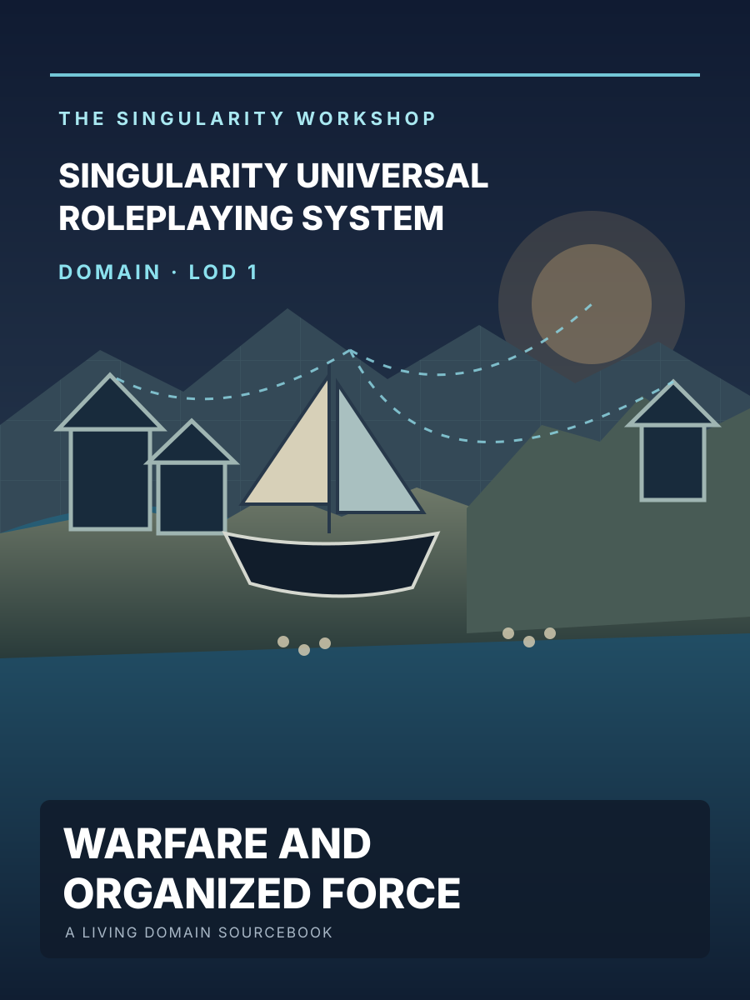
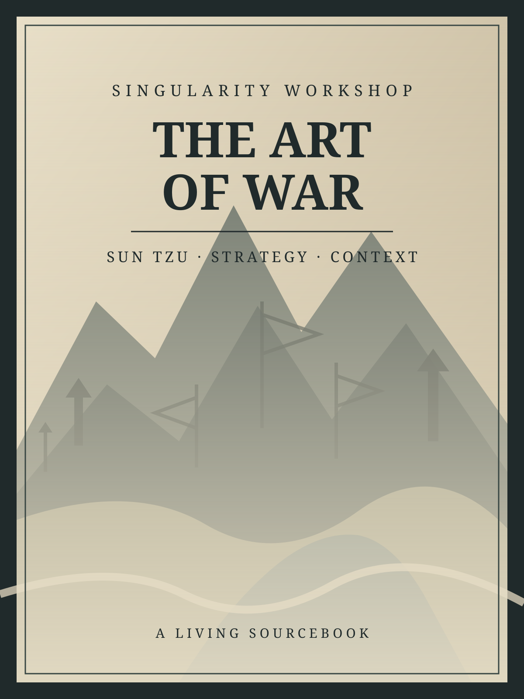

# raWWar — SURPS Sourcebook Library

The raWWar sourcebooks describe warfare as a broad domain of organized force, contested authority, protection, raiding, resistance, and consequence. They are domain-owned here and may be composed by SURPS when an Experience explicitly enables it.

## Domain — LOD 1

Descriptor: [warfare-and-organized-force.book.json](warfare-and-organized-force.book.json)

A broad map of the domain, including state and non-state warfare, piracy, privateering, outlawry, resistance, insurgency, mercenaries, historical interpretation, tabletop play, and simulation boundaries.

[Read Warfare and Organized Force](warfare-and-organized-force.md)

## LOD 2 — Strategy and reusable warfare manuals

### The Art of War

Descriptor: [the-art-of-war.book.json](the-art-of-war.book.json)

A dedicated study of the thirteen-chapter work traditionally attributed to Sun Tzu: textual history, attribution, chapter-by-chapter reading, strategic themes, reception, translation discipline, and tabletop/simulation applications.

[Read The Art of War](the-art-of-war.md)

### Fortifications and Strongholds

Descriptor: [fortifications-and-strongholds.book.json](fortifications-and-strongholds.book.json)

A reusable warfare-side manual for threat models, layered defense, siege endurance, military engineering, sustainment, civilian survival, maintenance, and recovery. Its worked crossover is the SURPS Dwarven Strongholds case study.

[Read Fortifications and Strongholds](fortifications-and-strongholds.md)

## The catalogue will expand across linked families

- **Historical eras and conflicts:** Greek and Persian worlds, Roman wars, Chinese and Japanese conflicts, Mongol campaigns, Viking-age warfare, colonial conflicts, Napoleonic wars, World Wars, Korea, Vietnam, contemporary and speculative future conflicts.
- **Participants and organizations:** political entities, regimes, militaries, coalitions, resistance groups, pirates, privateers, mercenaries, and militias—always distinguished from whole populations.
- **Irregular and maritime force:** piracy, privateering, outlaw bands, brigandage, Robin Hood traditions, insurgency, rebellion, resistance, and local defense.
- **Strategic thought:** *The Art of War* and comparative traditions of command, statecraft, intelligence, logistics, and military theory.
- **Campaigns, battles, and missions:** linked treatments at progressively narrower scopes.
- **Reusable manuals:** weapons, vehicles, ships, aircraft, fortifications, communications, doctrine, training, logistics, medicine, and engineering.

A book can cross-reference several others. LOD marks depth, not chronology or a mandatory hierarchy. Historical fact, disputed interpretation, legend, speculation, and fictional adaptation must remain distinguishable.

See [the sourcebook collection and editorial plan](README.md).
