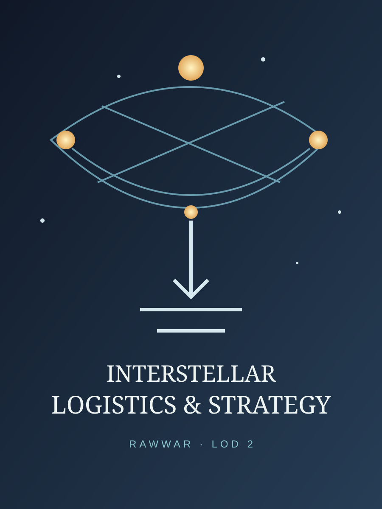

# Interstellar Logistics and Strategy

**Domain:** raWWar  
**LOD:** 2  
**Status:** Research and worldbuilding reference  
**Scope:** Strategic movement, sustainment, communication, infrastructure, political economy, and civilian systems across interstellar distances.

## Purpose and scope

Interstellar strategy begins with a question more difficult than how a fleet crosses a map: what makes a distant society, expedition, settlement, or coalition persist across years, decades, or generations? Distance is not merely a number between stars. It is a bundle of delays, energy costs, industrial dependencies, information limits, environmental risks, and political consequences.

This book treats logistics as a strategic system rather than a supply appendix. It connects orbital and planetary operations to the larger interstellar network, while leaving physical laws and material behavior to **Physics** and shared composition contracts to **SURPS**. It is a raWWar knowledge volume, not a claim that any particular faster-than-light technology exists.

Related reading:
- [Science Fiction Warfare](science-fiction-warfare.md) — the broad speculative domain.
- [Orbital Warfare and Space Infrastructure](orbital-warfare-and-space-infrastructure.md) — local orbital constraints and infrastructure.
- [Planetary Defense and Habitat Conflict](planetary-defense-and-habitat-conflict.md) — settlement security and civilian survival.
- [Autonomous Systems and Machine Agency](autonomous-systems-and-machine-agency.md) — delegated operations and machine governance.
- [Fortifications and Strongholds](fortifications-and-strongholds.md) — bounded defensive systems and endurance.

## 1. Evidence labels and setting contract

Every future-facing claim must be identified in context:

- **Established:** supported by current science, engineering, or deployed systems. Examples include finite light speed, orbital mechanics, conservation of energy, radiation exposure, and the need to reject waste heat.
- **Extrapolated:** a plausible extension of known principles, but not a demonstrated interstellar capability. Examples include highly automated industrial ecosystems, large-scale in-space resource processing, or long-duration closed-loop settlements.
- **Speculative:** depends on unresolved science, extraordinary engineering, unknown economics, or untested social assumptions. Examples include practical crewed interstellar travel at useful scale, self-replicating industrial networks, and reliable generation-scale ecological closure.
- **Fictional:** a rule invented for a setting, such as a specific warp drive, jump gate, wormhole network, or instantaneous communication system.

A setting should declare its travel and communication rules independently. If faster-than-light travel exists, do not silently assume faster-than-light communication. If a gate network exists, define capacity, construction, maintenance, access, failure modes, and political control. A fictional convenience becomes strategically meaningful only when its constraints are consistent.

## 2. Distance, time, and strategic reach

### 2.1 Light-time is a political fact

**Established:** electromagnetic signals propagate at finite speed in vacuum. A message exchanged between distant systems therefore has a delay that cannot be removed by better command discipline. A commander cannot continuously supervise events several light-years away using ordinary communications.

The strategic consequences include:
- decisions delegated to local authorities;
- plans that must tolerate stale information;
- distinct local interpretations of central policy;
- delayed recognition of emergencies;
- negotiation and verification that take place on different clocks;
- incentives for local institutions to become self-sufficient.

A polity may remain culturally, legally, or economically connected while becoming operationally decentralized. Do not equate political sovereignty with instantaneous command.

### 2.2 Travel time is not just cruise time

A journey budget should include acceleration and deceleration, transfer windows, navigation uncertainty, maintenance, crew or passenger health, refueling, traffic restrictions, and contingency reserves. In a generation-scale setting, include demographic succession, institutional drift, and the possibility that the destination changes before arrival.

**Established:** under known physics, relativistic travel introduces energy and time-dilation considerations; propulsion, shielding, and heat rejection are serious constraints. **Speculative:** any practical system that makes crewed interstellar transport routine. **Fictional:** any drive that bypasses these constraints by explicit setting rule.

### 2.3 Reach is a network property

A state does not control a region simply because a map colors it inside a border. Effective reach depends on the ability to observe, communicate, transport, repair, supply, adjudicate disputes, and provide credible protection. A remote system may be formally claimed but functionally autonomous.

Useful measures for worldbuilding and simulation:
- message latency and confidence;
- travel duration and variance;
- available repair and fabrication capacity;
- local energy and life-support reserves;
- number of independent supply paths;
- time to replace a critical component;
- local authority to act without approval;
- time required to restore service after disruption.

These are descriptive measures, not universal formulas. A setting should choose which ones matter.

## 3. The logistics stack

Interstellar logistics can be modeled as linked layers. A failure in one layer can propagate into others.

1. **Energy:** generation, storage, distribution, conversion, and reserves.
2. **Propulsion and transport:** vehicles, transfer systems, navigation, traffic coordination, and safe harbor.
3. **Life support:** air, water, food, waste processing, medical capability, and environmental monitoring.
4. **Industrial capacity:** extraction, refining, fabrication, precision tooling, repair, and quality assurance.
5. **Information:** communication, navigation references, scientific data, identity, records, and cybersecurity governance.
6. **Human systems:** trained labor, education, health, family life, social trust, and institutional succession.
7. **Political economy:** taxation, contracts, rationing, trade, insurance, property, public goods, and dispute resolution.

The layers are coupled. A power shortage can reduce water recovery; a component shortage can degrade propulsion; a communications outage can prevent coordinated maintenance; a labor crisis can make a technically sound plant unusable. Resilience is therefore not equivalent to maximizing stockpiles.

## 4. Nodes, routes, and network topology

### 4.1 Nodes

A node may be a planet, moon, orbital habitat, industrial station, shipyard, fuel depot, research outpost, communications relay, or fictional transit gate. Each node should have a capability profile:
- what it produces;
- what it consumes;
- what it can repair;
- what it cannot replace locally;
- how long it can operate in isolation;
- who governs it;
- who depends on it;
- what happens when it is unavailable.

A settlement with excellent food production but no precision manufacturing may remain dependent on imported electronics. A shipyard without local materials may be strategically important but fragile.

### 4.2 Routes

A route is more than a line between two points. It has capacity, travel time, risk, seasonal or orbital constraints, service requirements, and political permissions. In a setting without FTL, route planning must respect orbital mechanics and the actual transfer-energy budget. In a fictional network, define the equivalent costs and constraints rather than making travel free.

### 4.3 Centrality and chokepoints

A system can become important because many journeys, services, or political relationships depend on it. Such centrality may emerge from geography, infrastructure, standards, expertise, or trust. It does not automatically make the node defensible or legitimate.

The strategic question is not simply “Can an adversary seize the hub?” It is also:
- Can users reroute?
- Can the service be replicated?
- Does the hub's operator have incentives to remain neutral?
- What civilian services depend on it?
- Would disruption harm the attacker’s own network?
- Is redundancy physical, institutional, or merely nominal?

## 5. Industrial ecology and local self-sufficiency

“Self-sufficient” should never be a binary label. Measure it by subsystem and duration. A habitat may recycle most water yet import catalysts, medicines, electronics, or replacement membranes. A colony may grow food but lack the ecological diversity to survive a novel disease or crop failure.

Distinguish:
- **stockpiling:** holding critical goods for later use;
- **substitution:** using an alternate material or process;
- **repair:** restoring existing equipment;
- **remanufacture:** rebuilding components from recovered feedstock;
- **local production:** making new goods from local resources;
- **industrial independence:** sustaining the full chain of tools, expertise, energy, and quality control.

Local production can reduce vulnerability but create new dependencies on specialized labor, software, standards, and rare inputs. No settlement should be assumed independent merely because it mines local ore.

## 6. Campaign design across long distances

A campaign should be represented as a sequence of political and logistical conditions, not only a sequence of battles.

For each operation, define:
- political objective and legal authority;
- information available at decision time;
- local allies and institutions;
- transport and sustainment assumptions;
- acceptable duration and loss of service;
- civilian systems that must remain functional;
- abort and de-escalation conditions;
- what constitutes success after the force departs.

A force that arrives but cannot maintain itself may create a short-lived occupation, a humanitarian emergency, or a new dependency rather than durable control. A campaign can fail politically even when every tactical engagement is won.

This book intentionally addresses strategy and consequences at a systems level. It does not provide instructions for sabotaging real infrastructure or exploiting real supply networks.

## 7. Governance, sovereignty, and the long-distance polity

Interstellar governance is shaped by communication delay and unequal dependence. A central government may retain symbolic legitimacy while local institutions make most operational decisions. A distant colony may demand representation because it bears local costs; a core world may demand oversight because it finances shared infrastructure.

Questions for a setting:
- Who can authorize emergency action when contact is delayed?
- Which decisions are local, federated, or reserved to a central authority?
- How are taxes and shared infrastructure costs distributed?
- Can a settlement leave a federation, and what happens to shared assets?
- Who owns life-support infrastructure and essential data?
- How are disputes adjudicated when parties cannot appear at the same time?
- What rights belong to travelers, residents, workers, and descendants born en route?

Avoid assuming that distance inevitably produces rebellion. It may produce cooperation, negotiated autonomy, interdependence, cultural divergence, or renewed integration depending on institutions and incentives.

## 8. Civilian life and ethical constraints

The logistics network is also the civilian world. Food, medicine, communications, navigation, environmental control, and emergency services are not merely military assets. Treating them as expendable can turn a limited conflict into mass displacement or cascading humanitarian disaster.

A responsible setting accounts for:
- protected civilian services and continuity plans;
- medical evacuation and long-duration care;
- labor rights and coercive contracts;
- informed consent for generation-scale voyages;
- unequal exposure to risk;
- refugee status and access to life support;
- accountability for autonomous transport and industrial systems;
- post-conflict repair, compensation, and governance.

A settlement's survival should not depend on an invisible population of disposable workers.

## 9. Autonomous logistics and machine agency

Automation can improve inspection, scheduling, navigation, maintenance, and resource allocation. It can also concentrate power in opaque systems or create brittle dependencies. See [Autonomous Systems and Machine Agency](autonomous-systems-and-machine-agency.md).

A setting should specify:
- what the system may decide;
- what it may execute;
- what requires human or civic authorization;
- how it handles uncertainty and conflicting objectives;
- how people inspect and contest its decisions;
- how service continues when it fails;
- who is accountable for harm.

Do not infer moral or legal status from technical sophistication alone. Conversely, do not assume that a system with meaningful delegated authority is socially irrelevant.

## 10. Tabletop and simulation interpretation

A useful campaign model can represent each node with a small number of state variables: energy margin, life-support margin, industrial capacity, transport capacity, information latency, repair capacity, political cohesion, and civilian risk. Use ranges or qualitative states when precise data would be false confidence.

Events should alter dependencies rather than simply subtract hit points from a “supply” statistic. A delayed shipment might be harmless if substitutes exist, severe if a single component is critical, or politically explosive if allocation is perceived as discriminatory.

Suggested scenario seeds:
- a remote station must decide whether to divert a medical shipment;
- a newly independent settlement negotiates access to a shared navigation service;
- a shipyard faces a shortage that exposes a hidden industrial dependency;
- a relay failure leaves several communities with different versions of an emergency order;
- a long voyage arrives at a destination whose government has changed.

These are narrative and systems prompts, not predictions.

## 11. Research discipline and limitations

Interstellar logistics is presently a speculative strategic domain. Current physics supports discussion of finite signal speed, orbital mechanics, energy, radiation, and thermal constraints; it does not establish routine human interstellar transport or settlement. Claims about large-scale closed ecosystems, autonomous industrial expansion, and interstellar political economies require explicit assumptions.

Research should distinguish peer-reviewed science, engineering demonstrations, policy analysis, historical analogies, and fiction. Maritime empires, terrestrial supply lines, polar expeditions, and isolated communities can offer useful comparisons, but none is a direct template for interstellar society.

## 12. Design checklist

Before accepting an interstellar setting or campaign, ask:

- Are travel and communication rules separately defined?
- Are energy and thermal constraints accounted for?
- Are life-support and industrial dependencies visible?
- Does every important node have a credible maintenance and repair story?
- Are local authority and delayed central oversight explicit?
- Can the network reroute or degrade gracefully?
- Are civilian services and rights treated as strategic realities?
- Are autonomous systems bounded and accountable?
- Are speculative and fictional assumptions labeled?
- Does the outcome persist after the expedition or campaign ends?

The central principle: **interstellar power is the ability to sustain relationships across distance, not merely the ability to arrive.**

## Resource-economy companion

See [Extraction, Materials, and Industrial Foundations](extraction-materials-and-industrial-foundations.md) for cross-world resource abundance and processing; [Orbital Industry and Strategic Resource Networks](orbital-industry-and-strategic-resource-networks.md) for asteroid prospecting, receiving facilities, depots, and transport; and [Interstellar Economies and Multi-System War](interstellar-economies-and-multi-system-war.md) for millennia-scale imperial institutions, system autonomy, and multi-system conflict.
