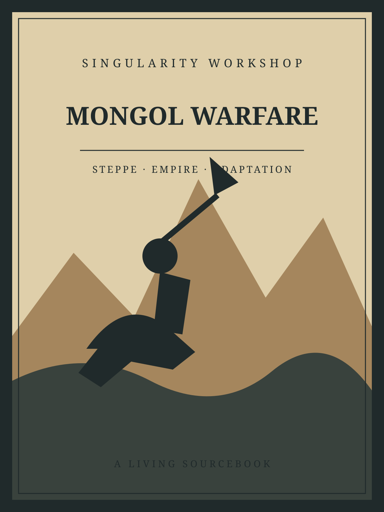

# SURPS — Domain — LOD 2 — Mongol Warfare

**Scope:** Mongol military and political expansion from the rise of Temüjin through the successor khanates, with attention to steppe society, mobility, command, logistics, adaptation, and regional variation.  
**Status:** LOD 2 historical sourcebook / first edition.  
**Descriptor:** [mongol-warfare.book.json](mongol-warfare.book.json)

## 1. A confederation becomes an empire

The Mongol Empire emerged from the political and social worlds of the eastern Eurasian steppe. Temüjin's rise and his proclamation as Chinggis Khan in 1206 followed a period of alliance-making, warfare, incorporation, and political consolidation. The resulting empire expanded across much of Eurasia, but it did not remain a single unified state. Successor khanates developed distinct political interests, institutions, and relationships with conquered populations.

“Mongol warfare” should not be reduced to an ethnic essence or a timeless cavalry formula. Its development depended on political unification, leadership, military organization, steppe ecology, intelligence, communication, and the ability to adapt to unfamiliar environments and opponents.

## 2. Steppe society, leadership, and obligation

Military organization was connected to kinship, household, patronage, loyalty, and the distribution of political authority. Temüjin's consolidation altered existing relationships and incorporated people from multiple groups. The empire's forces were not ethnically uniform; Turkic, Chinese, Persian, and many other peoples served in varied roles under Mongol rule and successor states.

The decimal organization commonly associated with units of tens, hundreds, thousands, and ten-thousands helped structure command and mobilization, but historical practice varied. Treat the decimal scheme as an institutional model whose implementation changed over time, not as proof that every army was a perfectly standardized grid.

Leadership involved personal authority, delegated command, discipline, political trust, and the management of rival elites. Succession and dynastic competition could shape strategic decisions as much as an enemy's field army.

## 3. Mobility is an ecological system

Mounted mobility was a major advantage in many steppe campaigns, but it depended on pasture, water, remounts, seasonal movement, animal health, and knowledge of routes. Multiple horses per rider could extend operational endurance while increasing the land and forage required. A mounted force cannot move indefinitely without affecting the landscape and the communities that inhabit it.

Terrain determines what mobility means. Open grasslands, deserts, forests, mountains, river systems, and cultivated regions impose different constraints. A campaign in northern China or the Middle East could not simply reproduce the movement patterns of the steppe. Adaptation required local expertise, siege equipment, infantry, engineers, naval resources in some theaters, and supply systems suited to the region.

## 4. Intelligence, communication, and operational coordination

Mongol campaigns are associated with reconnaissance, scouts, messengers, envoys, and coordinated movement across wide areas. Intelligence could include political information, route knowledge, estimates of local resources, factional relationships, and the intentions of rulers. Information was not always accurate, and long-distance command faced delays and uncertainty.

Operational coordination relied on planning, delegated authority, communication networks, and the ability to converge forces. Do not project modern real-time command systems onto medieval operations. Messages traveled through people and animals; weather, distance, terrain, and political conditions shaped what commanders could know and when.

## 5. Adaptation, siegecraft, and conquered expertise

The empire's campaigns across China, Central Asia, Persia, the Caucasus, and Eastern Europe required more than mounted archery. Siege warfare, engineers, artillery technologies of the period, infantry, translators, administrators, and specialists from conquered societies became essential. The Mongol military system could absorb expertise and reorganize resources for new strategic problems.

This adaptability was neither automatic nor uniform. Siege operations could be costly, prolonged, and dependent on local specialists. Campaigns could fail or stall. The outcomes of conquest depended on political fragmentation among opponents, alliances, terrain, disease, climate, and the ability to maintain supply and authority after victory.

## 6. Campaigns and regional histories

The campaigns against the Jin and Song states, the Khwarazmian Empire, polities in the Caucasus and Rus' lands, and powers in the Middle East and Europe belong to distinct theaters and political contexts. Avoid flattening these into one continuous invasion. Each requires its own chronology, local sources, and account of the opposing states.

The empire's expansion brought destruction, displacement, and mass death in many regions. Those consequences should be described with evidence and regional specificity, not hidden behind abstract campaign arrows or romanticized as a frictionless conquest. Cities and communities also negotiated, surrendered, resisted, collaborated, rebuilt, and changed under Mongol rule.

## 7. Empire after the unified khanate

The division of the empire among successor khanates changed political priorities and military organization. The Yuan dynasty in China, the Ilkhanate in Iran, the Chagatai domains in Central Asia, and the Golden Horde in the western steppe developed different institutions and relationships with local societies. Their armies and strategies cannot all be treated as direct copies of the early imperial force.

The political and cultural history of these successor states is essential to understanding the longer legacy of Mongol expansion. Military service, trade, diplomacy, religious change, and administration continued to connect regions even as dynastic unity weakened.

## 8. Source criticism

Sources include Mongolian traditions, Persian histories, Chinese chronicles, Armenian and Georgian accounts, Rus' chronicles, Latin and other European reports, archaeology, and later compilations. The *Secret History of the Mongols* is indispensable but requires attention to its textual history, narrative purpose, and translation. Persian and Chinese sources preserve perspectives unavailable in many western accounts, but they too have political and literary contexts.

Avoid repeating sensational troop totals or casualty numbers without source analysis. Identify whether a figure is a contemporary estimate, later report, modern reconstruction, or disputed claim. Distinguish the actions of armies and rulers from collective blame assigned to entire populations.

## 9. Tabletop and simulation applications

A Mongol campaign model should connect movement to ecology, politics, and information:
- pasture, water, season, remount condition, and animal losses;
- route knowledge, scouts, message latency, and uncertainty;
- alliance reliability, incorporation, hostages, and elite rivalries;
- force composition by theater, including engineers and local specialists;
- siege duration, labor, equipment, and supply;
- opponent cohesion, fortified settlements, diplomacy, and adaptation;
- post-conquest governance, displacement, reconstruction, and resistance.

Give local societies agency and distinct political goals. The player should encounter negotiation, coalition-building, environmental limits, and administrative choices—not merely a map waiting to be overrun.

## 10. Research anchors

Use modern specialist histories of the Mongol Empire and successor khanates, critical editions and translations of Mongolian, Persian, and Chinese sources, and regional archaeological studies. The [UNESCO Silk Roads Programme](https://en.unesco.org/silkroad/) offers regional context, while specialist scholarship should anchor military claims. Read the *Secret History of the Mongols*, Juvayni, Rashid al-Din, and Chinese dynastic histories with attention to date, perspective, and transmission.

## 11. Cross-references

- [Warfare and Organized Force](warfare-and-organized-force.md) — domain vocabulary and institutions.
- [Chinese Warfare](chinese-warfare.md) — campaigns and state contexts in East Asia.
- [Persian Warfare](persian-warfare.md) — Iranian imperial and regional contexts.
- [Fortifications and Strongholds](fortifications-and-strongholds.md) — siege endurance and defensive systems.
- [Piracy and Maritime Raiding](piracy-and-maritime-raiding.md) — comparison of mobile predation and maritime networks.
- Future focused studies: Temüjin's unification; the Khwarazmian campaign; Mongol conquest of northern China; the western campaigns; the Ilkhanate; Yuan military institutions; Golden Horde and Rus' relations.

Mongol military history is a history of political formation, steppe ecology, mobility, adaptation, and empire. Its complexity becomes visible when the conquered regions and successor states are studied alongside the famous campaigns.