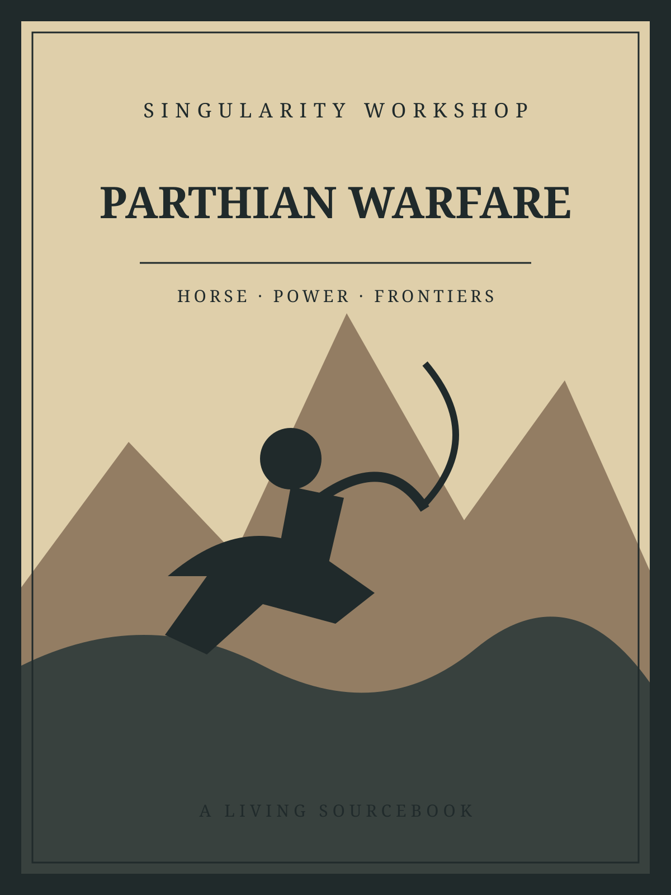

# SURPS — Domain — LOD 2 — Parthian Warfare

**Scope:** The Arsacid/Parthian Empire, its political-military institutions, mounted warfare, frontier systems, and relations with neighboring powers.  
**Status:** LOD 2 historical sourcebook / first edition.  
**Descriptor:** [parthian-warfare.book.json](parthian-warfare.book.json)

## 1. A changing Arsacid empire

The Parthian Empire, ruled by the Arsacid dynasty (conventionally dated c. 247 BCE–224 CE), emerged from the northeastern Iranian world and developed into a major power between the Mediterranean and Central Asia. Its history was not a static contest between two superpowers. Authority shifted among the royal house, aristocratic families, regional rulers, cities, and frontier communities. The empire's institutions changed through expansion, civil conflict, diplomacy, and war.

The label “Parthian” can refer to a ruling dynasty, an empire, a regional identity, or military traditions described by outsiders. Keep these meanings distinct. The empire governed diverse populations and territories; no single cultural stereotype explains its politics or armies.

## 2. Aristocratic power and command

Arsacid kingship relied on relationships with powerful noble houses and regional elites. These relationships could supply cavalry, money, political legitimacy, and local control, but also constrained royal choices. Succession disputes and elite competition were not peripheral distractions: they shaped mobilization, command cohesion, and the ability to sustain long campaigns.

Military authority should therefore be studied as a network. A ruler might possess formal sovereignty while negotiating with nobles whose resources and local followings were essential. In tabletop terms, command is not simply a chain of rank; it is a set of obligations, incentives, rivalries, and bargains whose reliability changes with events.

## 3. Mounted forces and the limits of a famous tactic

Parthian warfare is widely associated with mounted archers and heavily armored cavalry. The “Parthian shot”—shooting backward while withdrawing—became a memorable image in later accounts. It is a tactical motif, not a complete doctrine and not a universal explanation for Parthian success.

Mounted archery depends on trained riders, suitable horses, bows, arrows, remounts, grazing, water, and space to maneuver. Armored cavalry requires expensive equipment, skilled riders, animal care, and a social system capable of sustaining elite military service. These capabilities interact: reconnaissance, harassment, feigned withdrawal, shock action, pursuit, and the threat of encirclement can shape an opponent's choices.

The presence of these forces does not mean every Parthian battle was fought in open steppe or that infantry and fortifications were irrelevant. Terrain, weather, local allies, siege requirements, and political circumstances could change the composition and role of forces.

## 4. Horses, logistics, and operational reach

A mounted army consumes a large logistical base. Horses need forage, water, rest, replacement, veterinary attention, and suitable routes. A force that can move rapidly over one landscape may be constrained by mountains, forests, rivers, fortified towns, or a depleted grazing zone. Remount systems extend endurance but increase the supply burden.

A credible campaign model tracks the condition and availability of animals alongside human strength. It also considers the seasonal rhythm of campaigning, local provisioning, intelligence about routes, and the political cost of requisition. “Mobility” is never free: it transfers demands from roads and wagons to animals, land, and local populations.

## 5. Rome, Armenia, and the western frontier

The Parthian-Roman relationship involved repeated campaigns and negotiations over Mesopotamia, Armenia, Syria, and adjacent territories. Rome's invasions and Parthian counter-movements were shaped by command decisions, geography, supply, local rulers, and the political aims of both states. Armenia often became a contested arena in which dynastic legitimacy and external influence intersected.

The defeat of Crassus at Carrhae in 53 BCE is a major case study, but it should not become a simplistic morality tale about cavalry defeating infantry. Analyze intelligence, terrain, tactical choices, command, the Roman force's composition, Parthian logistics, and the wider political aftermath. Other campaigns produced different results; neither empire enjoyed uninterrupted superiority.

Diplomacy was a central instrument of power. Hostages, client kings, dynastic claims, embassies, treaties, trade, and negotiated borders could achieve goals that armies could not secure at acceptable cost.

## 6. Cities, fortresses, and internal conflict

The empire's military life extended beyond mounted battle. Cities, river crossings, fortified settlements, garrisons, and supply centers shaped control of Mesopotamia and Iran. Internal rebellions and rival claimants could divert forces, weaken frontier defense, or invite intervention. A campaign's outcome depended on whether victory could be translated into durable political authority.

The transition from Arsacid to Sasanian rule in 224 CE should be treated as a political and institutional transformation. Some elites, practices, and regional structures persisted; others changed. The new dynasty's claims to legitimacy and its military organization require their own study.

## 7. Source criticism

Evidence is uneven. Roman authors describe the Parthians through the lens of war, diplomacy, and Roman political memory. Archaeology, coinage, inscriptions, art, and regional studies provide essential counterweights, but surviving evidence varies across regions and periods. Later traditions may preserve older material while also reshaping it.

Avoid treating Roman labels for eastern peoples as precise self-identifications. Be cautious with ancient troop totals, tactical anecdotes, and descriptions of royal institutions. Mark what is securely attested, what is reconstructed, and what remains disputed.

## 8. Tabletop and simulation applications

A Parthian campaign can make mobility and political relationships playable without turning every encounter into a mounted-archer set piece. Useful scenario variables include:
- horse condition, remount availability, forage, and water;
- terrain suitability and maneuver space;
- noble-house commitments and the reliability of contingents;
- reconnaissance quality and information delay;
- the opponent's adaptation, discipline, and ability to deny resources;
- fortified towns, river crossings, and siege obligations;
- diplomatic leverage, hostages, client rulers, and succession claims.

Give opponents meaningful options. They may refuse battle, secure supply points, fortify crossings, negotiate, divide political coalitions, or adapt their formations. A simulation should reward strategic learning rather than presume a fixed ethnic or national advantage.

## 9. Research anchors

Use modern specialist histories of Parthia and the Arsacid state, regional archaeology, numismatic studies, and critical editions of Roman and Greek authors such as Plutarch, Cassius Dio, and Tacitus. The [Encyclopaedia Iranica](https://iranicaonline.org/) provides specialist entries and bibliographies that can guide further research. Treat accessible summaries as starting points and verify claims against scholarship.

## 10. Cross-references

- [Persian Warfare](persian-warfare.md) — comparative imperial context.
- [Achaemenid Warfare](achaemenid-warfare.md) — predecessor imperial system.
- [Roman Warfare](roman-warfare.md) — Roman institutions and campaigns.
- [Fortifications and Strongholds](fortifications-and-strongholds.md) — cities, frontiers, and siege endurance.
- Future focused studies: Carrhae; Antony's Parthian campaign; Armenia and the Arsacids; Parthian mounted warfare; Arsacid kingship and aristocratic politics; Roman-Parthian diplomacy.

Parthian military power rested on more than a celebrated maneuver. It emerged from mounted capability, elite politics, animal and human logistics, regional knowledge, and the strategic use of diplomacy as well as force.