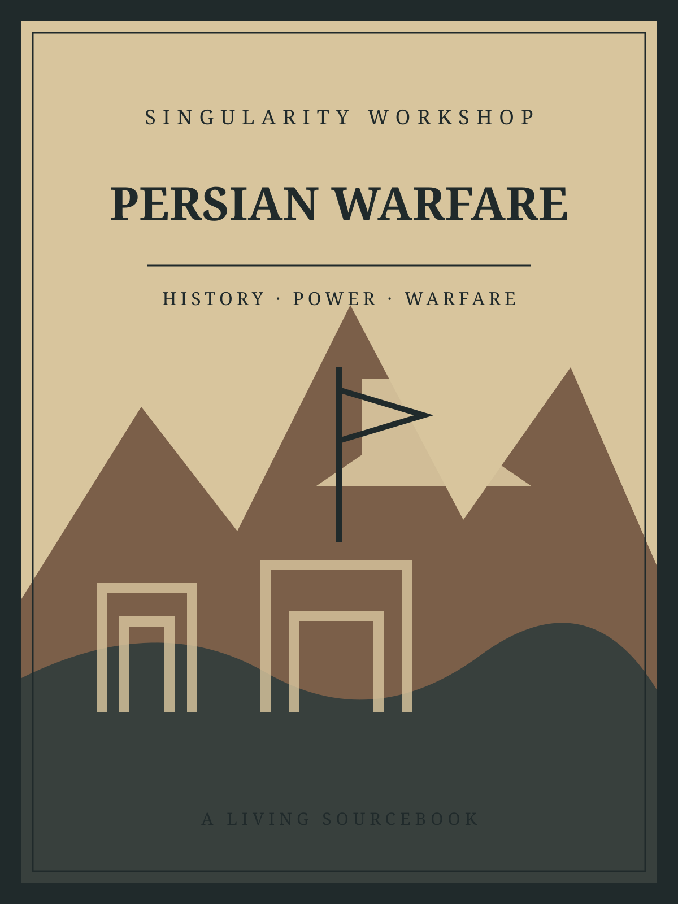

# SURPS — Domain — LOD 2 — Persian Warfare

**Scope:** Iranian and Persian imperial military traditions, with distinct Achaemenid, Parthian, and Sasanian periods and their wider regional contexts.  
**Status:** LOD 2 historical family / first edition.  
**Descriptor:** [persian-warfare.book.json](persian-warfare.book.json)

## 1. Three empires, many centuries

"Persian warfare" is not a single unchanging system. The Achaemenid Empire (c. 550–330 BCE), Parthian Empire (c. 247 BCE–224 CE), and Sasanian Empire (224–651 CE) were distinct political formations separated by centuries of institutional, technological, social, and geopolitical change. They shared elements of Iranian political and cultural heritage but must not be collapsed into one army or one national character.

The library will eventually provide dedicated books for each empire. This overview maps their connections, differences, and interactions with neighboring societies.

## 2. Achaemenid imperial warfare

The Achaemenid Empire emerged under Cyrus II and expanded across western and central Asia, Egypt, Anatolia, the Levant, and regions reaching toward the Indus. Under Darius I and his successors, imperial rule relied on provincial administration, royal authority, tribute, roads and communications, local elites, garrisons, fleets, and forces drawn from a vast range of subject and allied communities.

Do not describe the Achaemenid army as one homogeneous mass. Forces varied by region, campaign, status, and task. Cavalry, infantry, archers, maritime contingents, engineers, transport workers, and local levies contributed in different ways. The empire's scale was both a source of resources and a challenge of coordination, distance, loyalty, and supply.

Greek narratives of the Persian Wars are essential but partial. They were written by authors from communities at war with Persia or shaped by later political memory. Study Persian royal inscriptions, administrative evidence, archaeology, art, coinage, and the military contributions of subject peoples alongside Greek accounts.

## 3. Parthian imperial warfare

The Arsacid/Parthian Empire developed in a different political and military environment. Its power depended on a network of aristocratic houses, regional authorities, mounted forces, diplomacy, and control of routes between the Mediterranean and Central Asia. Political organization and military resources were not identical to the centralized image often projected onto later empires.

Parthian mounted warfare is frequently associated with horse archery and heavily armored cavalry, including the tactical traditions often summarized through the "Parthian shot." These are important subjects, but not an explanation for every Parthian campaign. Terrain, command, intelligence, remounts, horse supply, elite politics, allied forces, and Roman strategic choices all shaped outcomes.

Rome and Parthia competed and negotiated across Mesopotamia, Armenia, Syria, and frontier zones. Their relationship included invasions, raids, diplomacy, client kings, prisoner exchanges, and periods of accommodation. Avoid presenting the conflict as a simple timeless clash of civilizations.

## 4. Sasanian imperial warfare

The Sasanians overthrew the Parthian ruling house in 224 CE and built an Iranian empire that competed with Rome and later the eastern Roman Empire for control and influence across Mesopotamia, Armenia, the Caucasus, and adjoining regions. Sasanian military organization, royal ideology, aristocratic cavalry, infantry, fortifications, siegecraft, and frontier defense evolved over more than four centuries.

Sasanian heavy cavalry and elite armored horsemen are important, but the military system also depended on taxation, provincial administration, fortifications, transport, diplomacy, local forces, and the mobilization of resources. The long wars with Rome and Constantinople included shifting alliances, costly sieges, invasions, raids, negotiated settlements, and internal political crises.

The Sasanian state ended in the seventh century during the Arab-Muslim conquests. This transformation should be studied through multiple regional perspectives and not reduced to a single battle or a narrative of inevitable decline.

## 5. Common themes without false continuity

Across the three empires, useful comparative themes include:
- royal legitimacy and the relationship between ruler, aristocracy, and military command;
- provincial administration, taxation, tribute, and military finance;
- cavalry, infantry, missile troops, engineers, fleets, and specialist forces;
- roads, rivers, mountain passes, desert routes, supply depots, and seasonal campaigning;
- frontier systems, fortified cities, and strategic buffer regions;
- diplomacy, client rulers, dynastic marriage, intelligence, and negotiation;
- imperial representation, royal inscriptions, coinage, monuments, and the memory of victory.

These are comparative questions, not proof that the same institution persisted unchanged. Each claim must be dated and tied to a particular polity.

## 6. Greek, Roman, and neighboring perspectives

Persian history is often filtered through Greek or Roman narratives. Those sources can preserve valuable detail while also reflecting rivalry, political argument, and literary convention. A robust account gives Persian and Iranian evidence its own voice and studies the empire's relationships with Babylonians, Egyptians, Anatolian communities, Armenians, Arabs, Central Asian peoples, Indian polities, and many others.

The empires were multinational and internally diverse. Do not treat the subjects of an empire as a single people, nor assume every subject community supported or opposed imperial campaigns in the same way.

## 7. Tabletop and simulation use

A Persian imperial campaign should be built from geography, administration, communications, taxation, allied contingents, political relationships, and supply—not merely a large unit count. Different dynasties require different force structures and political models. A Parthian scenario should not simply reskin an Achaemenid army; a Sasanian frontier fortress should not inherit an Achaemenid administrative assumption without evidence.

Record uncertainty in force numbers, campaign routes, and source claims. Where a scenario needs invented details, label them as scenario assumptions.

## 8. Research anchors

- [Getty Museum — Persia: Ancient Iran and the Classical World](https://www.getty.edu/art/exhibitions/persia/explore.html)
- [The Metropolitan Museum of Art — The Achaemenid Persian Empire](https://www.metmuseum.org/essays/the-achaemenid-persian-empire-550-330-b-c)
- [Oxford Research Encyclopedia — The Achaemenid Persian Empire](https://academic.oup.com/edited-volume/34347/chapter/291402146)
- [UNESCO World Heritage Centre — Historical background on the Persian empires](https://whc.unesco.org/document/151679)
- Herodotus, Xenophon, Arrian, Cassius Dio, Ammianus Marcellinus, and other ancient authors should be read with attention to date, perspective, genre, and transmission.

## 9. Cross-references

- [Warfare and Organized Force, LOD 1](warfare-and-organized-force.md)
- [Greek Warfare, LOD 2](greek-warfare.md)
- [The Art of War, LOD 2](the-art-of-war.md)
- Future: Achaemenid Warfare; Parthian Warfare; Sasanian Warfare; The Persian Wars; Alexander's Invasion; Rome and Parthia; Rome and the Sasanians; Persian Siegecraft; Iranian Military Institutions and Royal Power.

The Persian imperial tradition is a succession of changing states and societies. Its story must be told from Iranian and regional evidence, not solely through the accounts of its enemies.
