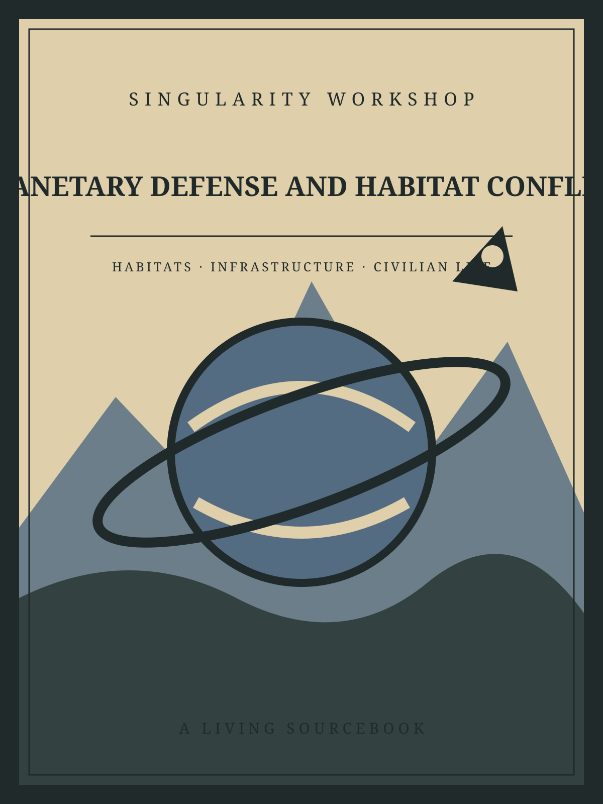

# SURPS — Domain — LOD 2 — Planetary Defense and Habitat Conflict

**Scope:** A science-fiction warfare sourcebook examining the security, defense, coercion, and conflict risks of inhabited planets, orbital habitats, stations, and other life-support-dependent settlements.  
**Status:** LOD 2 speculative domain / first edition.  
**Descriptor:** [planetary-defense-and-habitat-conflict.book.json](planetary-defense-and-habitat-conflict.book.json)

## 1. A settlement is an ecosystem

An inhabited habitat is not simply a fortress or a ship. It is a coupled technical and social environment: people depend on air, water, food, power, thermal control, waste processing, medical capacity, communications, maintenance, and governance. The same infrastructure that sustains ordinary life can become a source of vulnerability during a crisis.

This book treats planetary and habitat security as a systems problem. It does not provide procedures for attacking real infrastructure. Its purpose is to support responsible worldbuilding, high-level analysis, civil resilience, and simulation of consequences.

## 2. Evidence labels: what kind of future are we describing?

Every scenario should label its assumptions:
- **Established:** supported by current science, demonstrated engineering, or deployed systems.
- **Extrapolated:** a plausible extension of known principles or technologies, but not yet demonstrated at the proposed scale.
- **Speculative:** depends on unresolved engineering, economics, governance, or scientific questions.
- **Fictional:** an explicit rule of the invented setting.

These labels are not quality rankings. A fictional premise can be useful if it is internally consistent and clearly identified. A speculative claim should not be presented as a prediction or as current capability.

## 3. Planetary defense is not planetary militarization

Planetary defense can refer to protection from natural hazards, including near-Earth objects and space weather, as well as resilience against accidents and hostile acts. Those missions have different legal, technical, and institutional requirements. A civil planetary-defense system should not automatically become a weapon system or an excuse for unaccountable authority.

For fiction, define who authorizes protective measures, who audits decisions, how uncertainty is communicated, and how civilian populations participate. A credible system includes scientific institutions, emergency services, local governments, infrastructure operators, and international coordination.

## 4. Habitat dependence and graceful degradation

Habitats vary from small research stations to large rotating settlements and partially self-sufficient cities. Their resilience depends on redundancy, repair capacity, stored supplies, modularity, environmental monitoring, and the ability to reduce nonessential demand without endangering residents.

Avoid treating a single failure as automatically catastrophic or harmless. Consequences depend on system design, reserve capacity, time, repair access, population needs, and the availability of external support. A well-designed fictional habitat should have explicit safety margins and credible emergency modes.

## 5. Security, access, and governance

Habitat security involves identity, access rights, physical safety, cyber integrity, emergency authority, labor relations, and protection from coercion. Conflicts may arise from ownership disputes, unequal access to resources, political representation, labor conditions, environmental damage, or competing jurisdiction claims.

The setting should distinguish residents, visitors, workers, contractors, public authorities, operators, and security personnel. A habitat's owner is not automatically its legitimate sovereign. Legal status may be contested, layered, or negotiated across national and international frameworks.

## 6. Conflict without the battle-map cliché

In a closed life-support environment, armed confrontation can endanger everyone, including the party that initiates it. This changes incentives. Many conflicts may center on legitimacy, evacuation rights, labor stoppages, information integrity, legal jurisdiction, bargaining, sanctions, and external mediation rather than conventional battles.

When physical violence occurs in fiction, model it through consequences and uncertainty rather than a tactical recipe. The key questions are who is protected, who is endangered, what services remain available, and whether the settlement can recover.

## 7. Orbital and planetary constraints

Space is not an ocean. Orbital motion, energy, thermal rejection, radiation exposure, communication delay, propellant, debris, and access windows shape what is possible. Planetary environments add gravity, atmosphere, weather, terrain, and local resource constraints. A station in low orbit, a lunar settlement, a Martian city, and a deep-space habitat should not share one generic operating model.

Any proposed transport, rescue, reinforcement, or evacuation plan must account for travel time, vehicle capacity, life support, radiation protection, and the orbital or surface environment. Do not handwave logistics because the story needs a rapid arrival.

## 8. Civilian protection and humanitarian obligations

Residents are not background scenery. A conflict scenario should track injury, medical triage, family separation, displacement, access to food and water, loss of communications, psychological stress, and long-term environmental effects. Vulnerable residents may face different risks depending on age, disability, medical needs, employment, legal status, and access to transport.

Rules of distinction, proportionality, precaution, and humane treatment provide useful ethical and legal reference points, though their application in future space settlements may raise unresolved jurisdictional questions. Fiction should expose those questions rather than assume that technological novelty removes human rights.

## 9. Autonomous systems and escalation

Automated monitoring, maintenance, navigation, and emergency response could improve resilience, but delegation creates accountability questions. Who sets objectives? Who can override a system? How are failures detected? Can residents understand why a system denied access or initiated an emergency measure? What happens when communications are delayed or interrupted?

Autonomous systems should not be treated as infallible guardians or convenient villains. Model authority boundaries, audit trails, fail-safe behavior, human oversight, and contested responsibility. See the future companion volume on autonomous systems and machine agency.

## 10. Tabletop and simulation applications

A habitat-conflict scenario can use high-level system variables:
- population, occupancy, mobility needs, and evacuation capacity;
- air, water, food, power, thermal, medical, and communications service levels;
- redundancy, reserve duration, repair workforce, and spare-part availability;
- governance legitimacy, labor relations, ownership, and jurisdiction;
- information confidence, public trust, rumor, and emergency messaging;
- external support delay, transport capacity, and environmental exposure;
- civilian harm, displacement, recovery time, and long-term institutional change.

Use these variables to create meaningful decisions about prevention, de-escalation, continuity, and recovery. Avoid turning life-support failures into a simplistic hit-point mechanic.

## 11. Research anchors

Ground established claims in current spaceflight engineering, life-support research, orbital mechanics, planetary science, disaster resilience, humanitarian law, and space law. Useful starting points include [NASA's Human Research Program](https://www.nasa.gov/hrp/), [NASA's Orbital Debris Program Office](https://orbitaldebris.jsc.nasa.gov/), the [United Nations Office for Outer Space Affairs](https://www.unoosa.org/), and the [Outer Space Treaty](https://www.unoosa.org/oosa/en/ourwork/spacelaw/treaties/outerspacetreaty.html). These sources do not establish speculative settlement technologies; label extrapolations accordingly.

## 12. Cross-references

- [Science Fiction Warfare](science-fiction-warfare.md) — umbrella framework for speculative conflict.
- [Orbital Warfare and Space Infrastructure](orbital-warfare-and-space-infrastructure.md) — orbital constraints and infrastructure resilience.
- [Warfare and Organized Force](warfare-and-organized-force.md) — domain vocabulary and institutions.
- Future focused volumes: habitat law and sovereignty; emergency governance; civil defense and evacuation; autonomous maintenance and security; interplanetary logistics and rescue.

The central premise is simple: in a habitat, security is inseparable from keeping people alive. Credible conflict fiction takes infrastructure, legitimacy, and civilian consequences as seriously as military power.