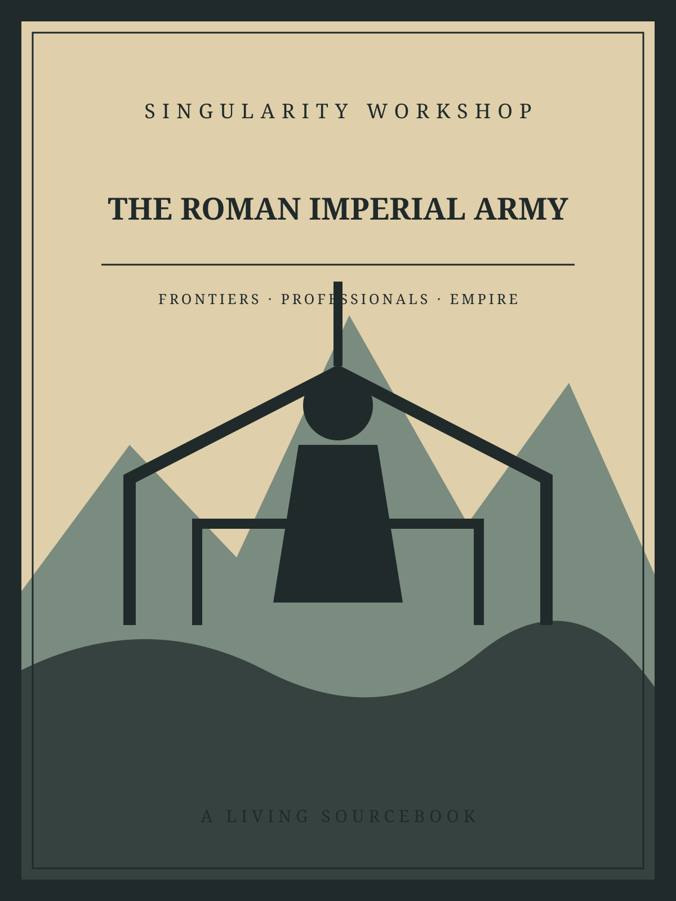

# SURPS — Domain — LOD 2 — The Roman Imperial Army

**Scope:** The armies of the Roman Empire from Augustus through the transformation of imperial military structures in late antiquity, with emphasis on institutions, regional variation, frontier systems, and civil-military relationships.  
**Status:** LOD 2 historical sourcebook / first edition.  
**Descriptor:** [roman-imperial-army.book.json](roman-imperial-army.book.json)

## 1. An army across centuries

The Roman imperial army was a changing institution, not a fixed formation frozen in the first century. Its structure, recruitment, equipment, deployment, and relationship to the state developed across the Principate, crises of the third century, and late antique reforms. Regional conditions and imperial priorities shaped how forces were organized.

The conventional distinction between Principate and Late Roman army is useful, but it can conceal gradual change and regional continuity. Avoid describing the later army as a simple decline from an ideal earlier model. Military systems adapted to new political, fiscal, demographic, and strategic pressures.

## 2. Legions, auxiliaries, and other forces

Legions were important, but they were only one part of the imperial military system. Auxiliary infantry and cavalry, fleets, urban cohorts, imperial guards, local forces, allied contingents, and later federate arrangements all require period-specific treatment. Their legal status, command relationships, and conditions of service varied.

The grant of citizenship to discharged auxiliaries under established service arrangements changed the relationship between military service and civic status. Recruitment practices evolved, including the role of provincial populations and, in later periods, changing forms of local and non-local recruitment. The empire's army was socially and geographically diverse.

## 3. Service, pay, and military society

Service involved pay, food, equipment, discipline, legal status, family relationships, retirement, and the risks of deployment. Soldiers lived in forts and settlements that became part of regional economies. Military communities interacted with merchants, craftspeople, families, local elites, and civilian administrations.

Military diplomas, papyri, inscriptions, tombstones, and archaeological remains provide evidence of service and identity. These records show that the army was not socially isolated. Its presence could create markets and infrastructure while also imposing taxation, requisition, land use, and coercive demands.

## 4. Frontier systems, not just walls

Roman frontiers were zones of interaction, movement, surveillance, diplomacy, trade, and military response. The Rhine, Danube, Euphrates, North African boundaries, and other frontier regions had different environments and political relationships. Forts and walls formed parts of wider systems involving roads, rivers, supply depots, patrols, intelligence, client rulers, and negotiation.

The term *limes* should not be reduced to a continuous impermeable wall. Frontier infrastructure could regulate movement and demonstrate authority, but it did not eliminate cross-border exchange or conflict. Local populations were participants in frontier life, not merely people outside the empire.

## 5. Command and imperial politics

Emperors, governors, legates, prefects, tribunes, centurions, and specialist officers held authority within a changing hierarchy. The emperor's relationship with the army was central to imperial legitimacy. Acclamation, succession disputes, military patronage, and regional concentration of forces could turn armies into decisive political actors.

Civil wars were not external interruptions to an otherwise stable system. They were recurring possibilities built into the relationship between military command, imperial succession, and regional power. The concentration of troops in a frontier zone could defend the empire while also giving a commander political leverage.

## 6. Campaigning, logistics, and infrastructure

The army depended on roads, bridges, ports, river transport, depots, pack animals, carts, food supply, water, medical support, replacement equipment, and fiscal administration. The famous road network was a strategic asset, but movement remained constrained by weather, terrain, disease, local resistance, and the carrying capacity of supply systems.

Roman engineering and administrative organization could support long campaigns, but they were not magic. A force's effective strength depended on what could be fed, transported, maintained, and coordinated in a given theater. Naval and riverine transport mattered in many regions.

## 7. Change in late antiquity

The third-century crises, reforms associated with Diocletian and Constantine, changing field-army structures, regional commands, and the transformation of frontier garrisons altered the imperial military landscape. The categories *comitatenses*, *limitanei*, and other late Roman labels are useful but must be read in their documentary contexts rather than treated as perfectly uniform branches.

The western empire's political fragmentation and the survival and transformation of the eastern empire produced different trajectories. Recruitment, federate relationships, fiscal capacity, fortification, and command changed in response to local conditions. The Eastern Roman military tradition continued to evolve well beyond the conventional date of the western imperial collapse.

## 8. Evidence and historiography

Evidence includes inscriptions, military diplomas, papyri, legal texts, coins, archaeology, forts, weapons, equipment, literary histories, and administrative documents. Vegetius is influential but wrote in a later context and cannot be treated as a direct handbook for every earlier period. Ammianus Marcellinus, Tacitus, Josephus, Cassius Dio, and other authors provide valuable but situated perspectives.

Modern reconstructions of unit strengths, deployment, and frontier staffing remain debated. Distinguish documented units from theoretical establishment strengths and distinguish a unit's nominal paper strength from its actual field complement.

## 9. Tabletop and simulation applications

A Roman imperial campaign model should link military and civil administration:
- unit type, legal status, recruitment region, service terms, and actual readiness;
- command hierarchy, governor relationships, imperial legitimacy, and succession;
- frontier geography, roads, rivers, forts, patrols, trade, and diplomacy;
- supply contracts, taxation, requisition, transport, disease, and maintenance;
- garrison communities, local economies, family life, and veteran settlement;
- civil-war risk, regional loyalties, mutiny, and competing claimants;
- late antique institutional change without simplistic decline scoring.

The model should distinguish a frontier zone from a border line and show how military security and civilian life affect one another.

## 10. Research anchors

Use Tacitus, Josephus, Cassius Dio, Ammianus Marcellinus, the *Notitia Dignitatum*, military diplomas, inscriptions, papyri, legal sources, and archaeology with period-specific criticism. The [Roman Inscriptions of Britain](https://romaninscriptionsofbritain.org/) database and [Vindolanda Tablets Online](https://vindolanda.csad.ox.ac.uk/) provide primary-source access. Specialist scholarship is necessary for institutional chronology and disputed reconstructions.

## 11. Cross-references

- [Roman Warfare](roman-warfare.md) — comparative overview.
- [Roman Republican Warfare](roman-republican-warfare.md) — antecedent institutions and civil-war transformation.
- [Persian Warfare](persian-warfare.md) — eastern frontier and imperial rivalries.
- [Fortifications and Strongholds](fortifications-and-strongholds.md) — frontier forts and defensive infrastructure.
- [Science Fiction Warfare](science-fiction-warfare.md) — comparative systems thinking for infrastructure, logistics, and political control.
- Future focused volumes: the Rhine and Danube armies; the eastern frontier; the third-century crisis; Diocletian and Constantine; Eastern Roman military evolution.

The imperial army was both a defense institution and a pillar of imperial power. Its history is best understood through the people, places, fiscal systems, and political relationships that sustained it.