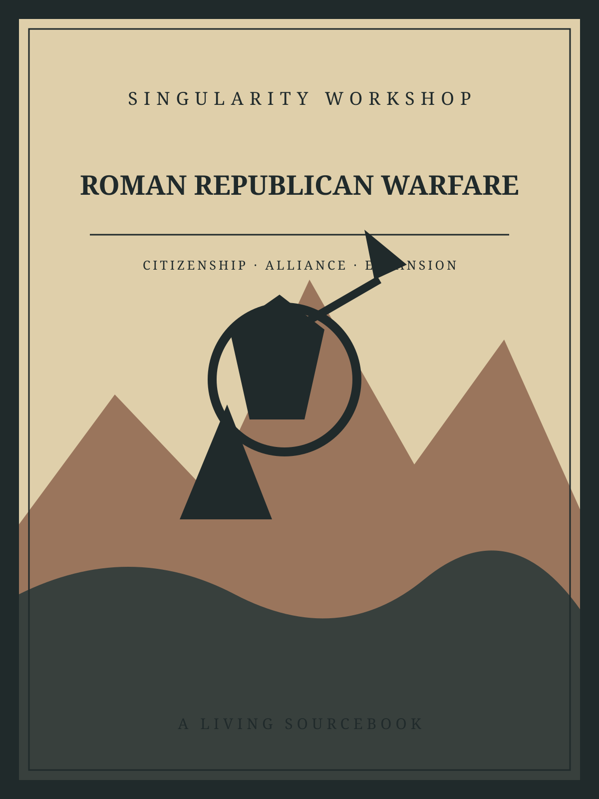

# SURPS — Domain — LOD 2 — Roman Republican Warfare

**Scope:** Roman warfare from the early and middle Republic through the collapse of republican government and the establishment of Augustus' principate.  
**Status:** LOD 2 historical sourcebook / first edition.  
**Descriptor:** [roman-republican-warfare.book.json](roman-republican-warfare.book.json)

## 1. A republic at war

The Roman Republic's military history is inseparable from its changing political institutions, social conflicts, alliances, and territorial expansion. Its armies were not a static machine. Recruitment, command, equipment, and obligations changed over centuries, while Rome's relationship with Italian communities and overseas provinces transformed the scale and character of warfare.

The traditional chronology of kings, early republic, middle republic, and late republic is useful, but early narratives were written down much later and must be assessed critically. Archaeology, inscriptions, comparative evidence, and contemporary or near-contemporary accounts do not always align with later Roman foundation stories.

## 2. Citizenship, property, and military obligation

Republican military service was shaped by civic status, property rules, age, political standing, and the needs of the state. The familiar model of property-qualified citizen soldiers captures important features of some periods but cannot explain the whole history. Rome's manpower system evolved alongside census practices, political reforms, expansion, and the changing relationship between citizens and allies.

The *socii* of Italy supplied substantial forces under treaty arrangements. These communities were not merely interchangeable auxiliaries: they had their own elites, interests, obligations, and bargaining positions. The Social War (91–88 BCE) exposed the tensions within this system and led to a major transformation of citizenship in Italy.

## 3. The manipular legion and military adaptation

The manipular legion is associated with the middle Republic and is often contrasted with the later cohort legion. Its tactical organization is known through sources whose descriptions require interpretation; it should not be treated as a universal template applied identically in every battle. Roman armies also used cavalry, light infantry, allied contingents, specialists, and naval forces where required.

Roman success cannot be explained by one formation. Recruitment depth, political resilience, alliance management, military learning, engineering, logistics, and the capacity to recover from catastrophic losses all mattered. Rome also suffered serious defeats and faced moments when its survival was uncertain.

## 4. Command, office, and competition

Consuls, praetors, dictators, promagistrates, legates, tribunes, and subordinate officers operated within political and military structures that changed over time. Command was affected by annual office, prorogation, senatorial decisions, personal ambition, patronage, and the need to coordinate multiple theaters.

Political competition could produce innovation and energy, but it could also generate rivalry, inconsistent strategy, and institutional breakdown. Military achievement could strengthen a commander's public standing and political leverage. The late Republic intensified these pressures as prolonged commands and personal armies became central to civil conflict.

## 5. Expansion across the Mediterranean

The wars against neighboring Italian peoples, Pyrrhus, Carthage, Hellenistic kingdoms, and other powers unfolded in different strategic environments. The Punic Wars demanded maritime power, allied manpower, long-distance logistics, and adaptation to a peer competitor. Campaigns in Greece and the eastern Mediterranean required diplomacy and engagement with complex political systems, not simply battlefield superiority.

Roman conquest did not instantly produce stable control. Provincial administration, taxation, garrisons, local elites, revolts, and negotiated settlements shaped the aftermath. Conquered communities retained agency and could cooperate, resist, litigate, rebel, or exploit Roman rivalries.

## 6. Naval warfare and engineering

The Republic's naval capacity expanded dramatically during the Punic Wars. Shipbuilding, crews, rower recruitment, harbors, supply, and allied maritime knowledge were essential. Roman naval power should not be described as an innate land-power deficiency suddenly solved by one invention; it was a learned and politically resourced capability.

Military engineering included roads, camps, siege works, bridges, field fortifications, and infrastructure that supported movement and control. These projects required labor, materials, expertise, and local cooperation or coercion. Engineering could extend reach but did not remove environmental and logistical limits.

## 7. The late Republic and civil war

From the Gracchan period through the Social War, Sullan conflict, Caesar's rise, and the wars among Caesar's successors, military institutions became entangled with profound political crises. Recruitment and loyalty shifted; veterans' settlement, land, debt, citizenship, provincial wealth, and elite competition all mattered.

Avoid the simplistic claim that one reform alone transformed the Roman army into a professional force loyal only to generals. The so-called Marian reforms are debated, and change was uneven. The late Republican armies emerged from cumulative institutional, social, and strategic developments.

## 8. Sources and contested narratives

Polybius offers a crucial account of the middle Republic, though his perspective and explanatory aims matter. Livy preserves extensive traditions but wrote under the Augustan regime and relied on earlier sources. Caesar's commentaries are powerful political narratives as well as campaign accounts. Sallust, Cicero, Appian, Plutarch, inscriptions, coins, and archaeology each contribute distinct evidence.

Numbers for ancient armies and casualties are often uncertain. State what a source reports, identify its date and perspective, and distinguish it from modern estimates. Do not present later moralizing anecdotes as transparent records of events.

## 9. Tabletop and simulation applications

Model republican warfare through interacting institutions:
- citizen recruitment, allied obligations, census and political reform;
- annual command, prorogation, senatorial authority, and personal ambition;
- alliance reliability, treaty rights, citizenship, and local agency;
- campaign season, roads, ports, supply, disease, and replacement capacity;
- legionary and allied composition appropriate to period and theater;
- naval capability, engineering labor, siege duration, and finance;
- veterans, land settlement, provincial extraction, and civil conflict.

A simulation should make political decisions consequential. Rome's manpower and resilience were institutional achievements with costs, not inexhaustible numerical bonuses.

## 10. Research anchors

Read Polybius, Livy, Caesar, Sallust, Cicero, and later accounts comparatively, alongside modern scholarship on the Roman Republic, Italian allies, Punic Wars, military institutions, and the Social War. The [Digital Augustan Rome](https://digitalaugustanrome.org/) and [Perseus Digital Library](https://www.perseus.tufts.edu/) offer research entry points, but specialist editions and archaeological publications remain essential.

## 11. Cross-references

- [Roman Warfare](roman-warfare.md) — broad comparative overview.
- [Greek Warfare](greek-warfare.md) — Hellenistic opponents and eastern Mediterranean contexts.
- [Warfare and Organized Force](warfare-and-organized-force.md) — shared domain framework.
- [Fortifications and Strongholds](fortifications-and-strongholds.md) — camps, siege works, and defensive systems.
- Future focused volumes: Punic Wars; Social War; Sulla and the civil wars; Caesar's Gallic campaigns; the triumviral conflicts.

Republican warfare was a changing relationship between civic obligation, allied communities, political competition, and expansion. It should be studied as a historical process, not as a timeless legionary formula.