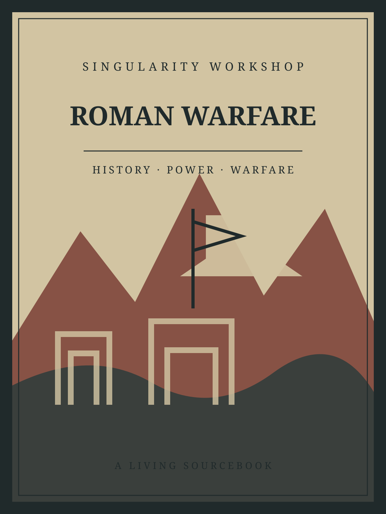

# SURPS — Domain — LOD 2 — Roman Warfare

**Scope:** Roman warfare from the traditional regal period through Republic, Principate, later Empire, and the eastern Roman continuation.  
**Status:** LOD 2 historical family / first edition.  
**Descriptor:** [roman-warfare.book.json](roman-warfare.book.json)

## 1. Rome's military history is not one legion

Roman warfare changed with Rome's political institutions, territorial scale, recruitment, resources, opponents, and internal conflicts. The army of the early Republic was not the imperial frontier army; the legions of the Principate were not identical to the forces of late antiquity; and the eastern Roman military world continued after the western imperial court disappeared.

This book provides a broad map. Dedicated books should treat the regal tradition, Republic, civil wars, Principate, third-century crises, late Roman transformations, and eastern Roman/Byzantine continuities with precise dates and source criticism.

## 2. Regal and early Republican traditions

Evidence for Rome's earliest military institutions is limited and filtered through much later literary accounts. Traditions about kings, early battles, and the organization of the citizen levy must be distinguished from what archaeology and contemporary evidence can establish. Avoid presenting later Roman origin stories as transparent records of the eighth through fifth centuries BCE.

## 3. The Republican army and expansion

The Republic's military system evolved over centuries. Citizen levies, allied Italian contingents, changing property and recruitment arrangements, and different tactical organizations supported Rome's expansion across Italy and the Mediterranean. The manipular legion was an important formation in the middle Republic, but its use and development varied by time and context.

The Punic Wars brought Rome into prolonged conflict with Carthage across Italy, Sicily, Iberia, North Africa, and the western Mediterranean. The wars required naval adaptation, allied mobilization, manpower replacement, finance, engineering, and strategic endurance. Hannibal's campaigns and Rome's eventual victory cannot be explained by a single tactical innovation.

Republican armies also fought in Spain, Greece, the Hellenistic east, Gaul, and other theaters. Expansion created new wealth and obligations while intensifying disputes over land, citizenship, command, provincial government, and political power.

## 4. The late Republic and civil war

The late Republican period saw major changes in recruitment, command, political competition, and the relationship between soldiers and commanders. Avoid reducing these transformations to a single "Marian reform" that instantly created a professional army. Institutional changes were gradual and contested.

Civil wars involving Marius and Sulla, Caesar and Pompey, and the later conflicts among Caesar's heirs and rivals were not simply external wars. They involved competing claims to legitimacy, provincial resources, military loyalty, political violence, and the collapse and reconstruction of institutions. The army became a decisive actor in Roman politics, but soldiers and commanders were not a single unified political bloc.

## 5. Principate and imperial frontier systems

Under the Principate, the army included legions, auxiliary cohorts and cavalry units, fleets, guards, specialized detachments, and personnel supporting administration and infrastructure. Deployment changed over time. Frontier security involved forts, roads, rivers, watch systems, local agreements, patrols, diplomacy, and the movement of mobile forces.

The army was not isolated from civilian life. Soldiers' families, merchants, craftspeople, enslaved people, local residents, veterans, and provincial communities formed part of the social world around military installations. Military construction and administration affected roads, bridges, towns, markets, and regional economies.

## 6. Late Roman transformation and eastern continuity

The third through sixth centuries involved changes in recruitment, command, field armies, frontier forces, taxation, fortifications, equipment, and imperial administration. The "fall of Rome" is not a sufficient description of these transformations. Western imperial authority fragmented through different regional processes; the eastern Roman state continued with its own institutions and military history.

The eastern Roman/Byzantine tradition should be treated as a continuation and transformation of Roman statehood, not as an unrelated civilization that suddenly appeared after a single date. Its military manuals, diplomacy, fiscal systems, naval forces, and frontier strategies deserve dedicated books.

## 7. Organization and lived experience

A Roman military book should distinguish:
- legionaries, auxiliaries, allied contingents, fleets, guards, engineers, scouts, medical personnel, clerks, and transport workers;
- officers and command appointments by period, not as a timeless rank chart;
- citizens, non-citizens, provincials, recruits, veterans, enslaved people, and civilians around forts;
- imperial troops, civil-war armies, local garrisons, and irregular allies;
- official ideals from actual practice, which could differ.

Do not assume every legion had the same strength, equipment, organization, or deployment throughout Roman history. Nor should the familiar image of the legionary obscure cavalry, archers, slingers, naval forces, siege specialists, and allied formations.

## 8. Logistics, engineering, and strategic endurance

Roman military effectiveness depended on recruitment, taxation, roads, ports, river transport, depots, local procurement, food and fodder, tools, medical care, communications, and political coordination. Forts and roads were not simply symbols of conquest; they supported movement, supply, administration, and regional interaction. Their effects differed across frontier zones.

Military engineering includes camps, roads, bridges, siege works, field fortifications, mines, ramps, artillery, and the maintenance of infrastructure. Claims about physical performance must be validated by Physics rather than inferred from an illustration.

## 9. Tabletop and simulation use

A Roman campaign should be parameterized by period, political authority, recruitment model, allied relationships, command structure, logistics, terrain, climate, and opponent. A legionary unit template must never be applied indiscriminately to the entire Roman timeline.

Scenarios can explore frontier patrols, siege operations, naval transport, civil-war loyalty, provincial revolt, recruitment, engineering, supply crises, diplomacy, and veteran settlement. Include civilians and local communities as agents with their own goals and constraints, not as scenery.

## 10. Research anchors

- [Oxford Classical Dictionary — Roman Republican armies](https://academic.oup.com/edited-volume/61673/chapter-abstract/548703772)
- [Oxford Classical Dictionary — Rome from Augustus to the Antonines](https://academic.oup.com/edited-volume/61673/chapter/548214591)
- [Cambridge History of Greek and Roman Warfare — Military Forces](https://www.cambridge.org/core/books/abs/cambridge-history-of-greek-and-roman-warfare/military-forces/98AD7B7DB07FB11A2243642140A9ABCD)
- Polybius, Livy, Caesar, Sallust, Tacitus, Josephus, Ammianus Marcellinus, and later military writers — each requires source-critical reading.
- Modern scholarship should be period-specific; do not use a single popular account as the authority for all Roman centuries.

## 11. Cross-references

- [Warfare and Organized Force, LOD 1](warfare-and-organized-force.md)
- [Greek Warfare, LOD 2](greek-warfare.md)
- [Persian Warfare, LOD 2](persian-warfare.md)
- [Fortifications and Strongholds, LOD 2](fortifications-and-strongholds.md)
- Future: Roman Republic; Roman Imperial Army; Roman Civil Wars; Punic Wars; Caesar's Gallic Campaigns; Roman Frontier Systems; Roman Naval Warfare; Roman Siegecraft; Late Roman Warfare; Eastern Roman Warfare; Roman Logistics and Military Engineering.

Rome's military history is a long sequence of adaptations and political transformations. Its institutions should be studied in their own periods, not reduced to a timeless legionary template.
