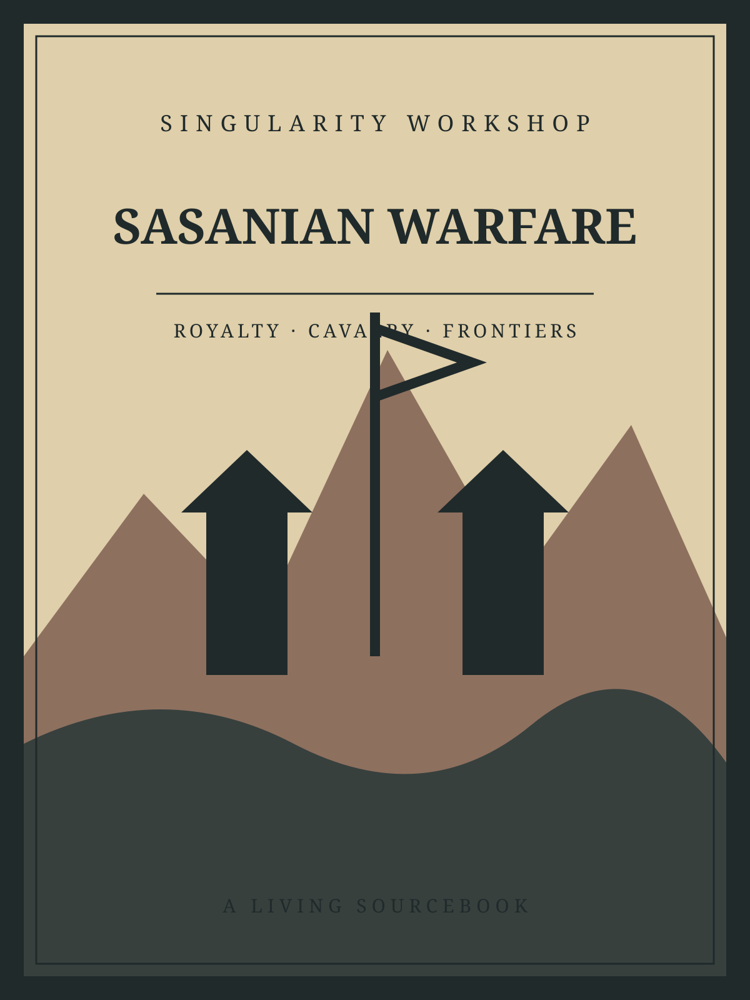

# SURPS — Domain — LOD 2 — Sasanian Warfare

**Scope:** The Sasanian Empire (224–651 CE), its military institutions, frontier systems, campaigns, diplomacy, and transformation.  
**Status:** LOD 2 historical sourcebook / first edition.  
**Descriptor:** [sasanian-warfare.book.json](sasanian-warfare.book.json)

## 1. An imperial state in a contested region

The Sasanian Empire emerged in 224 CE after Ardashir I defeated the last Arsacid ruler. For more than four centuries, Sasanian kings governed an Iranian imperial state whose strategic concerns included Mesopotamia, Armenia, the Caucasus, Central Asia, the Persian Gulf, and the routes connecting these regions. Its military history cannot be reduced to a sequence of wars with Rome: internal politics, frontier diplomacy, trade, taxation, local elites, and relations with neighboring peoples were equally consequential.

Sasanian rulers articulated distinctive claims to kingship and Iranian imperial legitimacy. Those claims changed over time and were contested within the dynasty and among powerful aristocratic families. Royal ideology, religious institutions, court politics, and military command intersected without being identical.

## 2. Military institutions and social foundations

The Sasanian military system drew on royal authority, aristocratic households, provincial forces, garrisons, frontier communities, and specialist personnel. The mounted elite is prominent in surviving representations and in many accounts, but no single formation explains the empire's capacity. Infantry, missile troops, engineers, siege personnel, transport workers, naval forces in relevant theaters, and locally recruited contingents all mattered.

The relationship between king and nobility shaped recruitment and command. Elite cavalry service required land, wealth, horses, armor, training, and support networks. This made military capacity inseparable from social hierarchy and political bargaining. Do not assume that a royal order automatically translated into uniform compliance throughout the empire.

## 3. Cavalry, equipment, and combined capabilities

Sasanian heavy cavalry and armored horsemen are among the best-known features of the period. Their importance should be examined through equipment, horse breeding and care, training, tactical role, and the social institutions that maintained them. Mounted forces could provide shock, mobility, reconnaissance, escort, and operational reach, but their effectiveness depended on terrain, supply, leadership, and coordination with other forces.

Sasanian warfare also involved archery, infantry, fortifications, field works, river operations, and siegecraft. Equipment and tactics changed over centuries and were influenced by interaction with Roman, Central Asian, and other neighboring powers. Avoid projecting one reconstructed “standard Sasanian army” onto every reign and theater.

## 4. Frontier systems and fortified landscapes

The empire's frontiers were not simple lines. They consisted of fortified towns, walls and barriers in some regions, garrisons, roads, river crossings, mountain passes, allied or client authorities, and zones of negotiated influence. Their purpose could include warning, delaying incursions, protecting agricultural districts, securing trade routes, and controlling movement.

Fortifications required maintenance, supplies, labor, command, and a population capable of sustaining them. A wall without garrisons or provisions is not a functioning defense system. Frontier security also depended on diplomacy, intelligence, seasonal campaigning, and the ability to respond to raids or larger invasions.

## 5. Siege warfare and the Roman frontier

Sasanian and Roman forces repeatedly fought over Mesopotamian cities, Armenian politics, and strategic corridors. Siege warfare could consume time and resources on a large scale. Defenders needed food, water, repair materials, medical support, command cohesion, and confidence that relief might arrive. Attackers needed engineering skill, supply, intelligence, labor, and political patience.

The long wars were punctuated by treaties, payments, exchanges, dynastic negotiations, and periods of relative peace. The relationship was not a permanent total war. Both empires faced internal crises and other frontiers; strategic priorities shifted as rulers and circumstances changed.

## 6. Diplomacy, trade, and strategic restraint

Diplomacy was a military instrument. Armenia, the Caucasus, Arab polities, Central Asian powers, and regional elites could influence the balance between the empires. Alliances and client relationships were often unstable and negotiated. Trade routes and commercial cities could be both sources of wealth and objects of strategic competition.

A campaign that wins territory but exhausts the treasury, destabilizes a frontier, or provokes a coalition may be a strategic failure. Conversely, a negotiated settlement may preserve resources and achieve a ruler's aims without a decisive battlefield victory. Model political objectives explicitly rather than assuming that conquest is always the goal.

## 7. The seventh-century transformation

The final decades of Sasanian rule included severe internal conflict, rapid changes of monarch, and exhausting wars with the eastern Roman Empire under Heraclius. The Arab-Muslim conquests then transformed the political landscape. The fall of the Sasanian state was not a single event or an inevitable civilizational collapse; it involved military defeats, political fragmentation, local negotiations, regional variation, and the emergence of new governing arrangements.

Study the experiences of different provinces and communities rather than treating the empire as a uniform actor. The continuity of Iranian language, administration, culture, and elite participation after the end of the dynasty complicates any simple narrative of total rupture.

## 8. Evidence and interpretation

Sasanian evidence includes royal inscriptions, coinage, seals, reliefs, archaeological sites, administrative and legal materials, and accounts by Roman, Byzantine, Armenian, Syriac, Arabic, and other authors. Each source has a particular purpose and perspective. Royal monuments project legitimacy; enemy chronicles frame victories and defeats; later accounts may compress events or reinterpret them through subsequent political and religious contexts.

Use modern specialist scholarship and regional studies. Distinguish contemporary evidence from later narrative, and note where chronology, troop strength, or institutional reconstruction remains disputed. Avoid treating artistic depictions as literal technical manuals.

## 9. Tabletop and simulation applications

A Sasanian frontier scenario should integrate political and physical systems:
- royal legitimacy and aristocratic cooperation;
- frontier garrison strength, maintenance, and supply;
- cavalry readiness, horse resources, and seasonal constraints;
- city resilience, siege endurance, and relief prospects;
- taxation, treasury capacity, and campaign duration;
- diplomacy with neighboring rulers and local communities;
- competing fronts and the opportunity cost of committing forces.

A campaign's consequences should persist: damaged agriculture, disrupted trade, displacement, elite defections, fiscal stress, and contested legitimacy. Civilian life is not background scenery; it is part of the system that sustains and suffers from imperial war.

## 10. Research anchors

Consult modern histories of the Sasanian Empire, archaeological and numismatic research, and specialist studies of Roman-Sasanian relations. Primary source traditions include Sasanian royal inscriptions and later accounts by Ammianus Marcellinus, Procopius, Armenian historians, and Syriac and Arabic authors. These sources should be read in their original historical contexts and not treated as interchangeable eyewitness reports. The [Encyclopaedia Iranica](https://iranicaonline.org/) offers specialist entries and bibliographies for further study.

## 11. Cross-references

- [Persian Warfare](persian-warfare.md) — comparative context across three Iranian empires.
- [Parthian Warfare](parthian-warfare.md) — Arsacid predecessor and points of continuity and change.
- [Roman Warfare](roman-warfare.md) — Roman and eastern Roman institutions and campaigns.
- [Fortifications and Strongholds](fortifications-and-strongholds.md) — frontier defenses and siege endurance.
- Future focused studies: Shapur I's campaigns; the wars of Khosrow I and Khosrow II; Armenia and the Caucasus; Sasanian siegecraft; the late Sasanian civil wars; the Arab-Muslim conquests.

Sasanian military power was sustained by institutions, elite relationships, frontier communities, fiscal capacity, and diplomacy. Its history is best understood as an evolving imperial system rather than a catalogue of armored cavalry and Roman battles.