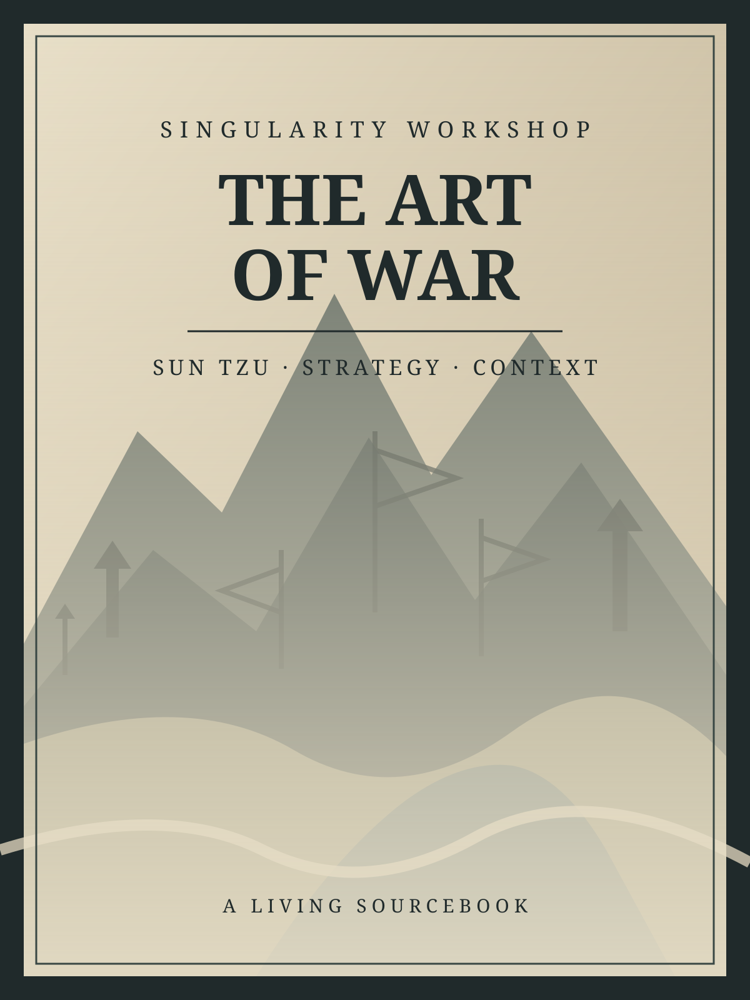

# Singularity Universal Roleplaying System — Domain — LOD 2 — The Art of War

**Descriptor:** [the-art-of-war.book.json](the-art-of-war.book.json)  
**Domain owner:** raWWar  
**Status:** Foundational classical strategy sourcebook / first edition  
**Version:** 0.1.0  
**Primary subject:** The received thirteen-chapter text traditionally attributed to Sun Tzu (Sunzi)

## 1. Why this book exists

*The Art of War* is one of the most influential works in the history of strategic thought. It deserves a dedicated sourcebook because it is not merely a collection of clever quotations. It is a compact work concerned with political purpose, the costs of conflict, preparation, knowledge, command, organization, adaptation, deception, terrain, and the conditions under which force should or should not be used.

This book studies the text as a historical work, a strategic argument, a transmitted literary artifact, and a source of ideas that later readers have interpreted in many different ways. It does not claim that a short ancient treatise is a universal answer to every modern conflict. Its concepts must be understood in their historical setting and tested against the conditions to which they are applied.

The work belongs alongside books on Chinese warfare, Warring States political history, military institutions, logistics, command, intelligence, diplomacy, and the wider history of strategic thought. It should also be read comparatively with other traditions rather than treated as the sole origin or final authority of strategy.

## 2. The work and its historical setting

The text is traditionally attributed to Sun Wu, commonly called Sun Tzu or Sunzi, and associated by later tradition with the state of Wu. Its received form is organized into thirteen chapters. The historical identity, life dates, authorship, composition history, and degree of textual unity remain subjects of scholarly discussion.

The text is associated with the broad world of ancient Chinese interstate competition and the Warring States era, but its formation and transmission should not be reduced to a single confidently dated moment without qualification. The discovery of a bamboo-slip military manuscript at Yinqueshan in 1972 materially changed modern understanding of early military texts and textual transmission. The received *Art of War* should therefore be studied alongside manuscript evidence and other early military writings, not in isolation.

A sourcebook edition must distinguish:
- traditional attribution to Sun Wu;
- the historical evidence for the person and the text;
- the received thirteen-chapter arrangement;
- manuscript witnesses and textual variants;
- later commentary and editorial reconstruction;
- modern translation choices and interpretations.

Do not turn uncertainty into either certainty or dismissal. A text can be historically influential even when questions about its authorship and compositional history remain open.

## 3. The thirteen chapters — a reading map

The following chapter names are common English renderings, not a claim that every translation uses identical wording. Each chapter is summarized in original prose; consult a complete public-domain or properly licensed translation for the text itself.

| Chapter | Common title | Main concerns |
|---|---|---|
| 1 | Laying Plans / Initial Estimates | Assessing the conditions of conflict, leadership, organization, environment, discipline, and the consequences of decisions before committing to war. |
| 2 | Waging War | The material and human costs of prolonged campaigns; the relationship between military action, state resources, and the need for a clear political purpose. |
| 3 | Attack by Stratagem | Achieving objectives while preserving what has value; the relationship between strategy, coercion, diplomacy, and battle. |
| 4 | Tactical Dispositions | Security, defensive posture, opportunity, and the difference between preventing defeat and creating the conditions for success. |
| 5 | Use of Energy | Coordinating direct and indirect action, timing, momentum, and the arrangement of forces. |
| 6 | Weak Points and Strong | Initiative, concentration, dispersion, uncertainty, and shaping the conditions under which opposing forces must respond. |
| 7 | Maneuvering | The difficulty of moving and coordinating forces; friction, communication, competing priorities, and the cost of maneuver. |
| 8 | Variation in Tactics | Adapting decisions to circumstances rather than applying fixed rules without judgment. |
| 9 | The Army on the March | Reading signs, movement, terrain, camp conditions, and the limits of interpreting observable behavior. |
| 10 | Terrain | How different environments shape movement, exposure, command, opportunity, and risk. |
| 11 | The Nine Situations | How the character of a situation affects cohesion, commitment, movement, and decision-making. |
| 12 | Attack by Fire | The historical treatment of fire as a destructive instrument and the importance of conditions, timing, and political consequences. |
| 13 | Use of Spies | Intelligence, human sources, local knowledge, information quality, and the strategic value and ethical risks of knowledge. |

A future expanded edition should give every chapter its own essay, translation comparison, historical examples, disputed readings, tabletop interpretation, and simulation mapping.

## 4. Strategic themes

### 4.1 Political purpose comes before military activity

Military action is not self-justifying. A state or organization must understand what it is trying to achieve, what political condition should follow, what costs it can sustain, and whether force is likely to produce the desired outcome. A tactical success can still be a strategic failure if it destroys the objective it was meant to secure.

### 4.2 Conflict consumes resources and lives

The text repeatedly treats prolonged war as costly. A campaign consumes food, transport, equipment, money, labor, attention, political legitimacy, and human lives. The burden does not fall evenly: soldiers, civilians, taxpayers, enslaved people, subject communities, merchants, and neighboring populations may experience the same war very differently.

### 4.3 Knowledge is incomplete and situated

Information is never simply "known" because a commander wants it. Sources have incentives, access, blind spots, and uncertainty. Reports can be delayed, distorted, misunderstood, or deliberately manipulated. A sound strategic model records who knows what, how they know it, when they knew it, and how confident they should be.

### 4.4 Adaptation is a command responsibility

The work values judgment under changing conditions. Plans are not substitutes for perception. A strategy that ignores terrain, weather, political change, logistics, morale, opposing agency, or unexpected events becomes brittle.

### 4.5 Deception is not the same as omniscience

The famous emphasis on deception is often simplified into a slogan. In context, deception belongs to a wider argument about uncertainty, perception, signaling, concealment, and the opponent's decisions. It does not mean that every opponent can be fooled or that deception guarantees victory.

### 4.6 Preserving people and political capacity matters

The text's preference for advantageous outcomes that avoid needless destruction should be read as strategic reasoning, not as a modern humanitarian code. It can be compared with later laws and ethics of war, but those frameworks must not be projected backward as if they were identical.

## 5. Reading the work without turning it into dogma

Common misreadings include:
- treating every sentence as an eternal law;
- extracting aphorisms without the chapter's argument;
- equating strategic deception with permission for unlimited dishonesty;
- assuming that avoiding battle is always possible or always desirable;
- treating the work as a complete manual for every military domain;
- ignoring the political and economic conditions that shape its advice;
- presenting it as proof that one culture possesses a timeless or exclusive genius for strategy.

The text is one important artifact within a diverse Chinese military and philosophical tradition. Its influence is real, but influence does not make every later use faithful to the original, and a popular quotation is not evidence that the quotation appears in the ancient text in that form.

## 6. Comparison with other strategic traditions

The Art of War should be placed in conversation with:
- other early Chinese military texts, including the *Wuzi*, *Wei Liaozi*, *Six Secret Teachings*, and the military writings associated with the Yinqueshan manuscripts;
- Greek accounts of war, command, and political conflict;
- Roman military practice and the later reception of Roman military writing;
- South Asian political and military thought, including the *Arthashastra* tradition;
- medieval and early-modern works on fortification, campaigning, naval power, and statecraft;
- modern strategic theory, while making the historical distance explicit.

Comparative study should ask what problems authors were addressing, what institutions they assumed, what evidence they had, and what kinds of political communities they imagined. Similar-sounding advice may arise from very different historical circumstances.

## 7. Tabletop and simulation applications

For tabletop play, the book can inform:
- strategic objectives and political constraints;
- incomplete intelligence and conflicting reports;
- campaign cost, supply pressure, and time;
- command friction and the limits of coordination;
- terrain and environmental uncertainty;
- negotiation, signaling, deception, and misinterpretation;
- the consequences of victory, stalemate, withdrawal, and escalation.

For simulation, represent these as explicit state and evidence rather than magic bonuses for quoting a maxim. Possible concepts include objective alignment, supply endurance, information confidence, command latency, cohesion, readiness, mobility, political support, and uncertainty. The values and transition rules must be owned by tested implementations; this sourcebook does not define a verified universal formula.

A scenario inspired by the text should give every faction its own goals, knowledge, constraints, and capacity to adapt. The opposing side is not a passive puzzle. It observes, learns, misleads, negotiates, and changes its behavior.

## 8. Copyright and translation discipline

The ancient work is not a modern copyrighted creation, but modern translations, introductions, notes, and scholarly editions can be protected. This sourcebook uses original summaries and analysis rather than reproducing a modern translation. Any future quotation must identify its translator and edition and verify that the text is public domain or otherwise licensed for the intended use.

A translation is an interpretation. Compare more than one translation when a strategic claim depends on a particular word or phrase. Do not silently combine translators and present the result as a single historical wording.

## 9. Research and further reading

The expanded research bibliography should prioritize critical editions, manuscript studies, academic histories of early China, and reputable translations. Useful starting points include:

- Sun Tzu, *The Art of War*, translated by Samuel B. Griffith (Oxford University Press, 1963). A major modern translation and study; the translation and editorial apparatus are copyrighted.
- Ralph D. Sawyer, *The Seven Military Classics of Ancient China* (Westview Press, 1993). Includes translations and historical framing; copyrighted.
- Victor H. Mair, studies and translations relating to early Chinese military manuscripts and the Yinqueshan discoveries. Verify the exact edition and claims before citing.
- The Yinqueshan Han tomb bamboo-slip texts and published archaeological/editorial studies of the military manuscripts.
- Mark Edward Lewis, *Sanctioned Violence in Early China* (SUNY Press, 1990), for the broader relationship between violence, political order, and early Chinese thought.

These are research leads, not substitutes for a claim-by-claim bibliography. Each future chapter expansion should attach a source to the specific historical or textual claim it supports.

## 10. Cross-references and next expansions

- [Warfare and Organized Force, LOD 1](warfare-and-organized-force.md)
- [Fortifications and Strongholds, LOD 2](fortifications-and-strongholds.md)
- Future: [Chinese Warfare and Military Thought](chinese-warfare-and-military-thought.md)
- Future: [Warring States China](warring-states-china.md)
- Future: [Command, Intelligence, and Strategic Deception](command-intelligence-and-strategic-deception.md)
- Future: [Logistics and the Cost of War](logistics-and-the-cost-of-war.md)

The next edition should deepen each chapter, compare translations and manuscript traditions, and connect strategic ideas to historically grounded case studies. *The Art of War* is a beginning of the strategic library, not its end.
