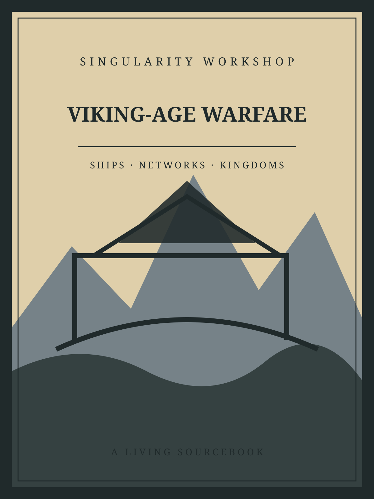

# SURPS — Domain — LOD 2 — Viking-Age Warfare

**Scope:** Armed activity and political transformation across Scandinavia and connected regions during the Viking Age, conventionally c. 793–1066 CE, with attention to raiding, trade, settlement, ships, regional rulers, and the formation of states.  
**Status:** LOD 2 historical sourcebook / first edition.  
**Descriptor:** [viking-age-warfare.book.json](viking-age-warfare.book.json)

## 1. The Viking Age was not one army or one people

The term “Viking Age” describes a broad historical period and a set of connected activities, not a single unified nation or military organization. Scandinavian communities participated in raiding, trading, migration, mercenary service, settlement, diplomacy, and state formation across the North Atlantic, Baltic, North Sea, river systems of eastern Europe, the Mediterranean, and parts of the North American Atlantic world.

“Viking” is often used as a blanket identity, but historical actors had local affiliations, political loyalties, languages, social positions, and changing interests. The same person or group might trade in one context, raid in another, serve a ruler elsewhere, and settle permanently in a new region. Avoid reducing all Norse people to raiders.

## 2. Ships, routes, and maritime capability

Ships were central to many Viking-Age operations. Different vessel forms served different purposes: cargo transport, coastal movement, river travel, troop carriage, and armed expeditions. Longships are important, but the maritime world also depended on merchant vessels, ports, landing places, shipbuilding knowledge, crews, navigational experience, and repair capacity.

Shallow-draft vessels could access rivers and coastal locations unavailable to larger ships, but this did not erase the challenges of weather, currents, tides, seasonal daylight, provisioning, and navigation. Ships required timber, iron fittings, rope, sailcloth, skilled labor, and ongoing maintenance. A fleet was an industrial and social achievement, not simply a collection of fast hulls.

Sea routes connected communities but also exposed them to risk. Coastal settlements, river ports, monasteries, trading centers, and political capitals faced different threat profiles. Maritime mobility could enable surprise and withdrawal, while local defenders could use terrain, barriers, warning systems, and political coordination to resist.

## 3. Raiding, trade, and political economy

Raiding could yield portable wealth, captives, tribute, and political leverage. It could also provoke retaliation, alliances against raiders, and changes in settlement patterns. Trade involved many of the same routes and maritime skills, but it was not simply raiding with a different label. Merchants, craftspeople, local rulers, and port communities shaped the exchange networks.

Captivity and enslavement were part of the period's political economy and must be treated as human experiences, not merely as abstract loot or economic units. Sources often describe wealth from the perspective of rulers and chroniclers; a fuller account asks what happened to communities, families, and individuals.

## 4. Armed groups and political authority

Expeditions could be organized around chieftains, kings, aristocratic households, coalitions, or temporary leaders. The size and composition of forces varied considerably. Later saga accounts may preserve traditions but were written down in different contexts and cannot automatically be treated as contemporary records.

The formation of Scandinavian kingdoms was gradual and contested. Rulers sought to control taxation, tribute, trade routes, law, religious institutions, and military obligations. Regional elites could cooperate, resist, or shift allegiance. The relationship between a king and armed followers was political as well as military.

## 5. Warfare beyond Scandinavia

Viking-Age forces interacted with the Frankish kingdoms, Anglo-Saxon polities, Ireland, Scotland, the Baltic, Slavic and Finnic communities, the Byzantine Empire, and Islamic polities connected through eastern trade routes. These encounters were not one-directional. Scandinavian groups could be invaders, settlers, traders, mercenaries, allies, subjects, or rulers depending on place and time.

The river routes of eastern Europe linked the Baltic to the Black and Caspian Seas. The Varangian presence in Byzantine service and the development of Rus' political formations require regional histories that include Slavic, Finnic, Byzantine, and other actors. Avoid treating eastern Europe as a passive corridor for Scandinavian expansion.

In the British Isles, raids, conquest, settlement, intermarriage, political alliance, and cultural exchange unfolded differently across Northumbria, Mercia, Wessex, Ireland, the Hebrides, and other regions. The events conventionally associated with 793 and 1066 are useful chronological markers, not the beginning and end of a single uniform process.

## 6. Weapons, protection, and battlefield practice

Archaeological finds and images indicate a range of weapons and protective equipment, including spears, swords, axes, bows, shields, helmets, and mail. Availability varied with wealth, status, region, and period. The popular image of every warrior carrying an expensive sword is inaccurate; spears and other accessible weapons were important.

Battlefield practice depended on formation, terrain, leadership, equipment, morale, and the goals of a particular force. The shield wall is a useful term for certain formation practices but should not become a universal magic formation. Evidence is fragmentary and often filtered through later literary descriptions. Avoid presenting modern reenactment conventions as settled historical fact.

## 7. Fortifications, settlement, and defense

Defensive responses included fortified settlements, burhs in Anglo-Saxon England, Scandinavian ring fortresses, local strongpoints, river barriers, watch and warning systems, and the political organization of regional defense. Fortifications were embedded in administration and labor obligations. Their effectiveness depended on garrisons, supplies, maintenance, communication, and the ability to mobilize defenders.

A raid's success could lead to strategic adaptation: rulers invested in defenses, fleets, taxation, and standing or semi-standing forces. Warfare therefore changed the political and economic landscape even when a particular expedition achieved little lasting territorial control.

## 8. Evidence and memory

Evidence includes archaeology, ship burials, settlement sites, runic inscriptions, coins, imported objects, contemporary chronicles, law codes, and later sagas. Each source has limits. Christian chroniclers may emphasize attacks on religious institutions; saga authors wrote centuries after many events; archaeological finds can reveal material culture but rarely identify every participant's motives.

The term “Viking” itself carries modern popular meanings that can obscure historical complexity. Distinguish archaeological evidence, contemporary written accounts, later literary traditions, national romanticism, and modern entertainment. Do not repeat horned-helmet imagery as historical fact; it belongs to later visual culture, not ordinary Viking-Age combat equipment.

## 9. Tabletop and simulation applications

A Viking-Age scenario should model maritime and political systems together:
- vessel type, crew skill, seaworthiness, cargo, repair, and seasonal weather;
- route knowledge, tides, river access, landing places, and warning time;
- local political cohesion, tribute arrangements, alliances, and rival claimants;
- the distinction between raiding, trade, settlement, mercenary service, and conquest;
- the capacity of defenders to mobilize, fortify, negotiate, or retaliate;
- captives, displacement, economic disruption, and long-term settlement;
- cultural exchange and the changing identities of communities.

Avoid giving every Scandinavian faction identical ships, tactics, and motives. A campaign in Ireland, the Baltic, the Frankish coast, and the eastern river routes should feel different because the political and environmental systems are different.

## 10. Research anchors

Use archaeological reports and specialist histories of Scandinavia, the British Isles, the Frankish world, Ireland, the Baltic, and early Rus'. Contemporary or near-contemporary sources include the Anglo-Saxon Chronicle, Frankish annals, Ibn Fadlan's account, and other regional records; read each in its own context. Sagas and later Icelandic literature are valuable cultural sources but require careful chronological criticism. The [National Museum of Denmark](https://en.natmus.dk/) and [The Viking Ship Museum](https://www.vikingeskibsmuseet.dk/en/) provide accessible archaeological and maritime context.

## 11. Cross-references

- [Piracy and Maritime Raiding](piracy-and-maritime-raiding.md) — distinctions among raiding, piracy, privateering, and naval power.
- [Outlaws, Bandits, and Popular Resistance](outlaws-bandits-and-popular-resistance.md) — contested authority and local resistance.
- [Fortifications and Strongholds](fortifications-and-strongholds.md) — defensive settlements and siege endurance.
- [Warfare and Organized Force](warfare-and-organized-force.md) — broad domain vocabulary.
- Future focused studies: Lindisfarne and the early raids; the Great Heathen Army; Alfredian burhs; the Danelaw; the Rus' river networks; Varangian service; Scandinavian royal unification; the North Atlantic settlements.

Viking-Age warfare was maritime, political, economic, and deeply regional. It cannot be understood through the image of a lone raider or a single fleet; it emerges from the networks of communities, rulers, ships, and contested coastlands.