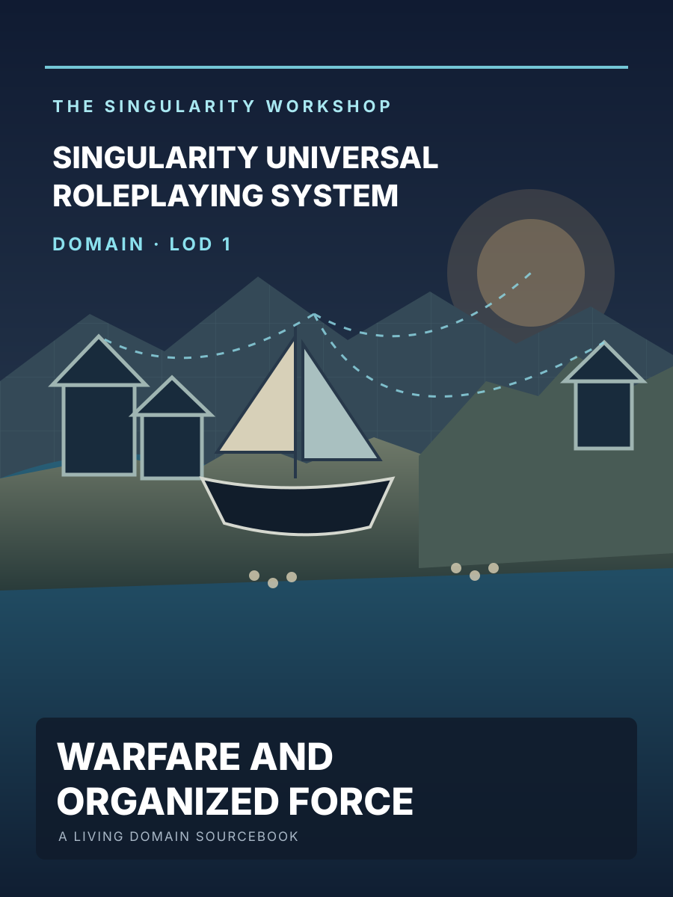

# Singularity Universal Roleplaying System - Domain - LOD 1 - Warfare and Organized Force

**Descriptor:** [warfare-and-organized-force.book.json](warfare-and-organized-force.book.json)  
**Domain owner:** [raWWar](https://github.com/TrentBest/raWWar)  
**Status:** Foundational sourcebook / first editorial pass  
**Version:** 0.1.0

## 1. Purpose — the realm of warfare

Warfare is not limited to formally declared wars, uniformed national armies, or battles between sovereign states. It is the broad human and speculative domain of organized force, armed contest, coercion, resistance, protection, raiding, defense, and the institutions and communities shaped by them.

This book establishes a map of that domain. It is a starting point for deeper historical, cultural, technical, operational, and fictional books. It is not a claim that every form of violence is warfare, nor that every participant in a conflict is a combatant.

The domain includes state and imperial warfare; civil wars; succession wars; revolutions; rebellions; coups; occupations; wars of independence; tribal, clan, city-state, dynastic, feudal, colonial, and non-state conflicts; raids, ambushes, sieges, invasions, naval, aerial, space, and cyber warfare; piracy, privateering, corsairing, raiding, smuggling networks, outlaw bands, brigandage, and organized banditry; resistance movements, insurgencies, guerrilla campaigns, partisan activity, sabotage, clandestine support, and civil defense; mercenaries, private military organizations, militias, auxiliaries, volunteer forces, peacekeepers, and irregular formations; policing, border enforcement, protective security, counter-piracy, and adjacent uses of organized force where legal and institutional boundaries matter; and logistics, intelligence, command, doctrine, training, medicine, engineering, fortification, diplomacy, law, economics, morale, memory, and aftermath.

The inclusion of a subject in this domain is an invitation to describe it accurately, not a moral endorsement.

## 2. What counts — and what must remain distinct

A useful account asks what kind of organized force is present, who authorizes it, whom it serves, whom it harms, what constraints apply, and how participants and observers understand it.

| Dimension | Questions |
|---|---|
| Political authority | Who claims sovereignty or the right to command? Is that claim recognized, contested, imposed, or absent? |
| Organization | Is the actor a state military, militia, insurgent organization, pirate crew, private force, criminal network, community defense group, or something else? |
| Legal status | What law and jurisdiction apply? How did contemporaries classify the actor, and how do later historians assess that classification? |
| Purpose | Conquest, defense, profit, survival, independence, ideology, protection, revenge, coercion, or mixed motives? |
| Methods | Conventional battle, raiding, ambush, siege, sabotage, policing, piracy, terror, negotiation, or a changing combination? |
| Social relationship | Does the organization protect, recruit, tax, exploit, displace, govern, or prey upon the surrounding population? |
| Perspective | Whose account is presented: participant, victim, state, opponent, chronicler, propagandist, later historian, or fictional narrator? |

A state is not identical to its government, regime, armed forces, population, or every individual citizen. A military is not a whole people. A resistance organization is not automatically representative of everyone it claims to defend. A criminal label may be legally accurate in one jurisdiction and politically contested in another. These distinctions are essential to sound history and useful roleplay.

## 3. The wide boundary: piracy, outlawry, and the Robin Hood problem

Piracy belongs in the warfare library because it can involve organized armed crews, vessels, contested control of routes, violence, coercion, plunder, political sponsorship, and sustained conflict with states or commercial powers. But piracy is not automatically naval warfare, and a pirate crew is not automatically a navy. Privateering, state-sponsored raiding, piracy, commerce raiding, and ordinary maritime crime require separate definitions and context.

The same care applies on land. Outlaws, brigands, bandits, highway robbers, insurgents, rebels, and community defenders can overlap in methods while differing in organization, purpose, legitimacy, and relationship to the population.

**Robin Hood is a useful boundary case, not a shortcut classification.** The Robin Hood tradition contains folklore, literary development, political reinterpretation, and possible historical inspirations. A sourcebook must distinguish the legendary figure and changing stories from any proposed historical individual. In a particular setting, a Robin Hood-like band might be represented as outlawry, popular resistance, insurgency, predatory banditry, local defense, or a mixture. The answer depends on evidence and context, not on the romantic label.

A good book can hold competing accounts at once: the sheriff's record, the village's memory, the victims' testimony, the ballad, the outlaw's own justification, and the later historian's assessment. The reader should be able to see who says what and why.

## 4. LOD — depth, not a timeline

LOD communicates the depth and specificity of a book. It is not a chronology, a quality score, a moral ranking, or a mandatory parent-child chain. A book may reference several books at different LODs; a technical manual may be reused by many historical and fictional settings.

This first book is **LOD 1**: a broad orientation to the domain and its major conceptual families.

The following is a working editorial map, not a frozen SURPS-wide LOD definition:

- **LOD 0 — Core concepts:** force, conflict, authority, combatant, civilian, organization, command, defense, coercion, and consequence.
- **LOD 1 — Warfare and Organized Force:** the broad domain map and relationships between its major families.
- **LOD 2 — Major families and contexts:** eras, conflict types, civilizations, political entities, military institutions, maritime raiding, insurgency, and other reusable contexts.
- **LOD 3 — Focused histories and operations:** campaigns, theaters, battles, sieges, named operations, organizations, and participants.
- **LOD 4 — Missions and encounters:** a specific objective, place, time, force composition, constraints, intelligence picture, and scenario state.
- **LOD 5+ — Specialist fidelity:** detailed technical, archival, tactical, experiential, or simulation-specific treatments when justified by subject and evidence.

These are editorial examples for raWWar to coordinate with SURPS. The shared SURPS LOD standard remains authoritative.

## 5. The living library — planned families

The catalogue should grow by cross-reference, not by forcing every subject into one tree.

### 5.1 Historical periods and conflict families

Candidate books include ancient warfare; Bronze Age and Iron Age conflict; Greek and Persian wars; Roman expansion and civil wars; Chinese dynastic warfare; Japanese warfare across distinct periods; steppe confederations and Mongol campaigns; medieval European and Middle Eastern warfare; crusading movements; Viking-age raiding and warfare; early-modern state formation; the age of sail; colonial wars; revolutions; the Napoleonic era; the American Civil War; the World Wars; the Korean War; the Vietnam War; decolonization; Cold War proxy conflicts; contemporary conflicts; and carefully labelled speculative futures such as WWIII.

A period label is only an index. Each book must identify its geography, dates, actors, scope, and disputed boundaries rather than imply that a whole century or civilization fought in one uniform way.

### 5.2 Participants, peoples, states, and organizations

Books may focus on Roman republic and imperial forces, Mongol polities and armies, Viking-age communities and warbands, Germanic peoples and particular successor polities, Imperial Japan and its armed institutions, Nazi Germany and its state and military organizations, Allied coalitions, resistance movements, partisan groups, pirates, privateers, mercenary companies, militias, and other participants.

Names such as Romans, Mongols, Vikings, or Germans are broad entry points, not timeless personalities. A useful participant book separates period, political organization, military institutions, internal diversity, civilian life, allies, opponents, and changes over time. It must never assign collective guilt or a fixed martial character to an ethnicity or nationality.

### 5.3 Irregular, maritime, and contested force

This family explicitly includes piracy and privateering; corsairs and maritime raiders; outlaw bands and brigandage; Robin Hood traditions and their historical contexts; insurgencies and counterinsurgencies; revolutions and resistance; mercenary and private forces; militias and local defense; organized crime in conflict zones; and transitions between criminal enterprise, political violence, and armed governance.

Each treatment should state its classification criteria and preserve disagreement where evidence or legal framework is contested.

### 5.4 Campaigns, battles, and missions

A campaign book explains objectives, actors, geography, logistics, command, chronology, strategic choices, civilian consequences, and how the campaign's history is reconstructed. A battle book narrows the lens to a particular engagement and its evidence. A mission book turns a bounded situation into a playable scenario while identifying which elements are historical, adapted, or invented.

D-Day, for example, is not a single interchangeable battle vignette: it belongs within the larger Normandy campaign, Allied invasion planning and coalition, German defensive systems, airborne and seaborne operations, logistics, intelligence, civilian experience, and subsequent operations. Focused books should link these scales instead of flattening them.

### 5.5 Reusable technical and institutional manuals

Technical books should be independent of a single war wherever possible. Candidate manuals include weapons, ammunition, armor, protective equipment, and maintenance; land vehicles, artillery, ships, submarines, aircraft, spacecraft, and autonomous systems; fortifications, field engineering, mines and obstacles, bridges, ports, airfields, and base construction; communications, navigation, sensors, intelligence collection, electronic warfare, and cyber systems; command structures, staff work, doctrine, training, tactics, operational art, and military law; logistics, procurement, transport, supply, fuel, food, water, sanitation, and repair; field medicine, evacuation, rehabilitation, casualty accounting, and public health; uniforms, insignia, ranks, pay, discipline, recruitment, conscription, and veterans' lives.

These manuals explain their own scope and limitations. They link to Physics for physical laws and consequences, Gestures for embodied human movement and procedures, and other authoritative Workshop providers rather than reimplementing those systems.

## 6. Historical truth, uncertainty, and fictional adaptation

Every historical sourcebook should make its epistemic status visible. At minimum, distinguish:

- **Established evidence** — supported by identifiable primary or reliable secondary sources.
- **Mainstream interpretation** — a scholarly synthesis, while recognizing interpretations can evolve.
- **Disputed interpretation** — competing explanations or uncertain evidence, with the disagreement described.
- **Traditional account / legend** — a culturally important story whose historical status is not established.
- **Fictional adaptation** — invented or altered material used for play.
- **Speculation** — a reasoned possibility, not an established event.
- **Future scenario** — explicitly prospective fiction, not a claim about events that have occurred.

Record source provenance, date of publication or creation, perspective, known limitations, and the claim each source supports. Avoid treating a single chronicle, state archive, memoir, propaganda artifact, or later popular account as the whole truth.

For modern atrocities, extremist movements, colonial violence, genocide, war crimes, and crimes against civilians, use precise language and contextual evidence. Do not sanitize harm through euphemism, turn perpetrators into an undifferentiated people, or erase victims and dissenters.

## 7. Tabletop play and simulation

The library serves both human play and computational worlds.

A tabletop chapter should provide enough procedure for a group to use paper, pencil, character records, dice or another agreed resolution method, and conversation. It should identify participants, stakes, information available to each side, uncertainty, consequences, and ways to resolve contested outcomes.

A simulation-facing chapter may additionally describe entities, attributes, capabilities, state, events, relationships, constraints, and measurable outcomes. These descriptions are not executable code by themselves. Runtime behavior belongs to the owning implementation and must be linked and tested there.

The same sourcebook can support a tabletop encounter and a simulation scenario, but it must not confuse a narrative description with a verified behavior contract.

## 8. SURPS composition and ownership

SURPS is optional. A host or Experience that does not enable SURPS remains valid and must not acquire an accidental SURPS dependency. When enabled, SURPS can discover and compose selected books and providers according to the shared SURPS contract. The simple opt-in belongs at the Experience/host configuration boundary; detailed book selection and precedence are separate editor concerns.

This sourcebook defines raWWar's domain knowledge. It does not freeze a new ISurpsRulebook API, invent a host checkbox implementation, or claim that book prose is executable behavior. Those contracts are coordinated with SURPS.

Ownership boundaries:

- **raWWar:** warfare concepts, historical and fictional content, organizations, combat domain rules, missions, and simulation requirements.
- **SURPS:** shared ontology, rulebook identity, LOD conventions, catalogue/composition contracts, and optional activation model.
- **Physics:** authoritative physical laws, material behavior, forces, motion, and physical consequences.
- **Gestures:** embodied human movement, posture, and physical procedures.
- **Other Workshop repositories:** their own authoritative capabilities and implementations.

## 9. First reading paths

Begin with this book for the domain map. Follow a period or conflict-family book for historical context. Follow participant books to understand institutions and people without collapsing them into stereotypes. Follow campaign, battle, and mission books for increasingly focused situations. Follow technical manuals for reusable equipment, doctrine, logistics, and institutional detail. Follow the linked domain implementation and evidence when asking what the simulation actually does.

## 10. Editorial rules for every future book

Every book should declare its identity, category, LOD, scope, owner, version, time/geographic coverage where relevant, provenance, certainty labels, and cross-references. It should state what it does not cover. A book may reference a more specialized book without depending on it for its own basic meaning.

A new book is not complete merely because it has a title and cover. It should teach its subject, show a worked example, identify uncertainty, link to adjacent books and authoritative implementations, and provide a clear route for tabletop use or simulation interpretation where appropriate.

---

**Next editorial milestone:** build the LOD 2 catalogue as cross-linked families: historical eras/conflicts, participants and organizations, and irregular/maritime warfare. Then develop one representative vertical slice from broad context through a focused operation to a playable mission, while validating the SURPS descriptor and opt-in conventions with the SURPS maintainers.
