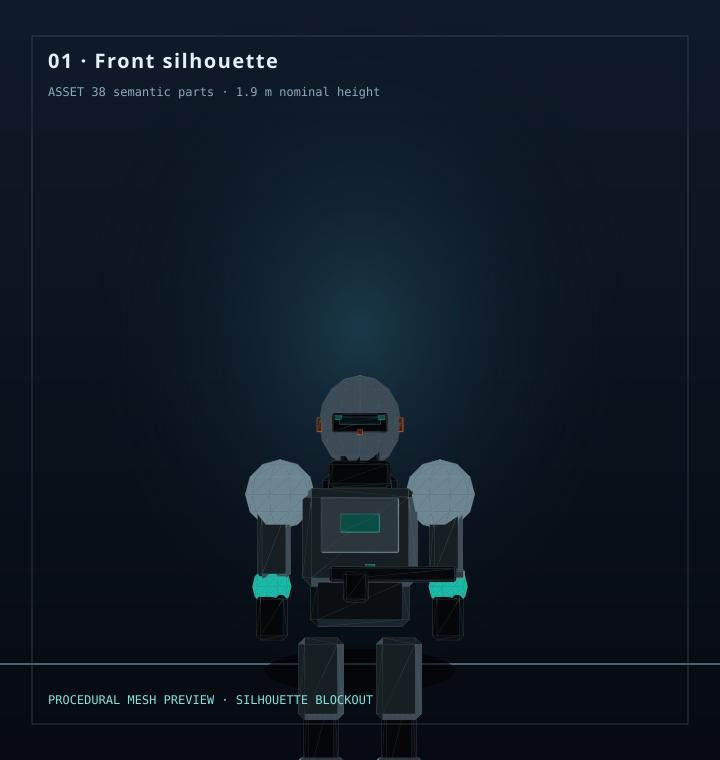
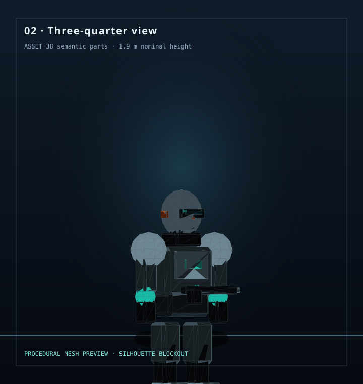
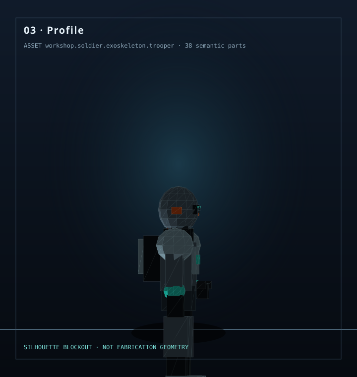
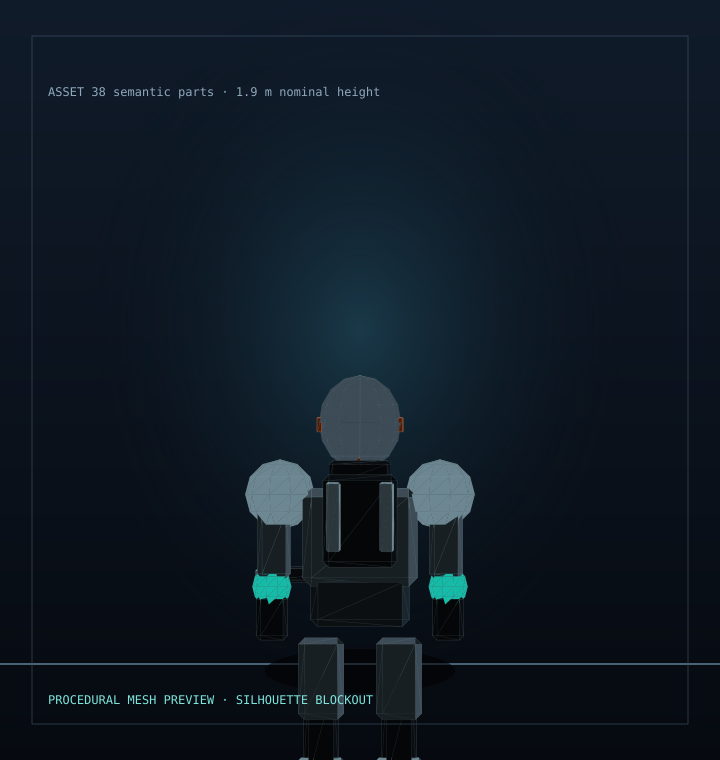
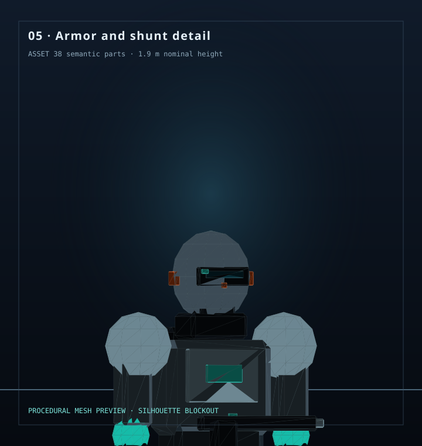
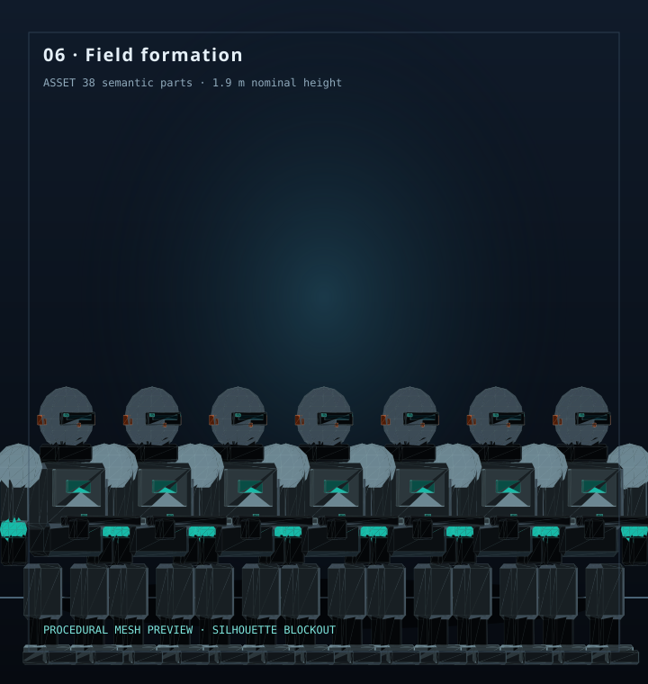

# Soldier Field — Event Horizon Scaling Lab

This is a visible soldier-first rendering target, not a triangle placeholder. The WebGPU page imports a separate, deterministic geometry asset whose stable semantic part IDs describe the modular armor, articulated chassis, helmet/visor, six provisional neural-shunt endpoints, life-support pack, and held tool silhouette. It avoids contemporary national military imagery and requires no downloaded model or external image. The current mesh is an intentional silhouette blockout; its component inventory is ready to refine without rewriting the renderer.

## See the soldier without running anything

These six SVG previews are checked into the repository and display directly in GitHub. They are rendered from the same procedural triangle mesh and stable part inventory used by the WebGPU lab. **No local server, browser launch, or WebGPU-capable device is needed to inspect the pictures.** The live lab remains available below for interaction and performance experiments.

| View | What to inspect |
|---|---|
|  | **01 · Front** — armor silhouette, helmet, torso, limbs, and held tool. |
|  | **02 · Three-quarter** — overall form and layered parts. |
|  | **03 · Profile** — life-support pack and weapon profile. |
|  | **04 · Rear** — pack and heat-exchanger layout. |
|  | **05 · Detail** — helmet, torso plate, shoulder hardpoints, and provisional shunt endpoints. |
|  | **06 · Formation** — repeated soldier geometry, previewing the scaling lab's goal. |

These are **static documentation renders**, not screenshots of a running GPU, and the model remains a silhouette blockout rather than production sculpting or fabrication-ready geometry. The live WebGPU lab is a separate, interactive experiment.

## Run the live WebGPU lab

Only for the interactive lab, from the raWWar repository root:

    py -m http.server 8080

Open http://localhost:8080/samples/SoldierField/WebGpuRunner/ in a browser with WebGPU enabled.

## Geometry asset

- `soldier-geometry.js` owns the semantic part inventory and deterministic mesh generator.
- `soldier-geometry.json` declares the asset ID, coordinate system, vertex format, and shunt endpoint IDs.
- `soldier-part.schema.json` defines the versioned engineering record contract for dimensions, materials, interfaces, manufacturing, inspection, research trials, and traceability.
- `soldier-part-records.json` carries records for all 38 current semantic parts. Unknown tolerances, physical material properties, mating interfaces, and acceptance criteria remain explicitly unresolved rather than invented.
- `soldier-cut-sheet.mjs` derives a stable machine-readable cut sheet from a part record. The lab lets you select any part and download its derived JSON cut sheet.
- `SOLDIER_DOSSIER.md` is the in-universe field dossier for neural shunts, the quiet seam, fabrication, failure signatures, and ambient soldier culture.
- `research-demonstrations.json` is the priced, setup-timed catalog offered through the head scientist's helmet tablet.
- `research-demonstrations.schema.json` defines the versioned catalog contract, including explicit unmeasured status for the fictional most-hit plate premise.
- `soldier-research-simulation.mjs` models ordering, setup advancement, a plate-impact event, thermal response, and funding a cooling iteration.
- `soldier-research-simulation.test.mjs` verifies the state transitions, cost accounting, and the follow-on trooper's heat complaint after research investment.
- Each part has a stable ID, primitive, local-space position/dimensions, and material key. The generated vertex stream is contiguous float32 position + colour data for triangle-list rendering.
- The lore currently enumerates six endpoints (paired ocular and auditory plus olfactory and cortical-stem). The possible five-assembly grouping is explicitly unresolved rather than silently choosing a canon.

## Engineering data and cut sheets

The current records are BIM-inspired engineering data, not a claim of certified or fabrication-ready BIM. Geometry values are nominal render-blockout values in metres. Each part carries a stable ID, revision/maturity, geometry, material status, interfaces, manufacturing status, inspection checks, research questions, and traceability/open issues. Cut sheets are derived from these records so the laboratory view, later drawings, and research-board comparisons can share one source of truth.

## Research-lab demonstration loop

The tablet offers a sternum-plate impact, thermal-dissipation prototype, and non-firing cutaway. Each entry has a stable ID, part reference, fictional research-credit price, setup-time estimate, event sequence, and research question. The player orders the test, advances the simulated setup clock, and runs the demonstration. The impact scene shows a crater and hot edge, a simulated hot barrel, a chassis thermal halo, and the head scientist's explanation. Funding cooling research changes the next simulated thermal result and unlocks a nearby trooper's dry joke about the rifle transferring heat into the exoskeleton.

The research board retains each run so the baseline and funded cooling iteration can be compared. The sternum plate is tagged as the fictional most-hit candidate, but its hit share is null and explicitly unmeasured; campaign simulation should eventually produce the distribution. The costs, temperatures, hit-rate premise, cooling gains, and dialogue are gameplay parameters, not measured engineering data. The impact requests a short rumble through the browser gamepad vibration API when a connected controller exposes compatible support; otherwise recoil remains visual and logged. This best-effort path has not been validated against physical controller hardware. The visible plate is a specimen illustration driven by the research result, not yet an independently manipulable 3D subassembly.

## What it does

- Renders a procedural 3D exoskeleton mesh through WebGPU.
- Uses instancing for a selectable population from 1 to 100,000 soldiers per horizon workload.
- Gives eight horizons independent instance buffers, field depths, tints, and refresh cadences.
- Includes ×10 and ×100 population steps.
- Reports frame interval p50/p95, JavaScript encode/submit-call p50/p95, CPU-side instance-update timing, bytes submitted through instance-buffer writes, and per-horizon update/reuse counters.

## Deliberate stress-test behavior

The selected population is repeated independently in every horizon workload. At population 1, the harness processes eight soldier instances across eight horizons; at population 100, it processes 800. This deliberately makes per-horizon cost visible even when a real near-field volume could not physically contain that many full-size soldiers. It is a stress model, not a physically valid occupancy simulation.

Cadences are demonstration values (1, 1, 2, 4, 8, 16, 32, and 64 frames). They are not imported from the Renderer bucket model yet. This page is not evidence that Renderer already drives the draw schedule.

## Measurement limits

Frame interval includes browser scheduling. JavaScript encode/submit timing is not GPU execution time. Upload counts represent data submitted by this sample, not measured physical memory-bus traffic. GPU timestamp queries, skeletal animation, production camera behavior, focal-beam quality allocation, and repeatable benchmark automation are not yet implemented. Treat the numbers as initial diagnostic telemetry, not a performance claim.

## Next engineering steps

1. Validate the first soldier on actual WebGPU hardware and tune the mesh/camera.
2. Add controlled quality variants and focal-beam detail selection.
3. Feed refresh, invalidation, and reuse decisions from actual Renderer Event Horizon bucket APIs rather than a duplicate page-owned cadence policy.
4. Capture GPU timestamps where supported, warm-up runs, repeated trials, and initial ×10/×100 scaling curves.
5. Increase practical population limits only as buffer/memory constraints and measurements justify it.

## Workshop integration boundary

This is an Experience-owned research and visualization lab. Its procedural soldier, part records, demonstration catalog, and fictional research loop belong to raWWar. The current browser/WebGPU harness remains a standalone experiment: it does **not** yet consume TheSingularityWorkshop.Visualize contracts or Renderer Event Horizon scheduling. Its per-horizon cadence is illustrative, and its telemetry is not a measured GPU execution benchmark. The next integration milestone is to connect Experience-owned presentation data to the Workshop contracts rather than duplicating the Renderer policy here.
